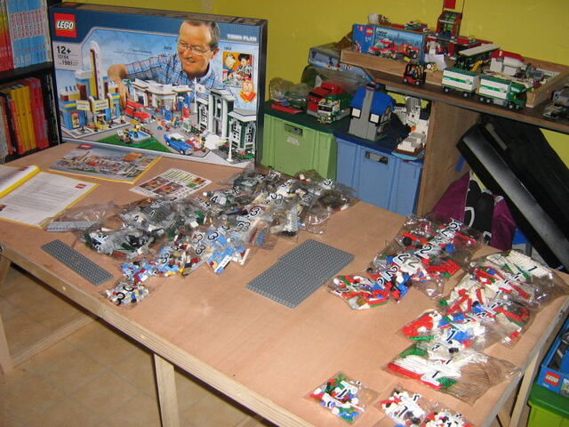
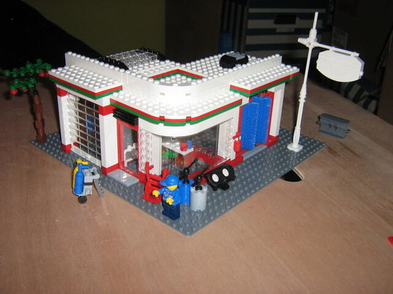
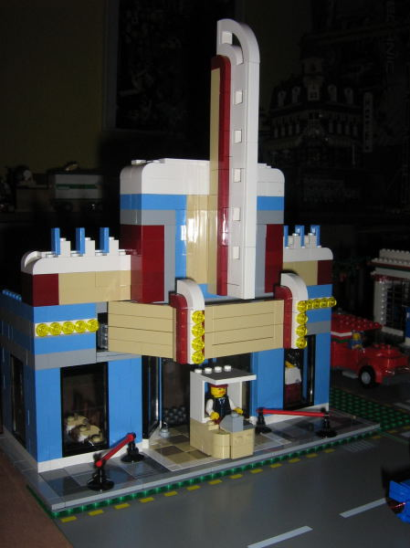
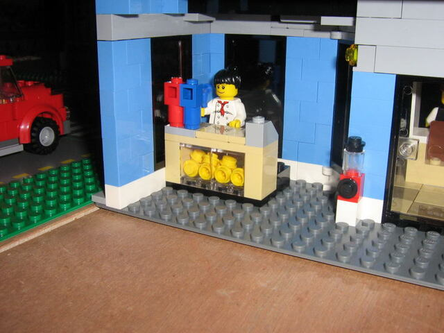
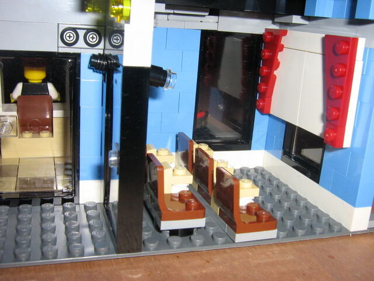
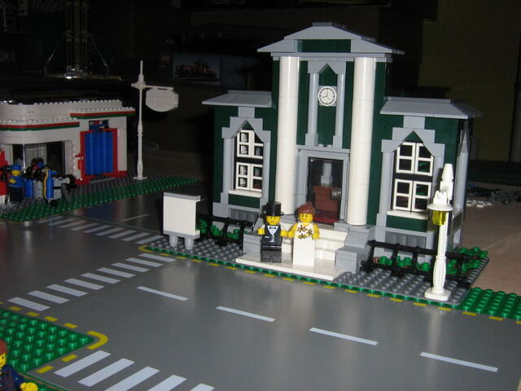
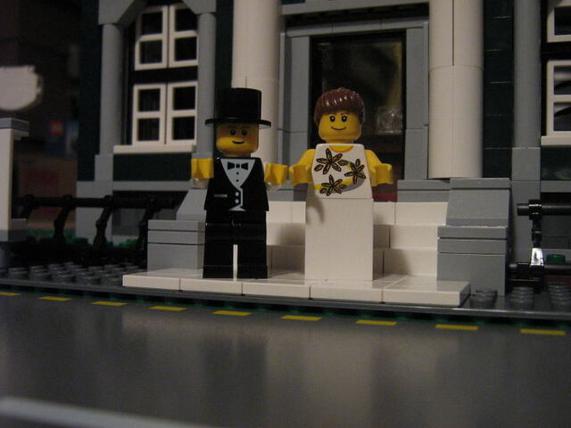
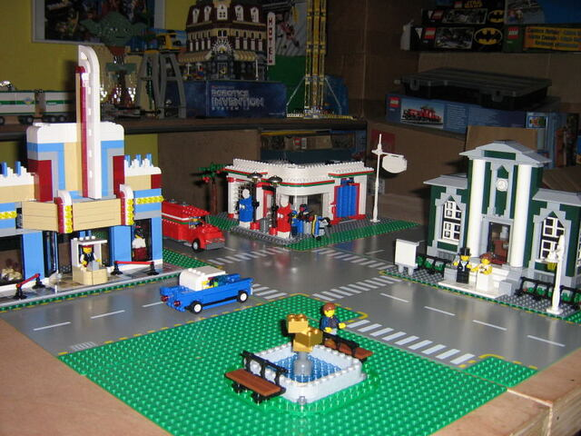

Venant d’apparaître au catalogue du service de vente en ligne LEGO, ce nouveau set reproduit tout un quartier de ville, comprenant une station service, un hôtel de ville, un cinéma.

Il contient également de quoi faire une petite fontaine, 2 véhicules et quelques personnages pour animer le tout.

Il est surtout une réédition du set 700/1, un des premiers modèles à inclure la brique avec cylindres internes dont le brevet a été déposé le 28 janvier 1958 !

Résumé :  
**–** Référence : 10184  
**–** Année Modèle : 2008  
**–** Nombre de pièces : 1981  
**–** Prix S@H (01/08) : 139,99€

**Vue générale**

Le set 10184 comporte donc trois bâtiments à monter, une station service, un hôtel de ville et un cinéma, deux véhicules et une fontaine.

La boîte met également en valeur afin de célébrer les 50 ans de la brique, le fait que ce set comprend une lettre de Kjeld Kirk Kristiansen, petit fils du fondateur de l’entreprise LEGO et trois briques "collector" dorées.

Pas de changement, les briques sont regroupées en plusieurs sachets numérotés qui permettront dans l’ordre de réaliser :  
**–** 1) La station service,  
**–** 2) Les véhicules et la fontaine,  
**–** 3) Le cinéma,  
**–** 4) L’hôtel de ville.

Mais avant de commencer, jetons un coup d’oeil sur cette fameuse lettre du petit fils du fondateur. Elle nous retrace quelques étapes de la vie de la brique depuis sa naissance en 1949, jusqu’à son évolution ultime de 1958, année qui marque l’aboutissement du concept et le départ de la grande aventure que nous célébrons aujourd’hui avec ce set.

Malheureusement je n’ai pas trouvé ni sur [Lugnet](http://www.lugnet.com/), ni sur [Peeron](http://www.peeron.com/) de détails sur le set historique 700/1, dont on aperçoit une trace sur le catalogue de 1958. Gageons qu’un collectionneur, lecteur de ces lignes, aura à coeur de nous faire parvenir un jour une petite photo ou un scan de la notice.

Revenons maintenant à l’assemblage des différents éléments de ce set.

Nous découvrons rapidement que ce set répond bien aux attentes des fans adultes. Il donne en effet la part belle aux techniques de construction "SNOT" illustrées par le basculement de vitre de la station service, l’enseigne de cette même station service, la façade du cinéma, les colonnes de l’hôtel de ville. Ceci séduira nos habitués du genre (Meuh, de qui veut-il parler ?).

**La station service**

Pas (trop) de métapièces, beaucoup de briques de base dans des couleurs sympa comme le dark green, le dark red et le medium blue. En termes de réutilisation des briques, les fans de trains trouveront même leur bonheur avec une plaque de base 6x24 en new dark grey.

Ceci vous expliquera pourquoi je n’ai pas mis en place les autocollants, car je ne compte pas conserver ce modèle monté et j’entends bien pouvoir réutiliser toutes les pièces pour de futures réalisations.

Un petit coup d’oeil sur les véhicules. Si la voiture ne mérite pas d’attention particulière malgré sa finesse et l’élégance de sa ligne, très 60’s, le camion reprend la forme du petit [camion HO](http://guide.lugnet.com/set/250_2) du set d’origine.

Concession à la modernité et aux licences, ce camion n’est plus estampillé ESSO, mais il porte les couleurs du gazier officiel de chez LEGO, OCTAN et pour consommer moins, la cabine est réduite à sa plus simple expression.

L’autre clin d’oeil rétro de cet ensemble n°2 est la forme des pompes à essence, elles aussi bien typées années 60.

Le cinéma présente quant à lui un aménagement complet pour une surface réduite.

**Le cinema**

On pourrait croire qu’il se limite à la majestueuse façade, mais non, il comprend également un comptoir à pop corn et la salle de projection, avec son écran et ses rideaux.

**Cinéma : Détail 1**

**Cinéma : Détail 2**

L’hôtel de ville donne la part belle à la décoration avec son dallage, ses colonnades et son parterre fleuri.

**L’hôtel de ville**

La mariée est sympa, quoiqu’un poil plus grande que le marié... y aurait-il là un clin d’oeil de la société LEGO vis-à-vis de notre président actuel ? On pourra toujours traiter ce "petit" détail en rajoutant des talonnettes au marié (je crois que notre président en porte déjà...).

**Mariés**

En conclusion, ce set d’environ 2000 pièces se situe dans la parfaite lignée du [Café Corner](/articles/les-breves-du-cafe-du-coin/), à savoir un set conçu principalement pour les fans et les collectionneurs. Je crois cependant qu’il peut constituer un beau set de départs pour les jeunes passionnés de LEGO, qui veulent commencer à assimiler des techniques d’assemblage adulte, tout en leur offrant un ensemble varié et coloré qui viendra compléter de façon formidable tout autre bâtiment de ville de la gamme grand public. Bref un beau cadeau à offrir à ses neveux, nièces, petits cousins, cousines si on souhaite faire partager la passion.

**Etat final**

J’en profite pour adresser mes remerciements aux designers de chez LEGO pour nous avoir concocté ce très joli set, en pensant que la plus grand difficulté aura sans doute été de retrouver une chemise à carreaux quasi identique à celle que Kjeld Kirk Kristiansen portait il y a 50 ans !
