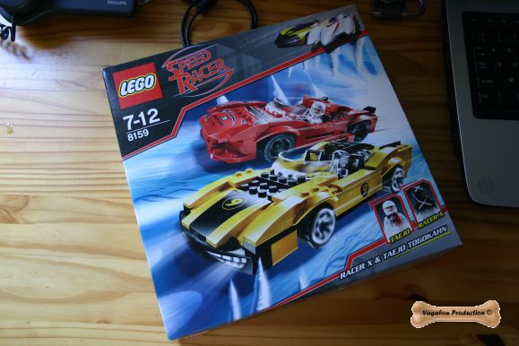
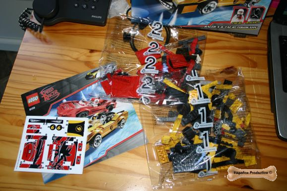
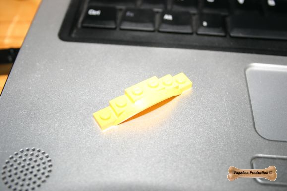
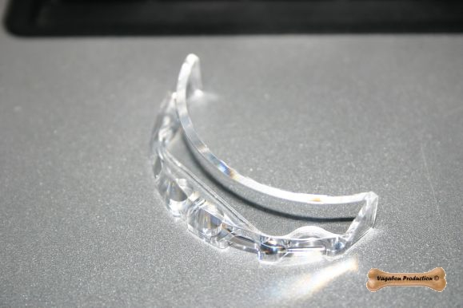
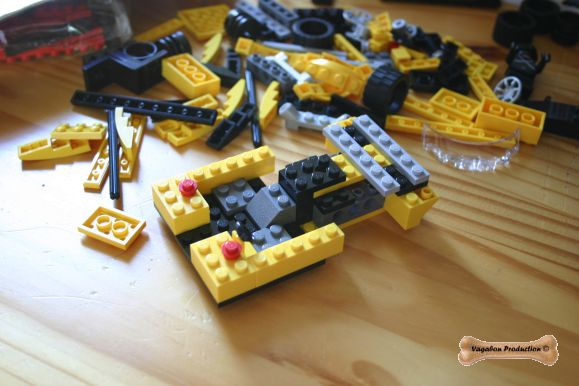
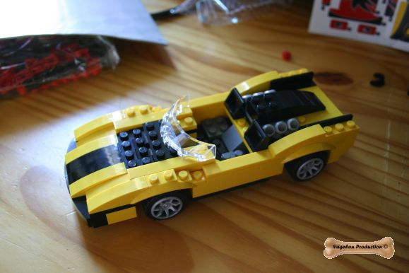
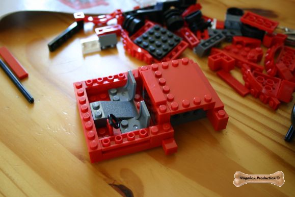
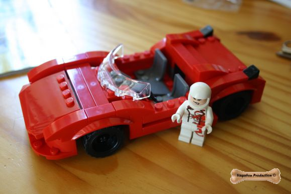
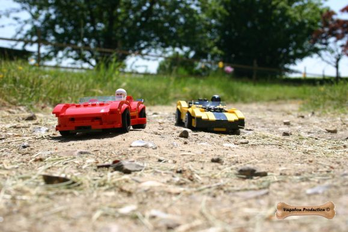
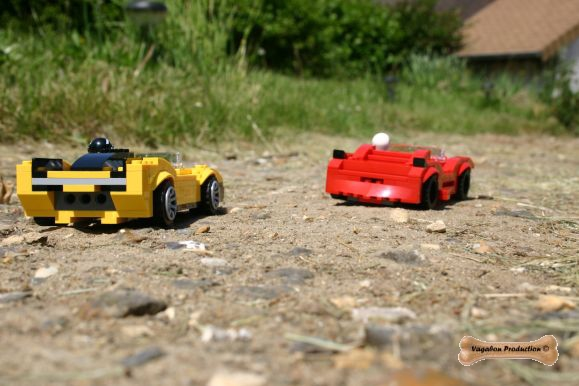

La gamme Speed Racer est issue du film du même nom qui sortira en salle le 18 juin prochain, lui même tiré de la série animée japonaise Mach Go Go Go créée par Tatsuo Yoshida en 1967.

C’est d’abord le design de la boite qui me l’a fait prendre en main, puis l’attrait de nouvelles pièces.

Une fois la boîte ouverte, on retrouve la notice, la planche d’autocollants et deux sachets de pièces, un par voiture.

## Attaquons le premier sachet.

D’abord présentation du pilote.

Casque et torse sérigraphiés, tête couleur chair (licence oblige) représentent bien : Racer X. Pilote mystérieux ayant pour but de débarrasser le monde de la compétition de ses brebis galeuses.

La construction de son véhicule se passe en 23 étapes sans difficultés, ni surprise si ce n’est les passages de roues

et le pare brise.

Etape 7

Etape 23

## Sachet N°2

Le deuxième pilote abordant une superbe combinaison ornée d’un dragon est TAEJO TOGOKAHN, Fils de Tetsua TOGOKAHN propriétaire de l’écurie du même nom. Il sera co-équipier de Speed Racer durant un rally.

Le montage se déroule comme l’autre modèle en 23 étapes, pour un rendu final très sympa.

Etape 12

Etape 23

Bon c’est pas le tout et si on profitait du soleil pour aller faire une petite course dehors ?

C’est parti !

Qui va gagner ?

A vous de jouer, maintenant !
