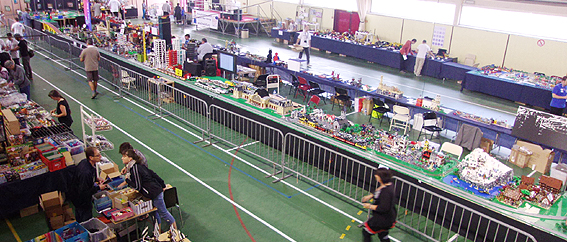
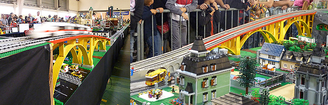
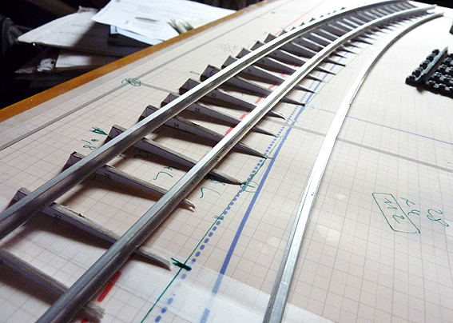
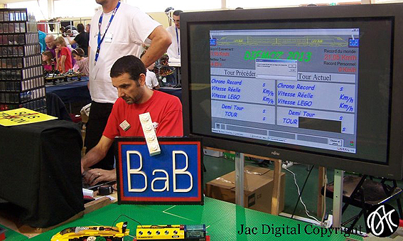

Lorsque l’on parle des trains LEGO, le réalisme est un sujet qui revient encore et encore. Le réalisme est souvent dans les détails : détails de la conception et des couleurs, détails des dimensions et des fonctions.

Le réalisme réside aussi dans le réseau et son exploitation. Il existait le Système 12V avec toutes ses fonctions automatisées telles que les lumières, la télécommande des aiguillages, les barrières de passages à niveaux, les feux et autres découpleurs de wagons. D’autres font quelques modifications pour installer le DCC (commande numérique) dans leurs créations pour un contrôle encore plus précis.

**Vitesse**

Mais le réalisme est aussi une question de vitesse. En France, nous sommes fiers de notre TGV, le Train à Grande Vitesse, et le moins que l’on puisse dire c’est qu’il est emblématique. Contrairement à ce qui se passe en Amérique du Nord, en Europe, "train" signifie trains de passagers à grande vitesse, comme le démontre au Royaume-Uni le Flying Scotsman (voir RailBricks n ° 6) ou l’ICE Allemand, tandis qu’en Amérique, le train c’est presque uniquement les trains de marchandises lourds.

De retour dans le monde de LEGO, la vitesse n’est pas facilement réalisable. La tension électrique est limitée à 9 volts avec un faible courant d’entrée, les courbes ont un très petit rayon et le coupon de voie droite est court, la connexion entre rail n’est pas très ’fine’. Ce sont des conditions que la haute vitesse ne peut pas gérer car la vitesse n’est pas seulement une question de matériel roulant, mais surtout une question de voie ferrée et aussi de puissance électrique disponible sur la voie.

**La voie des puristes**

Quelques trucs existent pour résoudre ces problèmes. Des courbes de très grand rayon peuvent être construites comme décrit dans l’article « Lisser les courbes sans angles de coupe » dans le numéro de RailBricks n ° 1 ou "Fun avec des rayons" dans RailBricks question 7 #. Cela permet aux trains de rouler à plein régime sans les incliner ni dérailler. Ces courbes peuvent également être améliorées en élevant le côté extérieur du rail, créant ainsi un dévers.  
[Grande courbe](http://www.freelug.org/spip.php?article1195)

La question de l’alimentation est plus technique à résoudre. A première vue, on pourrait penser que l’augmentation du nombre de moteurs rendrait le train plus rapide. C’est vrai, mais à une très petite échelle : vous ne pourrez certainement pas doubler la vitesse de votre train de cette façon. Pire, vous pourriez même le ralentir car les moteurs sont lourds.

La meilleure solution est d’alimenter votre train par les rails de la voie et de rapidement rejeter le système d’alimentation ’’Power Fonction’’ sur pile. Avec le système de 9V, vous devez utiliser plusieurs régulateur de tension LEGO en parallèle afin d’empêcher la tension de diminuer avec la distance ou la consommation des moteurs.

Néanmoins, vous alimentez la voie sous 9 volts, quelque soit courant que vous envoyez dans les rails. Si vous voulez augmenter la vitesse, vous devez alimenter la voie avec une tension plus élevée. Il y a une façon de le faire, d’abord expliqué par Daniel Stoeffler, qui consiste à brancher deux régulateurs de vitesse comme un circuit de série par l’intermédiaire d’un tronçon supplémentaire de voie. De cette façon, vous alimentez votre voie jusqu’à 18V théorique.

Notez que les composants électriques LEGO (moteurs, régulateurs de vitesse) ne sont pas destinés à être utilisés de cette façon, mais cela fonctionne. Il est toutefois possible que la durée de vie des composants puisse être raccourcie. Utilisez ces conseils à vos propres risques...

**Les bricoleurs sont dans la place.**

Si vous n’êtes pas un puriste, vous pouvez modifier les pièces LEGO ou faire usage de pièces non-LEGO. Et c’est le choix qu’on fait Denis Huot et Xavier Viallefont pour créer une voie à haute vitesse (LGV : Ligne Grande Vitesse) . Cette voie spéciale est exposée une fois par an dans divers événements qui se déroulent en France depuis 2008 (Fana’Briques, BriqueExpo ...) et les paragraphes suivant sont inspirés par deux articles qu’ils ont écrit pour le site FreeLUG sur la base de leur expérience.

**Mise à niveau**

Une ligne à grande vitesse doit être parfaitement de niveau. Il n’est pas possible d’utiliser des tables disparates pour installer ce réseau. Denis et Xavier utilisent des tables construisent en bois, dont la hauteur peut facilement être finement accordés sur un sol irrégulier.

**L’échelle**

L’écartement des rails de la voie LEGO est plus grand que celui des moteurs et boggies. C’est tout à fait logique car cela diminue le frottement dans les courbes . Mais, comme dit précédemment, la ligne à grande vitesse fait appel à une courbe de grand rayon. En conséquence, l’écartement des rails de la ligne à grande vitesse est un peu plus petit que celui des rails LEGO, ce qui rend le matériel roulant plus stable à haute vitesse.

**Longueur**

Les premières tentatives à grande vitesse ont été faites sur des lignes droites de 13 mètres puis de 19 mètres de long et la conclusion était évidente. Plus vous allez vite, plus la ligne devait être longue. Aujourd’hui, la ligne à grande vitesse est de 30 mètres de long (sans les courbes), mais est encore trop courte : l’utilisation d’une rampe pour obtenir l’aide de la gravité pour ralentir le train avant de la courbe ou de l’accélérer dans la ligne d’entrée, est très utile .

**Joint et éclisses**

Les rails droits LEGO sont de 12,8 cm de long. En conséquence, le train rencontre une jonction 8 fois par mètre. C’est inacceptable pour un train à grande vitesse et la ligne à grande vitesse est construit à partir de rails en aluminium de longueur de 1 mètre, connectés à l’aide d’éclisses vissées, ce qui donne des jointures presque imperceptibles.

**Les courbes**

La courbe de la ligne à grande vitesse n’a pas seulement un grand rayon (1,5 m), mais elle dispose également d’un dévers (maximum 13 °). Comme dans le monde réel, une clotoïde est utilisée comme courbe de transition de voie dans le but de limiter les conséquences de l’accélération centrifuge  
[Trains et virages](http://www.freelug.org/spip.php?article1041)

**L’alimentation électrique**

La ligne à grande vitesse est alimenté par une alimentation sur mesure offrant une source électrique pouvant aller jusqu’à 60V. De manière assez surprenante, les moteurs de LEGO résistent à la surcharge mais pour peu de temps.

**Mesure de la Vitesse**

Maintenant, vous avez juste à faire rouler vos trains. Un ordinateur avec son logiciel ad hoc fait maison et un couple de capteurs optiques permettent d’afficher des statistiques sur la vitesse du train (jusqu’à 30 km / h) en direct pour le public pendant les événements.

**conclusion**

.... la ligne à grande vitesse est un must lors d’événements et est très bien apprécié à la fois par AFOLs de train et les visiteurs.

**–** /-/-/-/

Pour en voir plus :

[LEGO speed train. TGV & other](https://www.youtube.com/playlist?list=PL525AA3316A78E69D)

[LEGO TGV 10233 - horizon express ? running - Diemoz 2013 - Briqu’Expo](http://youtu.be/8-h-BKMfpGU?list=UUTVB0KTfg_lrk9ZuhT_xQUA)

[Le record du monde de vitesse d’un train LEGO - 06/2014](http://railbricks.com/magazine/issue-14/)

[Règlement V3 : record du monde de vitesse d’un train LEGO](http://www.freelug.org/spip.php?article1687)

[Le record du monde de vitesse d’un train LEGO - 07/2012](http://www.freelug.org/spip.php?article1513)

[Construction de la LGV V.2](http://www.freelug.org/spip.php?article1220)

[Construction de la LGV V.1](http://www.freelug.org/spip.php?article1368)

[Fana L.G.V. et record train grande vitesse - le B a BA](http://www.freelug.org/spip.php?article1136)
