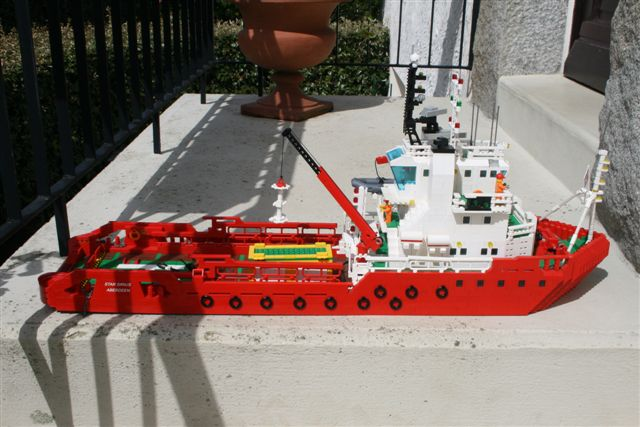
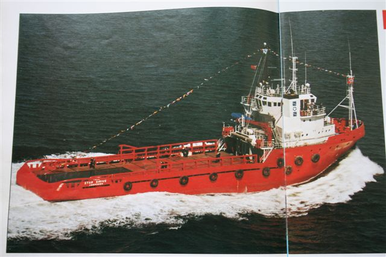
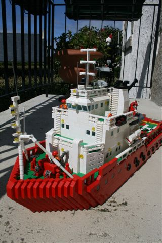
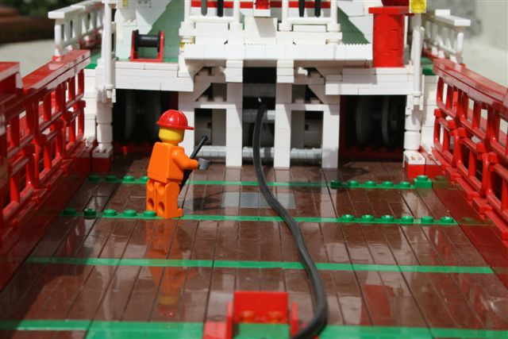

Aujourd’hui, je vous présente le "STAR SIRIUS", c’était un remorqueur révolutionnaire grâce à sa technologie embarquée à sa sortie (ndla : réformé), de haute mer offshore, spécialisé dans le ravitaillement des plates formes pétrolières en Mer du Nord.

Ce bateau, ou _supply_, avait un sister ship, STAR SIPECA, bateau toujours construit en deux exemplaires identiques, parfois 3 comme le célèbre TITANIC coulé en avril 1912 par un iceberg, OLYMPIA et BRITTANIC.

Pour mon diorama, avec l’aide d’une revue spécialisée, j’ai conçu le Star Sirius en version briques en moins de deux mois (je suis assez lent). Une première chez FreeLUG. C’est donc une maquette de 112 tenons de long environ par 26 tenons de large.

Tous les éléments du bateau sont reproduits sauf les ancres (j’espère, un jour, y remédier).

La mature du bateau (partie noire au dessus de la passerelle) m’a posé pas mal de problèmes, heureusement le SNOT (assemblage complexe de pièces) est passé par là.

Au niveau du radier extérieur, observez un câble noir qui sert à remorquer un bateau éventuellement, déplacer une plate forme, etc., et remontez jusqu’au tambour horizontal situé sous le château (terme marin désignant la partie habitable du bateau).

De chaque coté du tambour, vous apercevrez des tambours verticaux mais en diagonale. Ce sont de gros treuils qui servent à hisser sur le pont des objets très lourds.

Cette reproduction a sa place dans le nouveau port en compagnie des pompiers et des policiers de la mer.

Pour ceux qui recherchent une notice, désolé, c’est une création.

[Galerie photos](http://photos.freelug.org/main.php/v/barr__/creations/StarSirius/)

Prochainement, un nouveau bateau : un bateau des Phares et Balises.

* * *

Mes autres bateaux déjà présentés :  
**–** [Le "HJELMELAND", ferry norvégien](/articles/le-hjelmeland-ferry-norvegien/)  
**–** [Le bateau pompe](/articles/le-bateau-pompe-de-jean-marc/)  
**–** [Le patrouilleur des Affaires maritimes](/articles/le-patrouilleur-des-affaires-maritimes/)
