Pour la course de pod que nous allons représenter à la 16ème exposition Star Wars et SF à [Cusset](/articles/seizieme-edition-de-generation-sw-a-cusset-03/) , je me décide enfin à monter cette belle boîte.

Prix : Environ 80 Euros à son lancement  
**–** Disponibilité : Cette référence n’est plus en vente sur le site LEGO.  
**–** Taille de la boîte : 37,5 X 48 cm  
**–** Nombre de pièces : 810  
**–** Gamme : Star Wars  
**–** Contenu : Le pod racer de Anakin et le Pod racer de Sebulba, avec 5 minifigs Sebulba, Anakin Skywalker, Obi Wan Kenobi, Wald et Watto.  
**–** Temps de montage : compter quelques heures avec la pose des autocollants.

## La boîte

La boîte est bien grande avec un visuel que je trouve très vivant. Il représente un passage clef de la course, le choc entre les deux leaders. Sur le dos de la boîte, les pods sont à l’arrêt et on nous présente quelques modèles du moment. C’est encore un emballage un peu compliqué à ouvrir, mais en s’y prenant bien, on peut le faire en douceur et conserver le coffret, sinon arracher tout, c’est plus simple......

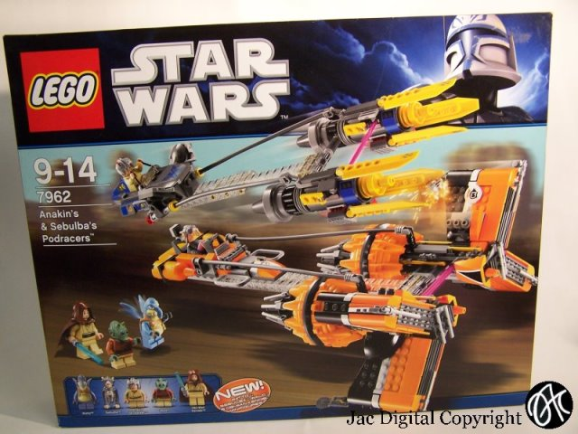

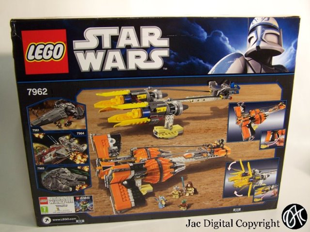

La boîte est bien pleine, avec 6 sachets, dont 5 seulement sont numérotés, une notice bien épaisse et une planche d’autocollants non protégés.

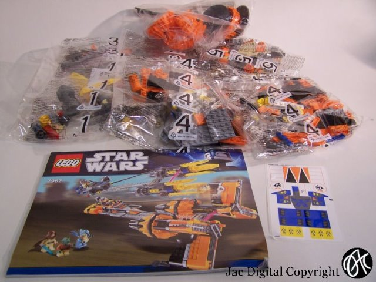

## Le Pod d’Anakin

La notice explique le montage des 5 minifigs contenues dans le sachet numéro 1. Elles sont très réussies. Watto et Sebulba sont beaucoup plus réaliste avec des touches de couleurs différentes, mais la position de ce dernier est toujours un peu délicate. Du coup, je ne pourrais pas vous le présenter avec les autres. Ça évitera aussi les disputes...

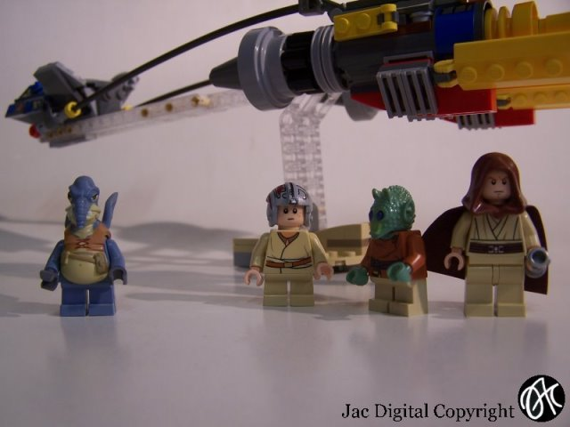

On enchaîne par le montage des moteurs du Pod d’Anakin.

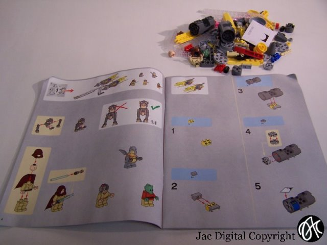

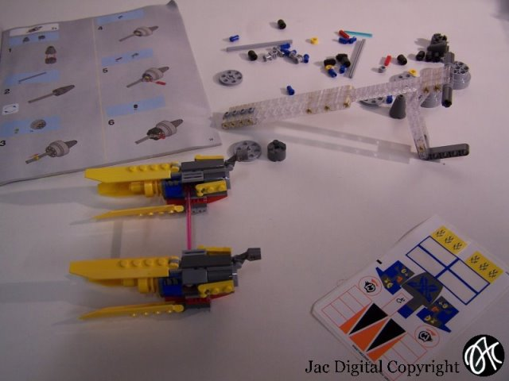

Dans chaque sachet, on trouve des pièces en plus. Voilà celles du premier sachet.

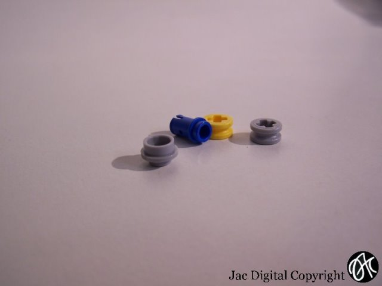

Avec le sachet numéro 2, on termine le pod par la construction de la capsule. Il contient aussi le socle de couleur tan pour fixer le support en pièce transparentes. On trouvera les tiges qui représentent les commandes dans le sixième sachet non numéroté.

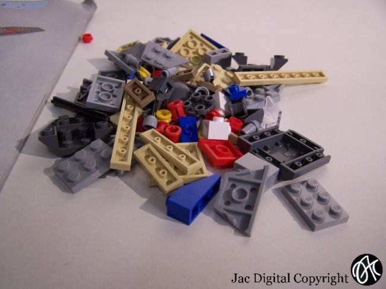

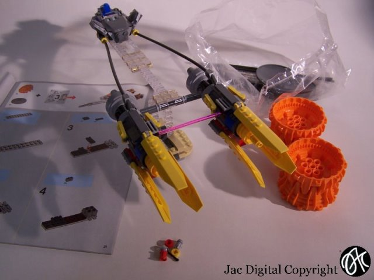

Voilà le pod d’Anakin fini avec les autocollants posés. Ça rend vraiment bien.

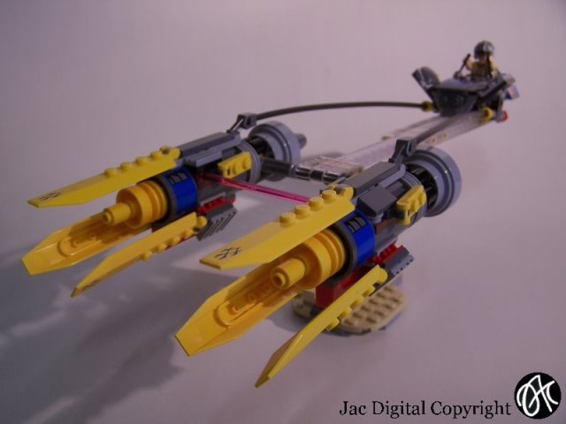

## Le pod de Sebulba

Pour le pod de Sebulba, il nous faudra les 3 sachets restant plus celui qui n’est pas numéroté. Nous commençons par une partie des moteurs avec le sachet 3. Au début on a l’impression que l’un des moteurs n’est pas bien fixé à cause des pièces qui représente l’échange de flux. Mais tout rentre dans l’ordre par la suite.

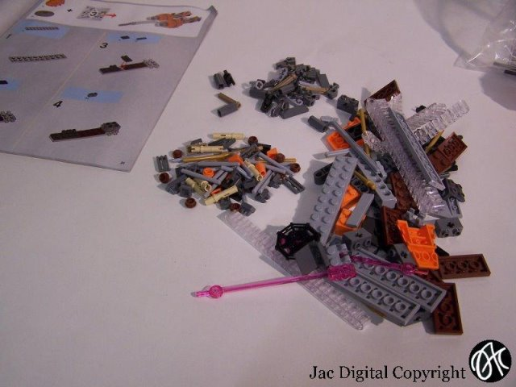

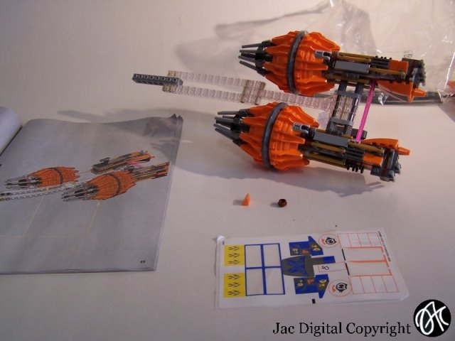

Voilà le contenu du sachet 4 pour terminer la construction de ces imposants moteurs. La pose des autocollants est presque obligatoire si on veut respecter la continuité des couleurs.

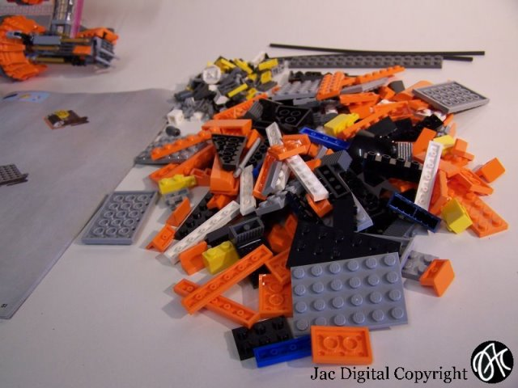

J’ai fait une petite modification, car je trouvais que la fixation de la partie qui tient les angles n’était pas assez plaquée. Je n’ai pas mis la pièce lisse orange à l’intérieur, de ce fait le montage qui se place au bord est plus aligné avec le reste de la carrosserie......

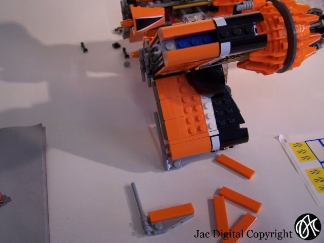

Et voilà les moteurs terminés.

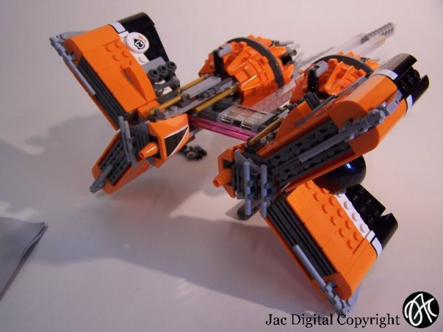

Sachet numéro 5 pour la capsule de commande ainsi que le support en pièces de couleur sable.

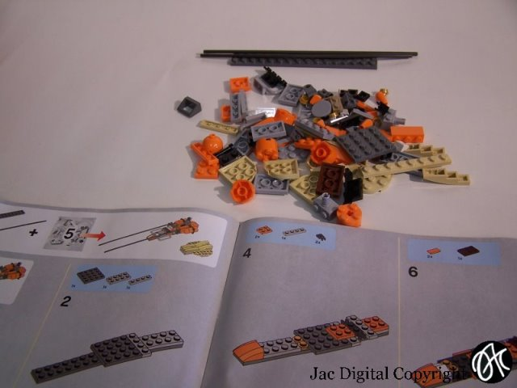

Voilà le pod terminé avec Sebulba aux commandes.

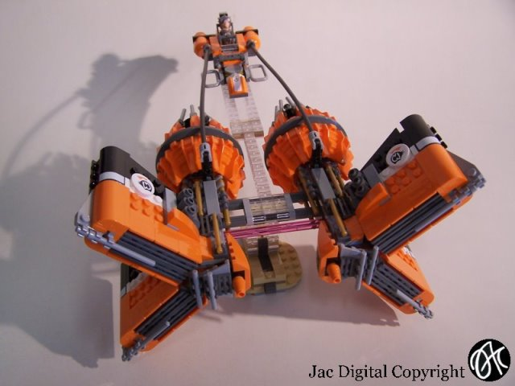

## Extra parts

Un beau petit lot de pièces en plus, avec forcément les pièces lisses oranges que je n’ai pas placées exprès.

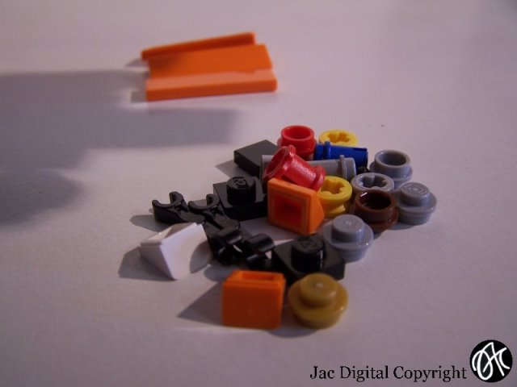

## Conclusion

Je trouve qu’il y a une réelle évolution par rapport à la boîte sortie en 1999. Les deux pods sont très intéressants à assembler. De plus le système qui sert de support peut être tenue en main. Il est très pratique et plus discret que les pièces de couleur sable. Par contre, on y trouve que 2 pods, alors que la référence [7171](http://guide.lugnet.com/set/7171) en contenait 3.

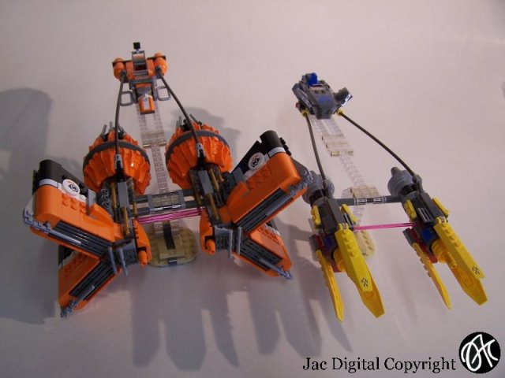

Beaucoup de personnages pour ce set mais moins que dans la version de 1999 qui comptait des droïdes meccano. De plus, je ne comprends pas la présence d’Obi Wan sur les lieux de la course alors qu’il est resté sur le vaisseau de la reine dans le film.

Malgré les quelques points négatifs, cette boîte me plait beaucoup, je recommande...

Pour plus de photos, voir la [galerie](http://photos.freelug.org/main.php/v/JAC/review/7962/).
