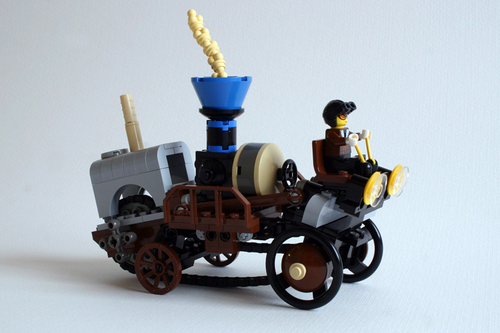
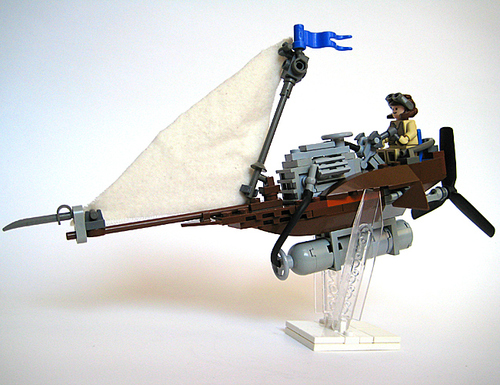
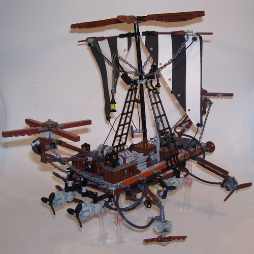
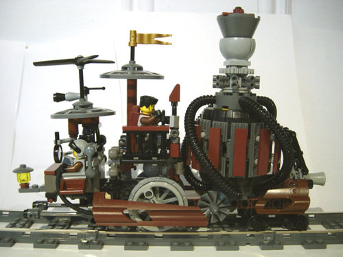
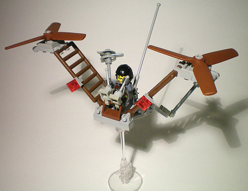
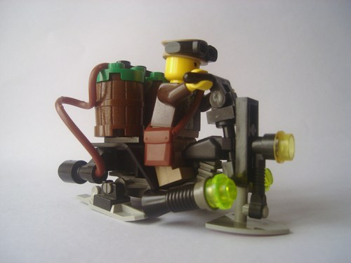
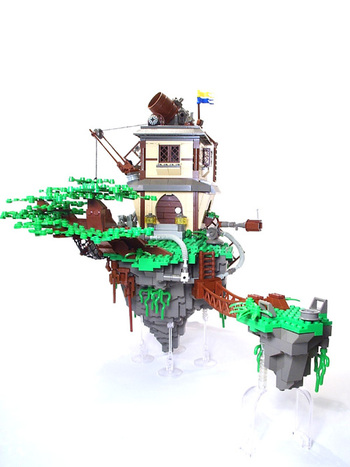
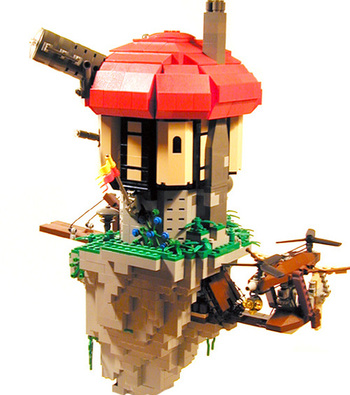
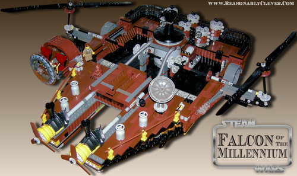

Steampunk, que l’on pourrait traduire par "futur à vapeur", est un thème développé par les AFOLs qui se base sur un genre de science-fiction.

Si vous avez aimé l’univers de _Wild Wild West_ ou de _La Ligue des gentlemen extraordinaires_, alors le steampunk ne vous est pas étranger. Il s’agit de cet environnement se situant à l’époque victorienne, vers la fin du XIXe et début du XXe siècle, où la vapeur est reine, et les engins mécaniques sont tout aussi déments qu’invraisemblables.

Ce thème est apparu dans la communauté AFOL il n’y a pas si longtemps que ça. Il s’est essentiellement répandu aux USA, beaucoup moins en Europe.

De ce thème, on distingue deux catégories : les véhicules et les habitations.

## Véhicules

Parmi d’autres, véhicules à vapeur, dirigeables, engins mécaniques, il existe de nombreux moyens de transport.

Le genre veut que les engins soient plus gros les uns que les autres, équipés d’énormes machineries à vapeur à l’efficacité moyenne si ce n’est faible.

Cela n’empêche pas les petits véhicules plus à la porté du premier bricoleur.

## Habitations

Particularité de ce thème, les habitations prennent place sur de petits rochers volants, en général riche en végétation.

## Comment faire du SteamPunk ?

Il faut penser vapeur, mécanique. On fait apparaitre fièrement des engrenages multiples, des citernes et autres bouilleurs. L’usage des plaques lisses avec jauge est un parfait complément. Côté figurines, on choisit plutôt les tenues grises ou marron, comme les vestes d’aviateur.

Les couleurs sont essentiellement le gris, couleur de l’acier, mais également le noir (qui rappelle le charbon) et le marron. Pour les habitations, le tan ou le gris font l’affaire.

Les personnes souhaitant s’investir dans ce thème piocheront de nombreuses pièces intéressantes dans la gamme [Adventurers](http://guide.lugnet.com/set/?qc=lego/system/adventurers).

Le Steampunk trouve son inspiration dans de nombreux domaines, comme les romans de Jules Verne, ou encore en adaptant d’autres fictions. FBTB avait ainsi réalisé un concours [StarWars Steampunk](http://www.fbtbforums.net/viewtopic.php?t=25755).

## Webographie

Voici une petite liste de liens se rapportant au sujet :  
**–** [Wikipedia:Steampunk](http://fr.wikipedia.org/wiki/Steampunk)  
**–** [Brickwiki:Steampunk](http://brickwiki.org/index.php?title=Steampunk)  
**–** [BrikJournal 3 (Winter 2005, page 32)](http://www.brickjournal.com/)

Toutes les images sont issues de [galeries Brickshelf, accessibles avec une recherche sur le mot-clé Steampunk](http://www.brickshelf.com/cgi-bin/search.cgi?q=steampunk&stype=dfic).  
**–** [http://www.brickshelf.com/cgi-bin/g...](http://www.brickshelf.com/cgi-bin/gallery.cgi?f=187584)  
**–** [http://www.brickshelf.com/cgi-bin/g...](http://www.brickshelf.com/cgi-bin/gallery.cgi?f=324261)  
**–** [http://www.brickshelf.com/cgi-bin/g...](http://www.brickshelf.com/cgi-bin/gallery.cgi?f=299268)  
**–** [http://www.brickshelf.com/cgi-bin/g...](http://www.brickshelf.com/cgi-bin/gallery.cgi?f=254046)  
**–** [http://www.brickshelf.com/cgi-bin/g...](http://www.brickshelf.com/cgi-bin/gallery.cgi?f=257047)  
**–** [http://reasonablyclever.com/lego/fa...](http://reasonablyclever.com/lego/falcon/3.html)
