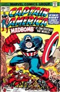
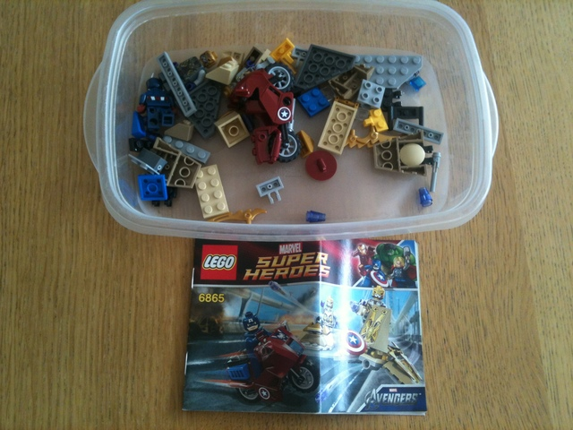
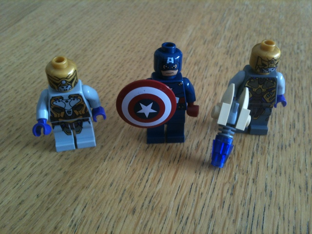
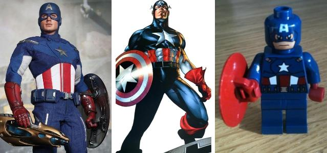
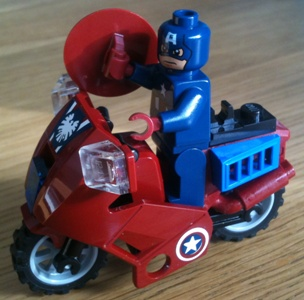
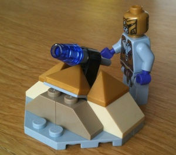
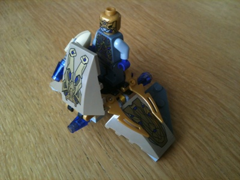

Fan de comics depuis plus de 20 ans, je ne pouvais pas rester insensible à la sortie de ces gammes. D’ailleurs la première série de Batman est responsable de ma sortie du fameux Dark Age !

Avec la sortie du Blockbuster "Avengers", LEGO s’en est donné à coeur joie, et voici un petit set consacré à la figure emblématique des Avengers : Captain America !

Tout d’abord, le contenu de cette boite : 72 pièces dont 3 minifigs.

Les deux soldats à la solde de Loki, le grand méchant du film. Ces personnages sont tirés directement du film et n’ont aucun lien avec les comics.

Attardons nous un instant sur LA minifig du Set : Captain America. Pour cela, je vous propose un petit comparatif avec la version du film et une des nombreuses versions du comics :

Vous pouvez constater que LEGO a choisi la version du Film comme référence, ce qui peut se concevoir vu le succès du film.

Maintenant le montage. Trois éléments sont à construire :  
Tout d’abord la moto de Captain America. Très simple, avec quelques stickers bien placés, je la trouve assez sympathique. En revanche, je n’ai pas souvenir avoir vu une telle moto dans le film, et l’utilisation d’une moto n’est pas spécialement récurrente dans le comics non plus. Un choix étrange de la part de LEGO.

Ensuite la petite base, avec son lance-missile :

Et pour finir le vaisseau du soldat :

Le set dans son ensemble a donc une forte jouabilité malgré sa petite taille, avec plusieurs éléments et une minifig pour chacun de ces éléments. Mon regret est donc la minifig de Captain America que je ne trouve personnellement pas géniale.
