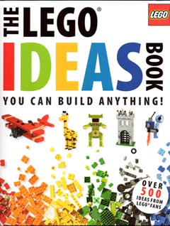
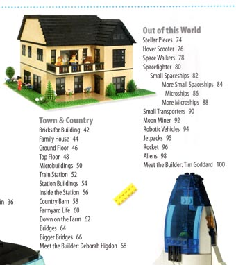
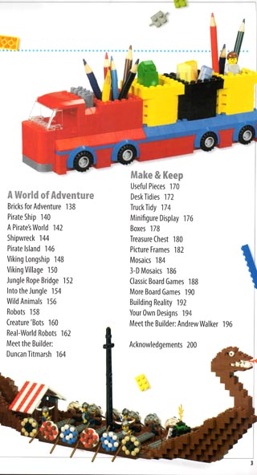
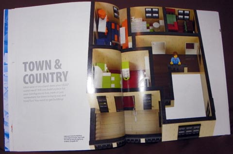
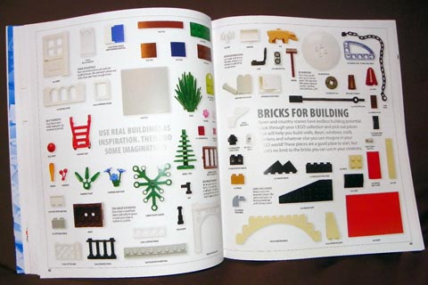
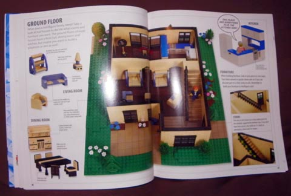
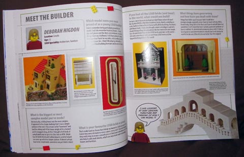

Le livre, sous-titré "You can build anything", - vous pouvez construire n’importe quoi (_sic_) - est clairement un livre d’inspiration. L’éditeur britannique, [Dorling Kindersley](http://www.dk.co.uk/) (DK) est un habitué des livres LEGO.

Ce livre est dans la droite ligne des ouvrages précédents de l’éditeur comme "The LEGO Universe" ou "[The LEGO Book](http://www.dk.co.uk/nf/Book/BookDisplay/0,,9781405341691,00.html?strSrchSql=lego/The_LEGO%AE_Book_Daniel_Lipkowitz)" ou les récents "[LEGO Star Wars, The visual dictionnary](http://www.dk.co.uk/nf/Book/BookDisplay/0,,9781405347471,00.html?strSrchSql=lego/LEGO%AE_Star_Wars_The_Visual_Dictionary)" et "LEGO Harry Potter, Building the Magical World".

Le livre, relié (hardcover) est un grand format (environ 23cmx28cm) entièrement en couleur. Il est très richement illustré par des photos de qualité. Le texte, en anglais, complète les photos et non l’inverse. Il faut rappeler que le livre est avant tout destiné à des enfants. En conséquence, le texte est simple et donc très accessible aux non anglophones accompagnés de l’outil de traduction de Google par exemple.

Les 200 pages se divisent en 6 chapitres, chacun détaillant un thème :  
**–** Véhicules (Planes, Trains & Automobiles),  
**–** Ville (Town & Country),  
**–** Espace (Out of this world),

**–** Médiéval (In days of old),  
**–** Aventure (A world of adventure),  
**–** Objets et Accessoires (Make & Keep).

Chacun de ces chapitres se découpent d’une double page de tête de chapitre,

d’une double page de présentation des pièces particulièrement utiles pour le thème présenté (pages que les fans trouveront inutiles mais essentiel pour les grands qui croient encore que LEGO rime uniquement avec brique 2x4),

de nombreuses pages présentant dans les détails des créations originales, et qui constituent le coeur du sujet du livre,

et de quelques pages présentant les créateurs, que les fans apprécierons beaucoup car ils s’y retrouveront à de nombreux égards,

L’éditeur étant Britannique, la plupart des créateurs sont originaires du Royaume-Uni (Barney Main, Tim Goddard, Duncan Titmarsh, Andrew Walker) à l’exception de Sebastiaan Arts (Néerlandais) et de Deborah Higdon (Canadienne).

Dissipons immédiatement tout malentendu. Même si des fans adultes ont très largement collaborés à cet ouvrage, les AFOls n’en sont pas, évidemment, les premiers destinataires.

A contrario, les parents trouveront ici des idées à travers 87 projets pour accompagner le jeu de leurs plus jeunes enfants quand ils ne savent pas quoi construire. Les plus grands construirons seuls leurs propres créations en s’inspirant des très nombreux modèles originaux.

**Et c’est là je pense le but premier : inspirer.**

Il est à mon avis largement atteint grâce à la richesse des thèmes développés, au nombre élevés d’illustrations, aux détails dévoilés (photos sous différents angles, de créations en cours de montage ou de variations de montage, de couleurs) ainsi qu’à la présentation de techniques subtiles connues des fans mais méconnues du grand public comme le SNOT, le greebling ou de conseils plus généraux mais essentiels comme la planification, la jouabilité ou l’apprentissage par essais et erreurs.

Ce livre de 200 pages coûte environ 20 euros et il les mérite (vous le trouverez facilement sur Amazon). Si vous avez déjà des livres de Dorling Kindersley, vous avez aussi une bonne idée de la qualité du produit. Je sais aussi qu’un achat se traduit souvent par un arbitrage entre deux dépenses. Je conclurai donc en vous rappelant que 20 euros c’est aussi le prix d’un set LEGO de 200 pièces environ ;-)

**–** Une [critique](http://www.wired.com/geekdad/2011/10/unleash-your-creativity-with-the-lego-ideas-book/) sur [Geekdad](http://www.wired.com/geekdad/)
