Pour le 30e anniversaire de STAR WARS, LEGO fête l’évènement à sa manière en sortant une série de nouvelles boites. Parmi celles-ci le Trade Federation MTT, dont je vais m’efforcer de vous commenter le montage.

La collection Star Wars s’enrichit d’une nouvelle grosse boite, le Trade Federation MTT.

Aussi appelé TMT pour Transport MultiTroupe, cette boite est la reprise de la [7184](http://guide.lugnet.com/set/7184) qui était sorti en 2000, il était aussi plus petit.

Le Transport MultiTroupe de la fédération du commerce est comme son nom l’indique un transport de droïdes de combat. Dans les films, il peut transporter jusqu’à 112 droïdes, dans notre cas il y en aura une vingtaine.

Ce TMT est apparu dans _l’épisode I : La menace fantôme_, dans la seconde trilogie de Star Wars.  
C’est sur la planète Naboo qu’a eut lieu la célèbre bataille des Plaines qui vit s’affronter les troupes gungans face aux droïdes de la Fédération du Commerce.  
Plusieurs de ces TMT étaient au combat.  
Pour la petite histoire, ce sont les gungans qui gagnèrent la bataille...

## Descriptif de la boite

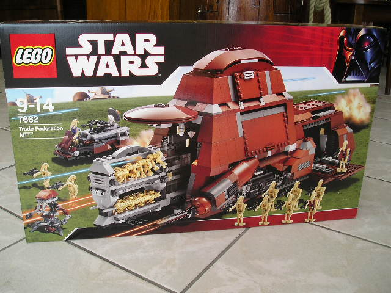

**la boite**

**–** Nom de la boite : Trade Federation MTT  
**–** Numéro de la boite : 7662  
**–** Nombre de pièces : 1326 pièces  
**–** Prix : 130 euros

On la trouve sur le [shop@home](http://shop.lego.com/ByTheme/Product.aspx?p=7662&cn=475&d=322) ou dans le commerce.

## Montage

Il n’y a pas moins de 17 sachets de pièces, ainsi que deux livres d’instructions pour le montage.

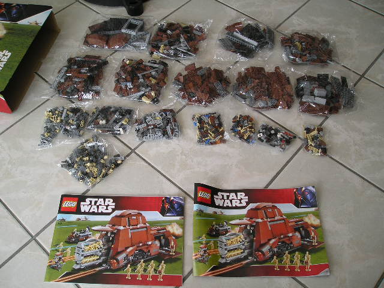

**le contenu**

Comme préconisé maintenant au début des instructions, on tri les pièces pour une facilité lors de la recherche des pièces.

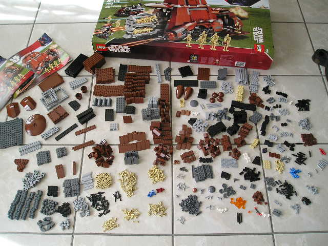

**les pièces**

On voit une petite modification dans l’élaboration des droïdes puisque leurs deux bras ne sont plus identiques.

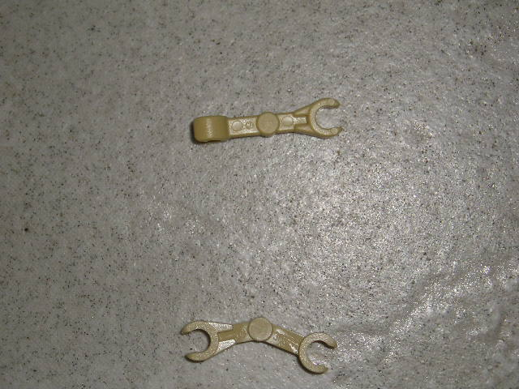

**les bras**

**–** Cela est du au fait que désormais les droïdes utilisent les nouveaux pistolets LEGO.  
L’assemblage des droïdes se fait à la chaine puisqu’il y en a 20 au total.

**–** On s’attaque donc à la construction de l’engin. On commence par un châssis.

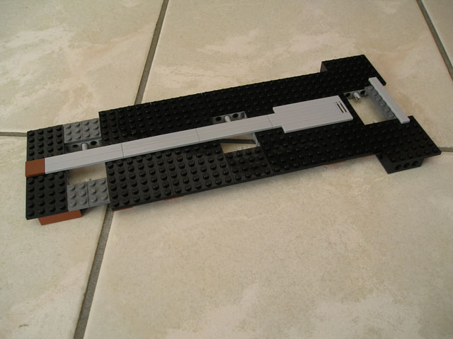

**le châssis**

**–** Et très vite on se rend compte de la taille de la bête.

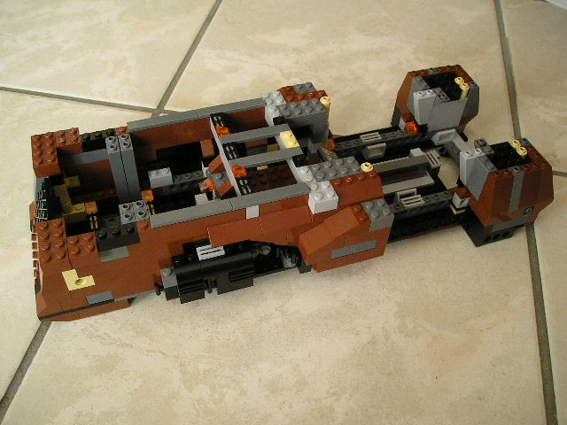

**étape 43**

**–** A la fin du premier livre, on voit déjà que la bête prend de la hauteur.

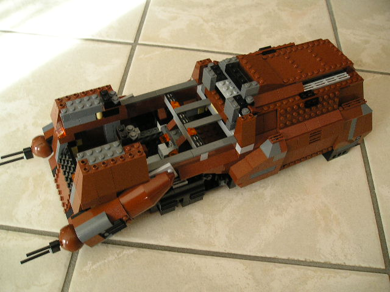

**étape 64 et fin du livret 1**

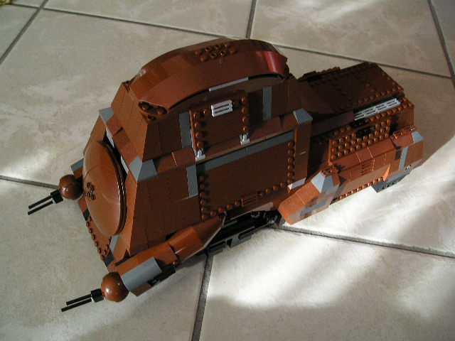

**étape 97 et fin**

**–** Après 97 étapes de construction, le TMT est fini.  
On pourrait croire qu’il est posé à même le sol, mais en fait il y a 6 roues en dessous qui permettent de le faire avancer sans difficulté.

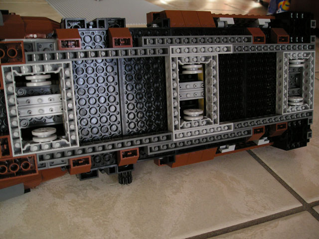

**les roues**

## vue d’ensemble

**–** L’armée est prête pour partir en combat contre les gungans.

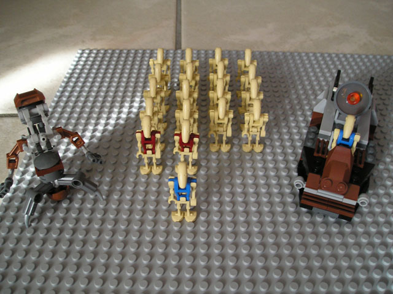

**l’armée**

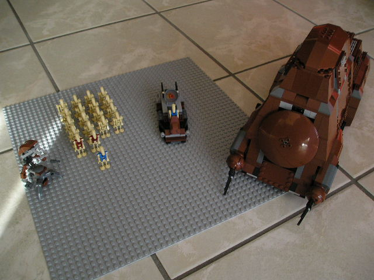

**l’ensemble**

**–** Une multitude d’ouvertures se trouvent sur le TMT.

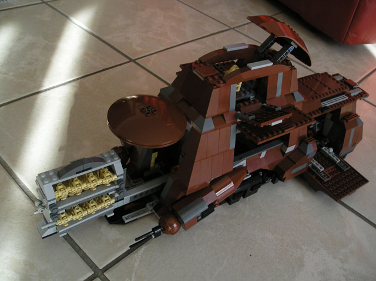

**ouvertures devant**

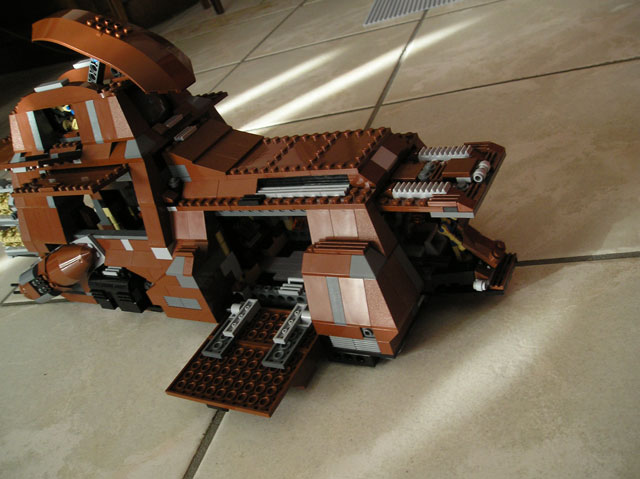

**ouvertures derrière**

**–** Le petit transporteur a une multitude de choix de transport : le pilote, les armes, les droïdes ou encore un de communication.

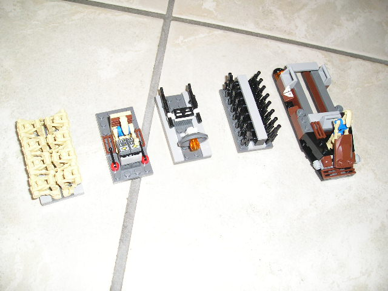

**le transporteur**

**–** Comme dans le film, on peut faire sortir l’armée de droïdes du ventre du TMT.

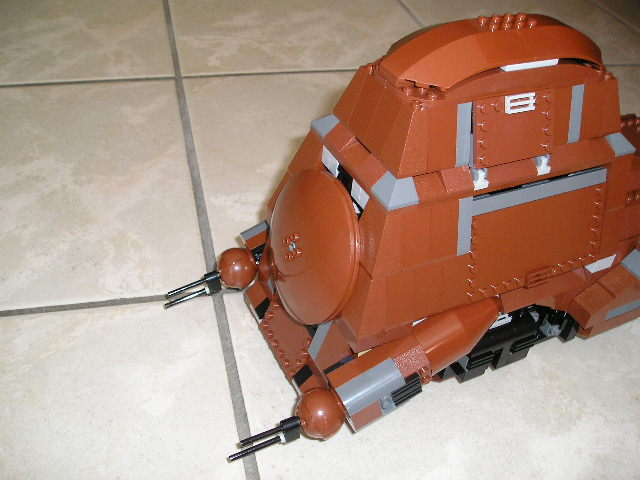

**étape1**

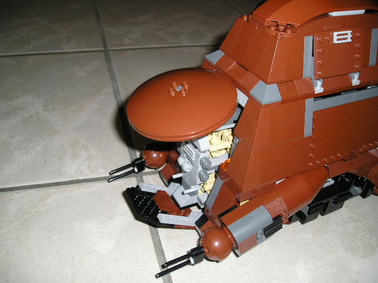

**étape2**

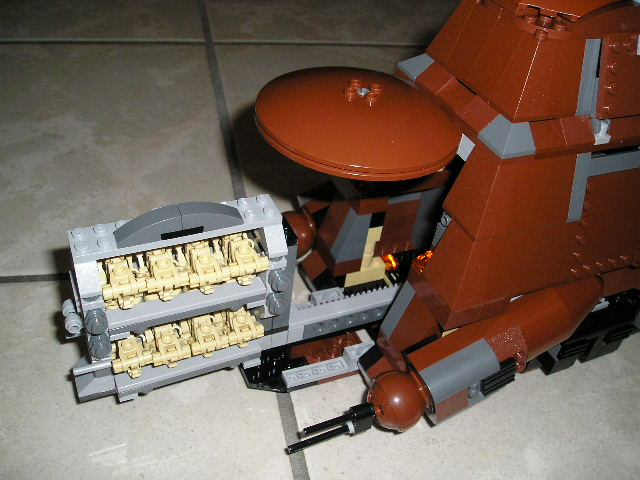

**étape3**

## Conclusion

**–** Je trouve que cette boite à une grande jouabilité pour les enfants, puisqu’il y a une multitude d’ouvertures du TMT, quatre choix pour le petit transporteur, et quand même une vingtaine de droïdes à préparer pour le combat, ainsi qu’un droïde destroyer.  
**–** 130 euros c’est cher, mais lorsqu’il est fini, on en a pour notre argent. 41 cm de long, 23 de haut et 15 cm de large.  
**–** Et n’étant pas particulièrement fan de Star Wars, j’ai comme même eu plaisir à le monter (normal pour des LEGO), et le trouve bien réussi.
