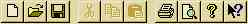
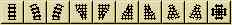
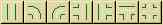
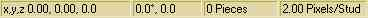
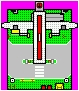
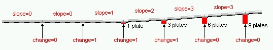

**–** Traduction abrégée de l’aide en ligne de Track Designer  
**–** Liste de trucs et astuces

* * *

**Traduction abrégée de l’aide en ligne de TD.**

Introduction

**–** Qu’est-ce que Track Designer ?

-   Track Designer vous permet de concevoir un réseau de train sur ordinateur. Vous pouvez réaliser un prototype de votre réseau très rapidement avant de le construire réellement, archiver des plans de réseaux préalablement construits, ou encore concevoir des réseaux qui dépassent votre stock réel de pièces. Lorsque le réseau est conçu vous pouvez en imprimer le plan et la liste des pièces nécessaires pour sa réalisation.
-   Track Designer n’est pas un programme de dessin, il range les données décrivant le réseau selon une structure mathématique et ne conserve aucune image bitmap du plan du réseau. La description graphique des éléments individuels est rangée dans un registre d’éléments. Un tel registre de base est fourni avec Track Designer et contient tous les éléments de voies 9V, 4,5V, 12V gris et 12V bleu, monorail, plaques de routes grises et vertes, et enfin les plaques de piste d’aéroport. Les plaques de bâtiments ferroviaires du 9V sont également inclus.
-   Track Designer prend en compte les dénivellations de voies, ce qui vous permet de concevoir des plans de réseau avec rampes et ponts. Les piliers sont automatiquement insérés.
-   Vous pouvez aussi ajouter vos propres éléments au registre d’éléments tels que bâtiments ou autres pièces personnalisées. Une option avancée vous permet de préciser la géométrie des éléments personnalisés de telle façon qu’ils puissent contenir des éléments de voie.

Les fichiers crées ou modifiés par la version 2.0 ne sont pas compatibles avec l’ancienne version 1.0. Mais la 2.0 peut lire les fichiers provenant de la 1.0. Si vous modifiez un fichier 1.0 il sera sauvegardé au format 2.0. Contrairement à la version 1.0, cette version de Track Designer n’enregistre pas le nom du registre d’éléments avec le plan du réseau. Cela facilite l’échange de fichiers sans avoir à déplacer le registre d’éléments en même temps. Mais cela signifie que si vous créez plus d’un registre d’éléments, vous devrez retenir vous-même avec quel registre tel plan de réseau a été conçu.

**–** Bien démarrer

-   Lorsque vous démarrez Track Designer, le programme ouvre par défaut un plan de réseau vide et charge le registre d’éléments fourni en standard. Vous êtes alors prêt pour concevoir un plan de réseau ! Cliquez simplement sur les boutons des boites à outils pour ajouter des éléments.
-   Vous pouvez aussi placer des éléments directement à l’aide du clavier en utilisant CTRL plus les flèches directionnelles, ce qui ajoutera un élément de voie courbe ou droit pour suivre le plus logiquement possible la direction indiquée.
-   Par défaut seuls les boutons de voies ferrées apparaissent. Pour voir les autres boites à outils de routes et de monorail, utilisez le sous-menu "Toolbox" du menu "View" pour sélectionner votre choix.
-   Pour insérer des éléments de bâtiments et autres éléments plus particuliers qui n’ont pas de bouton préprogrammé, utilisez la commande "Piece" du menu "Insert" (raccourci CTRL-I) et faites votre choix dans la liste proposée.
-   Track Designer adopte le mode classique de Windows pour le Couper/Copier/Coller. Les éléments peuvent être sélectionnés par double-click ou par ajout dans la sélection à l’aide de CTRL plus double-click.
-   La voie par défaut est le 9V mais vous pouvez changer pour un autre type de voie en utilisant l’onglet "Track" de la commande "options" du menu "View".
-   Au démarrage, vous apercevrez un carré gris clignotant dans une fenêtre à fond blanc. Ce carré indique l’emplacement du prochain élément qui sera ajouté. Ce carré vire au noir lorsque vous placez un élément de voie ou que vous sélectionnez un élément de voie existant.
-   À chaque démarrage de Track Designer, les premières commandes pourront paraître un peu plus lentes. C’est parce que la structure du registre d’éléments est optimisée pour gagner de la place mémoire et accélérer les temps de chargement. Il sera automatiquement décompacté lors de la première utilisation. À moins de sauvegarder volontairement le registre d’éléments, ce phénomène n’apparaît qu’au démarrage du programme.

**–** Les fonctions

-   **L’aide en ligne**. Sélectionnez la commande "Help Topics" du menu "Help" pour ouvrir le fichier d’aide en ligne. Pour obtenir de l’aide sur un point particulier du programme, cliquez sur le bouton d’aide (figuré par un point d’interrogation) et ensuite sur la commande, le bouton ou la fenêtre qui vous intéresse. Pour de l’aide contextuelle en ligne appuyez sur la touche F1 n’importe quand.
-   **Couper/Copier/Coller**. Seuls ou en groupe, les éléments peuvent être placés dans le presse-papier et collés dans le même plan de réseau, dans un autre plan de réseau ou encore dans un éditeur graphique. La taille du plan de réseau est infinie. Track Designer ajuste automatiquement la taille de l’espace de travail à la taille du réseau à mesure que vous le tracez. Les Couper/Copier/Coller sont possibles entre éléments du registre. La copie d’éléments du registre vers le plan de réseau ou en mode graphique vers le presse-papiers l’est également.
-   **Les courts-circuits**. La détection automatique des courts-circuits électriques vous indique lorsque vous concevez un plan de réseau qui ne pourra pas fonctionner. Une vue du plan électrique de votre réseau est d’ailleurs disponible sous forme graphique par la commande "Electrical" du menu "View".
-   **Imprimer**. Track Designer permet l’impression en couleur du plan de réseau sur toute imprimante couleur. Le programme utilise une mise à l’échelle de sorte que l’ensemble du réseau tiendra sur une page. La sortie imprimée contient aussi le nom du fichier du plan de réseau et une liste des pièces nécessaires pour la construction.
-   **L’aperçu avant impression** permet de visualiser la page avant sortie sur papier.
-   **Sélection automatique des éléments**. En utilisant les flèches directionnelles, Track Designer choisira intelligemment l’élément de courbe ou droit le plus logiquement placé par rapport à la position du curseur.
-   **Boite de sélection par cliquer-déplacer**. La sélection d’un groupe de pièces est possible par simple cliquer-déplacer sur les éléments à sélectionner.
-   **Amélioration du choix du tracé**. Un SHIFT-click permet de calculer et de tracer le chemin le plus court entre deux points.
-   **Rotation et inversion**. La sélection peut être tournée par pas de 90°, 45° ou 22,5°, ou encore inversée (image miroir). Lors d’une inversion, Track Designer convertit automatiquement les aiguillages en gauche en type droit et _vice-versa_.
-   **Zoom avant et arrière**. Quatre niveaux de zoom sont disponibles entre 2 pixels/tenon jusqu’à 4 tenons/pixel.
-   **Dénivellation**. Deux boutons permettent l’élévation ou l’abaissement du niveau de la voie. Chaque élément connecté aux éléments dénivelés est automatiquement ajusté pour créer les pentes nécessaires. Deux autres boutons sont disponibles pour modifier l’intensité de la pente. La commande "Elevation" du menu "Edit" permet de paramétrer directement ces valeurs en une opération.
-   **Compléter le registre**. Des éléments définis par l’utilisateur peuvent être ajoutés au registre d’éléments.

* * *

Track Designer commande par commande :

**–** **Le menu "File"**

-   **New**, crée un nouveau document (CTRL+N). Sélectionnez le type du nouveau fichier que vous voulez créer dans la boite de dialogue "File New". Le type "Layout" crée un nouvel espace de travail pour un plan de réseau (cas le plus général). Le type "Element Registry" crée un registre d’éléments dans le but d’en définir les propriétés.
-   **Open**, ouvre un document existant (CTRL+O). Track Designer affiche la liste des fenêtres ouvertes en bas du menu "Window". Une coche apparaît en face du nom de la fenêtre active. Sélectionnez un document de cette liste pour afficher sa fenêtre au premier plan.
-   **Close**, ferme un document ouvert. Track Designer vous suggérera d’enregistrer les modifications avant de fermer. Si vous fermez un document sans sauvegarder les modifications, vous perdrez tous les changements effectués depuis la dernière sauvegarde. Avant de fermer un document sans titre (qui n’a jamais été enregistré), Track Designer ouvrira la boite de dialogue de la commande "Save As" et vous proposera d’enregistrer ce document.
-   **Save**, enregistre un document ouvert sans modifier le nom de fichier (CTRL+S). Lorsque vous sauvegardez par cette commande un document pour la première fois, Track Designer ouvrira la boite de dialogue de la commande "Save As" afin que vous nommiez le document. Si vous souhaitez modifier le nom ou le dossier d’un document avant de l’enregistrer, alors utilisez la commande "Save As".

_**Attention**_  : Sauvegarder un plan de réseau ne sauvegarde pas le registre d’éléments ayant servi à le concevoir, y compris les représentations graphiques crées automatiquement par Track Designer. Si vous voulez sauvegarder tout ceci, il faut aussi sauvegarder le registre d’éléments. En général, vous n’avez pas à vous soucier de cela. C’est utile seulement si vous créez vos propres éléments particuliers.

-   **Save As**, enregistre un document ouvert sous un nouveau nom ou dans un nouveau dossier. Case _File Name_, tapez le nom de fichier. Un nom de fichier doit tenir en 8 caractères et 3 pour l’extension. Track Designer ajoute l’extension que vous avez tapé à la liste des types de fichier du sous-menu _Save File As_. _Drives_, sélectionnez le lecteur dans lequel vous voulez sauvegarder. _Directories_, Choississez le dossier dans lequel vous voulez sauvegarder le fichier. _Network_, cliquez ce bouton pour vous connecter à un lecteur distant en lui assignant une nouvelle lettre de lecteur.

-   **Print**, imprime le document ouvert (CTRL+P). Ouvre la fenêtre standard d’impression Windows.
-   **Print Preview**, Affiche à l’écran un aperçu avant impression du document ouvert. Permet de naviguer dans les pages à imprimer.
-   **Print Setup**, sélectionne une imprimante et sa connection selon le mode Windows classique.
-   **Exit**, quitte Track Designer.

**–** **Le menu ’Edit’**

-   **Undo**, oubliez ! ça ne marche pas dans TD.
-   **Cut**, **Copy**, **Paste**, trio classique pour le transfert d’éléments. Raccourcis CTRL+X, CTRL+C et CTRL+V classiquement aussi.
-   **Delete** (DEL), efface l’élément sélectionné du document actif.
-   **Select All** (CTRL+A), sélectionne tous les éléments du document actif. Pratique pour copier ensuite tout le plan dans un logiciel graphique.
-   **Properties** (CTRL+ENTER), sur un document "Registry", ouvre les propriétés de l’élément du registre sélectionné. Sur un document "Layout", ouvre la fenêtre des propriétés du document. Ces propriétés de "layout" sont les suivantes : _Description_, contient une ligne de texte qui sera imprimée en haut de la page ; _Comments_, un texte pour vous qui ne sera pas imprimé ; _Allow Short Circuits (Reversing Loops)_, cochez cette case si vous acceptez les court-circuits dans votre réseau (exemple, boucle de retournement), sinon TD vous les signalera systématiquement ; _Allow Pieces Below Ground Level (Negative Z)_, cochez cette case si vous acceptez de construire des voies sous le niveau du sol (hauteur négative), sinon TD vous en empêchera ; _Allow Height Mismatches_, cochez cette case si vous acceptez d’avoir des voies qui se rejoignent sans être à la même hauteur (exemple quai de chargement de wagons), normalement TD vérifie cela et l’empêche ; _Allow Slope Rule Violations_, cochez cette case pour faire des pentes bizarres, sinon TD vous en empêchera et calculera des pentes régulières ; _File Version_, indique la version du fichier, 1.0 ou 2.0.
-   Seulement en mode "Layout", **Refresh Support**, recalcule toutes les pentes en fonction des hauteurs indiquées.
-   Seulement en mode "Layout", **Elevation**, ajuste la hauteur de l’élément sélectionné ou remet les hauteurs à zéro.

**–** **Le menu ’View’ en mode "Layout"**

-   **Toolbar**, Affiche ou cache la barre d’outils de TD.
-   **Status Bar**, Affiche ou cache la barre d’état.
-   **Normal**, affiche le réseau (Layout) dans son mode normal avec les rails visibles
-   **Electrical**, affiche le plan de connexion électrique du réseau. La polarité des rails est montrée par des lignes bleues ou rouges. C’est très pratique pour détecter des court-circuits dans le plan du réseau. Par exemple une boucle de retournement directe sur un aiguillage.
-   **Scale**, Offre le choix du facteur d’échelle pour l’affichage de 2 pixels/tenon à 4 tenons/pixel.
-   **Toolbox**, affiche/cache les boites d’outils permettant le placement des différents types d’éléments de voies :
    -   _Tools_, la boite d’outils pour la modification des éléments de voie, rotation gauche, rotation droite, inversion horizontale, inversion verticale, zoom arrière, zoom avant, augmenter l’altitude de la voie, diminuer l’altitude de la voie, augmenter la pente de la rampe, diminuer la pente de la rampe.
    -   _Train_, la boite d’outils pour tracer des voies ferrées, voie droite, voie courbe à gauche, voie courbe à droite, aiguillage déviant à gauche avant, aiguillage déviant à droite avant, aiguillage déviant à gauche arrière, aiguillage déviant à droite arrière, aiguillage avec déviation rejoignant par la gauche arrière, aiguillage avec déviation rejoignant par la droite arrière, croisement. **Attention**, pour changer le type de voie ferrée qui sera tracée (par exemple 9V ou 12V) voir plus bas la commande "Options..." de ce menu View.
    -   _Monorail_, la boite d’outils pour tracer les voies du monorail, voie droite longue, voie droite courte, courbe à gauche, courbe à droite, aiguillage gauche avant, aiguillage droit avant, aiguillage gauche arrière, aiguillage droit arrière, aiguillage avec déviation rejoignant par la gauche arrière, aiguillage rejoignant par la droite arrière, petite courbe à gauche, petite courbe à droite, point d’inversion de marche commande à gauche, point d’inversion de marche commande à droite, rampe montante, rampe descendante.
    -   _Route_, la boite d’outils pour tracer des routes, route droite, virage à gauche, virage à droite, carrefour en T à gauche, carrefour en T à droite, carrefour en T de face, carrefour complet. Attention, comme pour la boite de rails, pour modifier le type de route à tracer, aller voir ci-dessous dans la commande "Options..." de ce menu "View".
-   **Options...**, permet de régler les choix de visualisation du réseau. Ces choix s’appliquent globalement à tous les réseaux ouverts et ne modifient que les tracés ultérieurs. Ils sont sauvegardés lors de l’enregistrement du réseau. Petit plus FreeLUG. Les explications ci-dessous ne figurent pas dans l’aide en ligne.
    -   _Track/train_, offre le choix du type de voie, 9V, 12V gris, 12V bleu, 4,5V gris et 4,5V bleu.
    -   _Track/Road_, offre le choix du type de plaque de route, grise avec piste cyclable, grise ancien type, verte piste d’aéroport, verte nouvelle route (pas la plus récente...).
    -   _Tools/Rotation Tools_, permet de régler le pas de langle de rotation, 22,5°, 45° ou 90°.
    -   _Tools/Elevation Tools_, permet de régler le pas d’incrément pour le changement d’altitude de la voie en brique et tiers de brique (plate).
    -   _Tools/Inclines/Slope_, règle le pas d’incrément de la rampe en briques et tiers de brique pour un élément de rail (16 tenons de long).
    -   _Tools/Inclines/Change_, règle la valeur de l’incrément pour une transition entre deux pentes, c’est à dire le début et la fin de la pente. En brique et tiers de brique pour un élément de rail en 16 tenons.
    -   _Tools/Element Registry_, permet d’indiquer le chemin d’accès au registre d’éléments avec lequel vous avez décidé de travailler. Par défaut, c’est dans le même dossier que TD.

**–** **Le menu ’View’ en mode "Registry"**

-   **Toolbar**, idem que en mode Layout
-   **Status bar**, idem que en mode Layout
-   **Refresh**, permet de mettre à jour le registre d’éléments
-   **Options**, idem que en mode Layout

**–** **Le menu ’Insert’ en mode "Layout"**

-   **Piece**, permet d’insérer un élément sur le plan du réseau. Le choix s’effectue dans une fenêtre listant tous les éléments disponibles dans le registre avec lequel on travaille sur le moment.

**–** **Le menu ’Insert’ en mode "Registry"**

-   **Element**, pour insérer un nouvel élément dans le registre d’éléments. Ce n’est possible que si une partie au moins de l’arbre des éléments (partie gauche de la fenêtre) est sélectionnée. La boite de dialogue pour créer un nouvel élément contient les champs suivants :
    -   _Description_, pour décrire l’élément. Evitez d’y porter des informations redondantes, par exemple le numéro de l’élément, la taille ou la classe qui figureront plus bas.
    -   _Part Number_, c’est le numéro de pièce défini par LEGO. Souvent gravé en relief sur chaque pièce à un endroit discret. Pour une Macro c’est un numéro unique non utilisé par une autre Macro. Jusqu’à 4 chiffres sont autorisés (ce qui est un problème, car LEGO produit aussi des numéros de pièces à plus de 4 chiffres, NdT).
    -   _Type_, décrit le type de l’élément. À savoir : _Piece_, pièce unique basée sur un moule unique ; _Set_, une boite de pièces complète telle que vendue par LEGO ; _Subset_, sous-ensemble d’une boite, utile si une boite contient plusieurs objets séparés à construire (exemple, une maison et une voiture dans la même boite) ; enfin _Macro_, un ensemble de pièces. Par exemple, un rail 12V contient six pièces.
    -   _Class_, désigne la classe à laquelle l’élément appartient. Par exemple, un rail 9V appartient à la classe des éléments de train 9V. Les classes suivantes sont définies : _Basic_, tout élément n’appartenant pas aux classes suivantes ; _9V Train_, tout élément de train 9V, par exemple les boites de la série 45XX ; _Monorail_, n’importe quel élément du système monorail ; _Road_, les plaques de routes grises avec piste cyclable ; _12V Train_, les éléments de train 12V à rails gris, par exemple les boites des séries 77XX et 78XX ; _4.5V Train_, les éléments de 4,5V à rails gris, incluant les boites qui fonctionnent avec le 4,5V ou le 12V (77XX et 78XX par exemple) ; _12V Train (Blue)_, n’importe quel élément pour le 12V à rails bleus ; _4.5V Train (Blue)_, idem pour le 4,5V à rails bleus ; _Old Road_, toutes les plaques de route grises sans piste cyclable ; _Airport Runway_, toute plaque verte de piste d’aéroport ; enfin _New Road_, toute plaque de route verte à l’exception des précédentes.
    -   _Dimensions_, indique les dimensions x, y, z de l’élément. x et y sont mesurées en tenons où x est la longueur et y la largeur (c’est-à-dire x>y). z est mesurée en tiers de hauteur de brique (plate). Par exemple, une brique standard aura un z=3. Ces dimensions sont surtout utiles pour distinguer des pièces similaires avec un même nom mais des tailles différentes. Elles sont aussi utiles si l’élément n’a pas de "Rendering" ni de "Geometry" définis. Si une plaque de base possède des dépassements sans tenons, ne pas inclure des dépassements dans ces dimensions (mais les inclure dans le champs "Bounds", voir plus bas, NdT).
    -   _Serial Number_, utilisé pour distinguer différents éléments ayant le même numéro de pièce (Part Number). Normalement le numéro de pièce est unique et ce champ devrait rester vide. Cependant, dans le cas d’une boite ayant plusieurs sous-ensembles (Subset) que vous voudriez décrire séparément, alors ce champ prend son utilité.
    -   _Custom_, cochez cette case si l’élément est une pièce spéciale non fournie par LEGO. Par exemple, une pièce que vous avez fabriqué vous-même à partir de pièces modifiées.
    -   _ID_, c’est le numéro d’identification de l’élément qui est généré automatiquement par le programme pour identifier chaque élément sans erreur. Vous ne pouvez pas insérer deux éléments ayant le même numéro ID. Vous devrez changer l’un des autres champs tel que le numéro de série (Serial Number) par exemple.

-   **Geometry**, pour créer des informations sur la géométrie de l’élément sélectionné. Permet de décrire mathématiquement les propriétés d’un élément. Celui-ci peut avoir plusieurs "Geometry". Par exemple, un aiguillage peut à la fois être décrit comme une séparation en deux voies ou une réunion de deux voies distinctes, selon le sens selon lequel vous parcourrez l’aiguillage. Le système de coordonnées, général à Track Designer, décrit l’axe X de gauche à droite, l’axe Y de haut en bas et l’axe Z définissant la hauteur en tiers de brique (plate). La boite de dialogue contient les champs suivants :
    -   _Geometry Type_, défini le type de géométrie utilisable. Peut prendre la valeur "custom" si aucun des types existant n’est applicable. Toutes les géométries prédéfinies sont accessibles aux outils de dessin du réseau. Même si l’un des types de géométrie semble convenir à la pièce "custom" que vous concevez, utilisez le type "custom", sinon les outils de dessin de réseau seront perturbés.
    -   _Mirror Image Type_, décrit le type de géométrie lorsque l’élément est tourné (haut/bas ou gauche/droite). De nombreux types acceptent "self" comme valeur. Mais les aiguillages, par exemple, changent cette valeur lorsqu’ils sont tournés. Les géométries de type "custom" ont toujours la valeur "self" dans ce champ.
    -   _Default Start Port_, indique le numéro du point de connexion au départ (Start Port Number)lorsque l’élément est vu avec cette géométrie. C’est aussi le point auquel sera connecté l’élément lorsqu’il est inséré en jonction avec un autre.
    -   _Bounds_, indique le rectangle délimitant cet élément lorsqu’il est vu selon cette géométrie. Cela devrait être vu avec le point de connexion au départ (Start Port Number) orienté à zéro degré (défini comme horizontal à droite en regardant dans le point de connexion au départ). Les unités sont des tenons et l’origine du rectangle est définie au centre du point de connexion au départ par défaut (cela signifie que l’angle en haut à gauche peut avoir des coordonnées négatives). Les dépassements de dimensions de l’élément doivent être inclues dans ce champ (par référence aux dimensions de l’élément, vu plus haut, qui ne tiennent pas compte de ces dépassements, NdT).
    -   _ID_, défini un numéro d’identification unique pour cette géométrie dans TD.
    -   _Port Number_, Chaque élément peut avoir jusqu’à 4 points de connexion (Port) pour le connecter aux autres éléments.
    -   _Enable Port_, cochez cette case pour chaque point de connexion existant dans la géométrie. Il doit toujours y avoir au moins un point de connexion valide, c’est pourquoi le premier point de connexion est coché par défaut. Si un élément n’a pas de point de connexion, il n’a probablement pas besoin de définition d’une géométrie.
    -   _Class_, décrit la classe du point de connexion (Port). Généralement, la classe du point de connexion est la même que la classe de l’élément lui-même, mais il y a des exceptions. Par exemple, un passage à niveau 9V est un élément de train, mais deux de ses points de connexion sont de classe "Road" pour leur permettre une connexion aux éléments de routes.
    -   _Move to_, pour indiquer le numéro de point de connexion qui sera la sortie du point de connexion entrant correspondant. Par exemple, un croisement possède quatre points de connexion, mais pour chaque point de connexion entrant il n’y a qu’un point de connexion sortant. Si il doit y en avoir plusieurs, alors il faut choisir le plus adapté. Par exemple, un aiguillage possède deux points de connexion sortant pour un point de connexion entrant, dans ce cas, le point de connexion sortant le plus évident serait celui qui fait aller le train tout droit et non celui de la voie déviée.
    -   _Offset X,Y,Z_, indique le début (en tenons pour X et Y, et en tiers de brique pour Z) à partir du point de connexion zéro. Évidemment le début du point de connexion zéro par rapport à lui même est nul, c’est pourquoi ces valeurs sont non-modifiables. Les autres valeurs doivent être indiquées par rapport au point de connexion zéro avec zéro degré d’orientation. Réfléchissez à deux fois avant de définir un point de connexion au départ qui ne sera pas le point de connexion zéro. Comme pour le champ "Bound", il est possible que certaines de ces valeurs soient négatives.
    -   _Angle_, indique l’angle relatif entre le point de connexion zéro entrant et le point de connexion en question. Par exemple, pour sortir du point de connexion zéro entrant est 180° (c’est toujours vrai, et donc non-modifiable), alors que sortir de l’autre point de connexion tout droit donne le même angle que pour entrer, donc 0° (Au secours... NdT).
    -   _Port Polarity_, décrit les propriétés électriques de chaque point de connexion. Pour chaque point de connexion (en ligne), il y a un lien électrique possible à tous les autres points (en colonne). Le lien est de la nature suivante : _n/c_, pas de contact électrique ; _+ve_, contact positif, la polarité reste la même ; et _\-ve_, contact négatif, la polarité est inversée. Pour bien comprendre cela, il faut regarder vers le dehors d’un point de connexion entrant et considérer que le rail gauche porte le 0V et le rail droit porte le 9V (par exemple). Ensuite en regardant au dehors d’un point de connexion sortant, demandez-vous si la polarité est la même ou non.

-   **Piece List Entry**, cette boite de dialogue permet d’éditer ou de créer une entrée dans la liste de pièces d’un élément. Une liste de pièces rassemble tous les éléments constitutifs d’un élément composite. Ce n’est pas indispensable d’avoir une liste de pièces pour un élément composite, mais ça peut être utile pour lire la liste des éléments d’un réseau. Par exemple, un croisement est un élément composite assemblant deux rails droits. Si ces deux rails droits ne sont pas précisés dans la liste de pièces de cet élément composite, ils n’apparaîtraient pas dans la liste des éléments du réseau où ce croisement est employé.
    -   _Part Number_, Tapez le numéro de l’élément. Cet élément peut avoir n’importe quel type, un ensemble, un sous-ensemble, une macro ou une simple pièce. Pour faire autrement, on peut choisir un élément en navigant dans une liste avec le bouton "browse". Dans certains cas, le numéro d’élément peut être insuffisant pour désigner un élément (par exemple, un ensemble et une pièce peuvent avoir le même numéro d’inventaire). Si cela arrive, il faut nécessairement employer le bouton "browse" pour choisir le bon élément.
    -   _Quantity_, Entrez le nombre d’éléments pour cette liste.
    -   _Colour_, Choisissez la couleur de l’élément. Pas programmé !

-   **Rendering**, est une boite de dialogue qui permet d’éditer les propriétés d’un rendu ou d’en créer un nouveau. Un rendu est une des nombreux "bitmap" qui permet d’afficher un élément sous différents angles et à différentes échelles.
    -   _Scale_, permet de définir l’échelle du rendu en pixels par tenon. C’est un nombre à virgule qui permet d’entrer de très petites échelles de rendu.
    -   _Symetry_, est facultatif, mais peut être employé pour éviter d’entrer plusieurs rendus là ou un seul aurait suffit grâce à la symétrie du rendu. Zéro degrés signifie que le rendu n’a pas de symétrie, c’est la valeur par défaut. 90 degrés, signifie que le rendu possède une symétrie de rotation en son centre et apparaît de la même façon lorsqu’il est tourné de 90, 180 ou 270 degrés. 180 signifie que le rendu possède une symétrie de rotation en son centre et apparaît semblable lorsqu’il est tourné de 180 degrés.
    -   _ID_, C’est le numéro d’identification du rendu généré automatiquement par le programme pour identifier chaque rendu par un numéro unique. Vous ne pouvez pas créer deux rendus avec le même numéro ID. Vous devrez changer un des champs tel que l’échelle ou la rotation.
    -   _Port Number_, chaque élément peut avoir jusqu’à quatre ports utilisés pour le connecter aux autres éléments.
    -   _Enable Port_, cochez cette case pour valider chaque port utilisé de l’élément. Cependant, il est inutile de valider les ports qui découlent de la symétrie. Par exemple, un rail droit possède une symétrie de 180 degrés et donc le rendu du port 0 à O degrés est le même que le rendu du port 1 à 180 degrés. Pour chaque port validé, vous devez indiquer la rotation et l’origine.
    -   _Rotation_, donne l’angle en degrés du port (comme si vous regardiez dans le port), où zéro degré est horizontal vers la droite. Augmenter les degrés fait tourner dans le sens des aiguilles d’une montre.
    -   _Origin_, représente l’origine du port mesurée en pixels à partir du haut à gauche du "bitmap". L’origine devrait toujours être placée à l’axe central de la voie pour les éléments de voie ferrée. Ces chiffres sont toujours positifs.
    -   _Error_, représente la marge d’erreur en fractions de pixels sur les dimensions pour un rendu. Par exemple, un rail droit de 16 tenons de long placé à 45 degrés à 2 pixels par tenon fait 22,627 pixels en X et en Y. Evidemment un "bitmap" ne peut pas avoir des dimensions avec des décimales et donc Track Designer permet des rendus avec des erreurs variables selon le rendu. Dans cet exemple, il y aurait un rendu avec 22 pixels et une erreur de -0,627 et un autre rendu avec 23 pixels et une erreur de +0,373. Ce qui permet de juxtaposer les éléments sans défaut d’affichage. Track Designer choisi le rendu approprié tout seul. Cette valeur est facultative et on laisse la valeur zéro, Track Designer sera forcé de travailler avec un seul rendu. L’erreur est mesurée par rapport au port 0 et donc l’erreur du port 0 est toujours nulle. Si vous entrez des valeurs d’erreurs, vous devrez préciser l’erreur de chaque port, quelque soit le port activé. Cette fonction n’est pas programmée !!! (pourquoi je l’ai traduite alors ? NdT)
    -   _Primary Colour_, désigne la couleur identifiant l’élément. Par exemple, une brique rouge devrait avoir "Red" de spécifié ici. C’est doublement utile au programme. Cela permet à Track Designer de recolorer un élément en remplaçant tous les pixels d’un rendu correspondant à cette couleur avec une autre (dans le cas d’une sélection d’un élément par exemple). De plus, cela indique à Track Designer quelle couleur à éviter lors d’une mise en contraste pour la sélection de cet élément. Pour changer la couleur, cliquez sur le bouton "Change" et choisissez une couleur pleine. La couleur est ensuite représentée par un nombre hexadécimal sur 24 bits au format BBGGRR (B=bleu ; G=vert ; R=rouge).
    -   _Transparent Colour_, désigne la couleur transparente pour un rendu, ce qui fait qu’un rendu produisant cette couleur ne l’affichera pas. La couleur par défaut est blanche, mais si le rendu possède des pixels que vous voudriez garder blancs, vous devez indiquer ici une autre couleur que le blanc. Sinon les pixels blancs de votre élément apparaîtront transparents et prendront la couleur des pixels sous-jacents. Pour changer la couleur, cliquez sur le bouton "Change" et chosissez une couleur pleine. La couleur est ensuite représentée par un nombre hexadécimal sur 24 bits au format BBGGRR (B=bleu ; G=vert ; R=rouge).
    -   _Note_, n’importe quel rendu peut représenter des vues multiples d’un élément vu de différents ports. Par exemple, un rail courbe possède deux ports, mais vu d’un port, ce rail à l’air d’un rail courbe à droite, tandis que vu de l’autre port, il a l’air d’un rail courbe à gauche. Cependant, un rail courbe à gauche à 0 degrés à le même rendu qu’un rail courbe à droite à 157,5 degrés. Ainsi, un seul rendu pour ces deux vues aura besoin d’être défini, mais deux ports devront être indiqués.

-   **Synthetic Rendering**, est une boite de dialogue qui permet de calculer une nouvelle image sur un élément à partir d’une image de synthèse. On peut mettre à l’échelle et tourner l’image de synthèse en question pour produire cette nouvelle image qui sera placée sur un élément. Track Designer utilise la meilleure image disponible pour commencer. La rotation est limitée par pas de 90°.  
    Normalement vous ne devriez pas avoir besoin de ces fonctions, parce que Track Designer calcule automatique ces images synthétiques selon les besoins lors du tracé du réseau. Cependant, si vous voulez perfectionner le tracé en modifiant l’image bit-map vous même, ces fonctions seront utiles. Produisez l’image qui vous convient (avec un logiciel graphique), copiez l’image bit-map dans le presse-papiers et collez-la, et le tour est joué.

-   -   _Scale_, entrez l’échelle du nouveau tracé. Un nombre à virgule est autorisé pour les échelles inférieures à un.
    -   _Rotation_, entrez l’angle de rotation. Il s’agit de la rotation par rapport au port zéro. Seules des rotations multiples de 90° sont possibles. Ainsi, un port zéro peut avoir un rendu tourné de 90°, 180° ou 270°.

**–** **Le menu ’Report’**

-   **Pieces**, crée une liste des pièces employées dans le plan du réseau. Utilisez cette commande pour obtenir la liste exhaustive des éléments nécessaires pour réaliser le réseau représenté sur le plan.

-   **Area**, crée une liste des dimensions et de la surface utilisée par le plan du réseau. Les dimensions sont données en tenons, en pieds et pouces, et en mètres. Cette commande élimine automatiquement tout espace inutilisé autour du réseau et colle donc au plus près des dimensions limites.

**–** **Le menu ’Window’**  
Le menu "Window" offre les commandes suivantes qui permettent d’arranger en plusieurs vues plusieurs documents dans la fenêtre principale de Track Designer.

-   **New Window**, Crée une nouvelle fenêtre du document actif.  
    Utilisez cette commande pour ouvrir une nouvelle fenêtre dupliquant le contenu de la fenêtre active. Vous pouvez ouvrir plusieurs fenêtres de documents ainsi pour visualiser des parties différentes ou des vues différentes du même document. Si vous modifiez le contenu d’un document dans une fenêtre, alors toutes les autres fenêtres reliées au même document seront mises à jour automatiquement. Lorsque vous ouvrez une nouvelle fenêtre de document, elle devient la fenêtre active et est affichée au premier plan par dessus toutes les autres.

-   **Cascade**, dispose les fenêtres en les superposant.  
    Utilisez cette commande pour arranger les fenêtres en les superposant automatiquement au mieux de la surface disponible.

-   **Tile**, Dispose les fenêtres en les juxtaposant.  
    Utilisez cette commande pour arranger les fenêtres en les juxtaposant automatiquement au mieux de la surface disponible.

-   **Arrange Icons**, dispose les icônes des fenêtres réduites.  
    Utilisez cette commande pour disposer au mieux les icônes des fenêtres réduites au bas de la fenêtre principale. C’est utile si il y a une fenêtre de document ouverte au bas de la fenêtre principale qui cacherait certains ou tous les icônes des fenêtres réduites.

-   **Split**, subdivise la fenêtre active en deux parties.

-   **Window 1, 2, ...**, permet d’atteindre la fenêtre spécifiée.  
    Track Designer affiche la liste des fenêtres de documents ouverts au bas du menu "Window". Une marque apparaît en face du nom de la fenêtre active. Sélectionnez une fenêtre dans cette liste pour en faire la fenêtre active.

**–** **Le menu ’Help’**  
Le menu "Help" offre les commandes permettant d’obtenir les conseils d’utilisation de Track Designer.

-   **Help topics**, donne accès à l’index des sujets pour lesquels de l’aide est disponible.  
    Utilisez cette commande pour afficher l’aide (en anglais) de Track Designer. À partir de la nouvelle fenêtre ouverte, vous pouvez naviguer dans l’aide en ligne en cliquant sur les mots clés affichés en couleur. Cette aide exploite l’outil d’aide en ligne standard de Windows, vous disposez donc de trois onglets nommés Sommaire, Index et Recherche. Le sommaire donne accès au plan du document d’aide avec des mots clés cliquables. L’Index regroupe exhaustivement tous les mots dans le texte intégral de l’aide. Recherche permet de faire des recherches dans le texte de l’aide.

-   **About**, Affiche le numéro de version du programme.

**–** **Les barres d’outils**  
**–** **Utiliser la barre d’outils standard**  
La barre d’outils est affichée en haut de la fenêtre du programme, juste sous la barre des menus. La barre d’outils donne accès à des raccourcis vers de nombreux outils de Track Designer. Pour cacher ou afficher la barre d’outils, sélectionnez "Toolbar" dans le menu "View" (ALT,V,T).  
De gauche à droite, les icônes sont les suivants :

-   Créer un nouveau document
-   Ouvrir un document existant. Track Designer ouvre alors une boite de dialogue permettant de localiser le document à ouvrir.
-   Enregistrer le document actif avec son nom courant. Si le document n’a encore jamais été nommé, alors Track Designer ouvre la boite de dialogue "Save As".
-   Couper les éléments sélectionnés
-   Copier les éléments sélectionnés
-   Coller au point d’insertion les éléments sélectionnés
-   Imprimer le document actif
-   Afficher un aperçu avant impression du document actif

**–** **Utiliser les barres d’outils de dessin**  
Il y a quatre barres d’outils autres que la barre d’outils standard. Par défaut, seulement deux d’entre-elles sont visibles, la barre d’outils Train en haut de la fenêtre et la barre d’outils Edition sur la droite de la fenêtre active. Les barres d’outils Monorail et Route peuvent être activées par la commande "Toolbox" du menu "View". Chaque barre d’outils peut être déplacée en cliquant-tirant le fond de la barre sur l’endroit de la fenêtre qui vous convient.

Pour plus d’informations voir :

-   **La barre d’outils Edition**  
    Cette barre d’outils est affichée sur la droite de la fenêtre Track Designer. Pour afficher ou cacher cette barre d’outils, utilisez la commande "Toolbox" du menu "View". Elle peut aussi être déplacée n’importe où dans la fenêtre ou sur les bords en cliquant-tirant le fond de la barre d’outils. La barre d’outils Edition comporte les outils suivants de gauche à droite :
    
    
    
    -   Rotation de la sélection dans le sens des aiguilles d’une montre,
    -   Rotation de la sélection dans le sens inverse des aiguilles d’une montre,
    -   Bascule symétrique horizontale de la sélection,
    -   Bascule symétrique verticale de la sélection,
    -   Diminuer le zoom (moins gros),
    -   Augmenter le zoom (plus gros),
    -   Elever l’altitude de la sélection,
    -   Diminuer l’altitude de la sélection,
    -   Augmenter la pente de la sélection,
    -   Diminuer la pente de la sélection.

-   **La barre d’outils Train**  
    La barre d’outils Train est affichée en haut de la fenêtre de Track Designer. Pour afficher ou cacher cette barre d’outils, utilisez la commande "Toolbox" du menu "View". Elle peut aussi être déplacée n’importe où dans la fenêtre ou sur les bords en cliquant-tirant le fond de la barre d’outils. La barre d’outils Train comporte les outils suivants de gauche à droite :
    
    
    
    -   Placer un rail droit
    -   Placer un rail courbe à gauche (inverse des aiguilles d’une montre)
    -   Placer un rail courbe à droite (sens des aiguilles d’une montre)
    -   Placer un aiguillage avec voie déviée à gauche
    -   Placer un aiguillage avec voie déviée à droite
    -   Placer un aiguillage avec jonction venant de la gauche
    -   Placer un aiguillage avec jonction venant de la droite
    -   Placer un aiguillage à partir d’une voie déviée à gauche
    -   Placer un aiguillage à partir d’une voie déviée à droite
    -   Placer un croisement de voies

-   **La barre d’outils Monorail**  
    La barre d’outils Monorail est affichée en haut de la fenêtre de Track Designer. Pour afficher ou cacher cette barre d’outils, utilisez la commande "Toolbox" du menu "View". Elle peut aussi être déplacée n’importe où dans la fenêtre ou sur les bords en cliquant-tirant le fond de la barre d’outils. La barre d’outils Monorail comporte les outils suivants de gauche à droite :
    
    
    
    -   Placer un élément de voie droite
    -   Placer un élément court de voie droite
    -   Placer un élément de voie courbe à gauche (inverse des aiguilles d’une montre)
    -   Placer un élément de voie courbe à droite (sens des aiguilles d’une montre)
    -   Placer un aiguillage voie déviée à gauche
    -   Placer un aiguillage voie déviée à droite
    -   Placer un aiguillage avec jonction venant de la gauche
    -   Placer un aiguillage avec jonction venant de la droite
    -   Placer un aiguillage à partir d’une voie déviée à gauche
    -   Placer un aiguillage à partir d’une voie déviée à droite
    -   Placer un élément court de voie courbe à gauche (inverse des aiguilles d’une montre)
    -   Placer un élément court de voie courbe à droite (sens des aiguilles d’une montre)
    -   Placer un élément de voie avec inverseur à gauche
    -   Placer un élément de voie avec inverseur à droite
    -   Placer un élément de rampe montante
    -   Placer un élément de rampe descendante

-   **La barre d’outils Route**  
    La barre d’outils Route est affichée en haut de la fenêtre de Track Designer. Pour afficher ou cacher cette barre d’outils, utilisez la commande "Toolbox" du menu "View". Elle peut aussi être déplacée n’importe où dans la fenêtre ou sur les bords en cliquant-tirant le fond de la barre d’outils. La barre d’outils Route comporte les outils suivants de gauche à droite :
    
    
    
    -   Placer un élément de route droite
    -   Placer un élément de route tournante à gauche (inverse des aiguilles d’une montre)
    -   Placer un élément de route tournante à droite (sens des aiguilles d’une montre)
    -   Placer un élément de route avec voie déviée à gauche
    -   Placer un élément de route avec voie déviée à droite
    -   Placer un élément de route avec voie déviée en bas (T)
    -   Placer un croisement de routes

**–** **La barre d’état**  
La barre d’état est affichée en bas de la fenêtre de Track Designer. Pour afficher ou cacher la barre d’état utilisez la commande "Status Bar" du menu "View".  
La partie gauche de la barre d’état décrit les actions des éléments de menu pendant que vous naviguez dedans avec les flèches du clavier. Elle affiche aussi ce que feront les boutons des barres d’outils au moment où vous cliquez dessus et juste avant de relacher le bouton de la souris. Si après avoir lu le message sur la barre d’état, vous ne souhaitez plus effectuer cette commande, alors relachez le bouton de la souris en dehors de la zone de la barre d’outils.

La partie droite de la barre d’état possède quatre zones. La première montre les coordonnées x,y,z de la position courante du curseur : x et y sont mesurés en tenons et z est mesuré en briques et plates (1/3 de brique). Par exemple, x,y,z 88.00,40.00,2.2 donne 88 et 40 tenons avec une hauteur de 2 briques et 2 tiers de brique. L’origine x,y est un peu arbitraire puisque vous pouvez ajouter des éléments dans n’importe quelle direction y compris à des coordonnées négatives. Mais la position par défaut du curseur est simplement définie à 0,0. L’origine z de 0 est le ras du sol.  
La seconde zone montre l’angle et la pente. C’est soit l’angle et la pente à laquelle le prochain élément sera placé, ou bien c’est l’angle et la pente de l’élément sélectionné si le curseur se trouve entre deux éléments jointifs. L’angle est mesuré dans le sens des aiguilles d’une montre avec le 0 à droite. La pente est mesurée en briques et plates pour une longueur de 16 tenons.  
La troisième zone montre le nombre total de pièces dans le plan en cours. (En réalité cela montre le nombre d’éléments, certains éléments sont des boites et ils comptent comme un au lieu d’additionner les pièces de chacune de ces boites.)  
La dernière zone montre le facteur d’échelle en cours.

**–** **Les commandes au clavier et à la souris**  
**–** Dessiner et déplacer les pièces en utilisant le clavier  
La plus grande partie des éléments de train, monorail et route peuvent être placés à l’aide du clavier. La plupart des touches sont directes (pour les anglophones... NDT), par exemple, S est relié à l’élément droit (Straight en anglais) de rail, de monorail ou de route selon le contexte. Si le contexte est ambigu, l’élément par défaut sera un rail de train.  
**–** Les commandes clavier sont divisées en trois sections.

-   Les commandes de dessin. Commandes pour insérer des éléments à l’aide du clavier.
-   Les commandes de mouvement. Commandes pour déplacer se curseur sur le plan.
-   Les commandes de sélection. Commandes pour sélectionner des pièces ou pour éditer la sélection.

-   -   _**Les commandes de dessin**_

| Touche | Action |
| --- | --- |
| S | Placer un élément droit |
| L | Placer un élément courbe à gauche |
| R | Placer un élément courbe à droite |
| Q | Placer un quart de droite de monorail |
| SHIFT+L | Placer un aiguillage avec voie déviée à gauche |
| SHIFT+R | Placer un aiguillage avec voie déviée à droite |
| CTRL+L | Placer un aiguillage avec jonction venant de la gauche |
| CTRL+R | Placer un aiguillage avec jonction venant de la droite |
| ALT+L | Placer un aiguillage à partir d’une voie déviée à gauche |
| ALT+R | Placer un aiguillage à partir d’une voie déviée à gauche |
| X | Placer un croisement |
| K | Placer un élément de voie avec inverseur à droite |
| SHIFT+K | Placer un élément de voie avec inverseur à gauche |
| U | Placer un élément de rampe montante |
| D | Placer un élément de rampe descendante |
| T | Placer un élément de route avec voie déviée en bas (T) |
| CTRL+Flèche Gauche | Placer un élément courbe ou droit pour aller vers le 180° (9h00 en cadrant de montre) |
| CTRL+Flèche Droite | Placer un élément courbe ou droit pour aller vers le 0° (3h00 en cadrant de montre) |
| CTRL+Flèche Haut | Placer un élément courbe ou droit pour aller vers le 270° (12h00 en cadrant de montre) |
| CTRL+Flèche Bas | Placer un élément courbe ou droit pour aller vers le 90° (6h00 en cadrant de montre) |
| Effacement | Efface l’élément sélectionné ou qui vient d’être placé |

-   -   **_Les commandes de mouvement_**

| Touche | Action |
| --- | --- |
| Flèche Gauche | Déplace le curseur à gauche le long de la voie ou d’un tenon vers la gauche si il n’est pas sur une voie |
| Flèche Droite | Déplace le curseur à droite le long de la voie ou d’un tenon vers la droite si il n’est pas sur une voie |
| Flèche Haut | Déplace le curseur vers le haut le long de la voie ou d’un tenon vers le haut si il n’est pas sur une voie |
| Flèche Bas | Déplace le curseur vers le bas le long de la voie ou d’un tenon vers le bas si il n’est pas sur une voie |
| SHIFT+Flèche Gauche | Déplace le curseur de 16 tenons vers la gauche en quittant la voie si nécessaire |
| SHIFT+Flèche Droite | Déplace le curseur de 16 tenons vers la droite en quittant la voie si nécessaire |
| SHIFT+Flèche Haut | Déplace le curseur de 16 tenons vers le haut en quittant la voie si nécessaire |
| SHIFT+Flèche Bas | Déplace le curseur de 16 tenons vers le bas en quittant la voie si nécessaire |
| Espace | Avance le curseur d’une position sur la voie dans la direction en cours |
| C | Tourne le curseur de 90° à droite |
| A | Tourne le curseur de 90° à gauche |
| H | Bascule la direction horizontale |
| V | Bascule la direction verticale |
| Z | Agrandit le zoom |
| SHIFT+Z | Diminue le zoom |
| + | Augmente l’élévation courante |
| \- | Diminue l’élévation courante |
| \> | Augmente la pente |
| Diminue la pente |  |

-   -   **_Les commandes de sélection_**

| Touche | Action |
| --- | --- |
| Flèche Gauche | Déplace la sélection d’un tenon vers la gauche |
| Flèche Droite | Déplace la sélection d’un tenon vers la droite |
| Flèche Haut | Déplace la sélection d’un tenon vers le haut |
| Flèche Bas | Déplace la sélection d’un tenon vers le bas |
| SHIFT+Flèche Gauche | Déplace la sélection de 16 tenons vers la gauche |
| SHIFT+Flèche Droite | Déplace la sélection de 16 tenons vers la droite |
| SHIFT+Flèche Haut | Déplace la sélection de 16 tenons vers le haut |
| SHIFT+Flèche Bas | Déplace la sélection de 16 tenons vers le bas |
| Suppression | Efface la sélection |
| Effacement | Efface la sélection |
| C | Tourne la sélection de 90° à droite |
| A | Tourne la sélection de 90° à gauche |
| H | Bascule la sélection horizontalement |
| V | Bascule la sélection verticalement |
| + | Augmente l’élévation de la sélection |
| \- | Diminue l’élévation de la sélection |

**–** **Modifier en utilisant la souris**  
La souris est employée pour sélectionner et déplacer une ou plusieurs pièces. Si vous cliquez en dehors du tracé du réseau, alors vous démarrerez une nouvelle section de voie. Si vous cliquez sur une portion de voie, alors vous sélectionnerez cet élément de voie. Track Designer place le curseur à l’extrémité la plus proche de la pièce et règle l’angle de tracé à partir de la pièce en question.

-   _Les commandes d’Edition_

| Touche | Action |
| --- | --- |
| Bouton Gauche | Déplace le curseur à la nouvelle position |
| Bouton Droit | Affiche le menu popup |

-   _Les commandes de sélection_

| Touche | Action |
| --- | --- |
| Double click Bouton Gauche | Sélectionne l’élément |
| Cliquer-glisser Bouton Gauche | Sélectionne les éléments en les entourant ou déplace la sélection |
| CTRL+Cliquer-Glisser Bouton Gauche | Copier et déplacer la sélection |
| CTRL+Double click Bouton Gauche | Sélectionne tous les éléments connectés à la pièce cible |
| SHIFT+Bouton Gauche | Ajoute l’élément cible à la sélection en cours |

**–** **Comment faire...**

-   **Exporter un circuit vers un autre programme**  
    Un plan de réseau peut être exporté vers une autre application telle qu’un programme de dessin ou de traitement de texte en tant qu’image. Sélectionnez tout le plan de réseau par la commande "Select All" (CTRL+A) du Menu "Edit". Copiez dans le presse-papier (CTRL-C) et ensuite collez l’image dans le programme de votre choix. Le plan de réseau est collé en tant qu’image standard (bitmap) windows.

-   **Ajouter des bâtiments au circuit**  
    Des bâtiments ou autres éléments spéciaux peuvent être ajoutés à un plan de réseau en utilisant la commande "Piece" (CTRL+I) du menu "Insert". Si l’élément n’existe pas dans le registre d’éléments, vous pouvez l’y ajouter vous-même en suivant les instruction suivantes.

-   **Créer ses propres éléments**  
    _Comment ajouter des éléments fabriqués au registre des éléments ?_  
    Vous pouvez créer des éléments vous-même et les ajouter au registre des éléments. Cela vous permettra ensuite de les insérer dans un plan de réseau. Vous voudrez faire cela si l’élément dont vous avez besoin ne figure pas dans le registre ou bien pour modifier un élément existant pour l’adapter à vos besoins.  
    Pour ajouter un élément :  
    **1**. Passez en mode Registre (CTRL+TAB) avec le menu "Window".  
    **2**. Sélectionnez la section "Elements" dans l’arborescence du registre (partie gauche de la fenêtre).  
    **3**. Ajoutez un élément avec la commande "Element..." du menu "Insert".  
    **4**. Remplissez toutes les propriétés de l’élément.  
    **5**. Ajoutez un rendu graphique à l’élément avec la commande "Rendering" du menu "Insert".  
    **6**. Réglez l’echelle à 2.0 et le premier port à zéro degrés.  
    **7**. Avec un programme graphique (Paintbrush par exemple), dessinez une image (bitmap) de l’élément à 2 pixels par tenon et à la rotation de 0°.  
    **8**. L’image bitmap devrait être à 4 ou 8 bits par pixel (16 ou 256 couleurs par pixel). Dans Paintbrush cela se règle au moment d’enregistrer l’image.  
    **9**. Copiez l’image bitmap dans le presse-papier. Retournez dans Track Designer et collez l’image dans le rendu graphique.  
    **10**. Si vous n’avez besoin de l’élément qu’en rotations multiples de 90°, alors vous n’avez pas besoin d’autres rendus graphiques. Dans ce cas, Track Designer génèrera automatiquement les autres rotations et les autres échelles de l’élément.  
    **11**. Si vous avez besoin de l’élément en rotations de 45°, alors vous devez définir au moins un rendu graphique à 45°.  
    **12**. Si vous utiliserez l’élément en rotations de 22,5° ou multiples, alors il vous faudra définir des rendus graphiques pour 22,5°, 45° et 67,5°.  
    **13**. Si l’élément est ou inclu un élément de voie (train, monorail ou route), il faudra définir une géométrie. Pour des éléments fabriqués, il faut seulement une géométrie dont le type sera "custom".  
    **14**. Optionnellement, si l’élément est un ensemble de pièces, un sous-ensemble ou une macro, il faut définir une liste de pièces. Cette liste précise la quantité de chacune des pièces composant l’élément. Le but de cette liste est de permettre le calcul des pièces nécessaires à un plan de réseau et montrer avec exactitude les éléments nécessaires.

**Voyons un exemple.**  
En guise d’exemple, nous allons ajouter au registre l’élément correspondant au terminal d’aéroport de la boite 6399. C’est un élément complexe, donc si vous réussissez cet exercice, tous les autres vous sembleront faciles.  
Voici l’image bitmap et regardons comment procéder :

  
Basculer dans le mode Registre (CTRL+TAB).  
Sélectionnez la section "Elements" dans l’arborescence du registre.  
Ajoutez un élément avec la commande "Element" du menu "Insert".  
Remplissez les informations pour cet élément comme suit :  
\- **Description** : "Airport terminal".  
\- **Part Number** : "6399", c’est le numéro de la boite.  
\- **Element Type** : "Subset", puisque la boite 6399 contient d’autres éléments c’est juste un sous-ensemble.  
\- **Dimensions** : On ignore les dépassements d’éléments avec les plaques de base parce que les plaques de base définissent l’espace que les éléments utiliseront effectivement. X définit la longueur en tenons et Y définit la largeur parce que nous considérons normalement que les éléments sont tracés de gauche à droite. Habituellement pour les voies X est plus grand que Y, mais dans ce cas précis les voies traversent une base très large et donc X est plus petit que Y. X vaut 32, qui est la longueur de la plaque de base de gauche à droite, Y vaut 40 parce que l’autre plaque de base ajoute encore 8 tenons du haut en bas. Z n’est pas vraiment utile dans cette version de Track Designer, on pourra utiliser une valeur approximative, par exemple la hauteur de l’ensemble en 1/3 de briques.  
\- **Serial Number** : À moins d’avoir effacé les sous-ensembles d’origine dans la boite 6399 fournie dand le registre, vous devriez entrer au moins 3 ici. Track Designer permet à des éléments différents de posséder les mêmes "Part Number", "Class" et "Type" à condition que le "Serial Number" soit unique.  
\- **Custom** : la boite 6399 Terminal d’aéroport fait partie d’une boite officielle, alors cette case ne devrait pas être validée.  
À l’aide d’un programme graphique (genre Paintbrush), créez une image bitmap à 2 pixels par tenon à la rotation de zéro degré avec un fond de couleur magenta (voir l’image ci-dessus).  
L’image bitmap devrait être en 4 ou 8 bits par pixel (16 ou 256 couleurs par pixel).  
Copiez l’image bitmap dans le presse-papier (CTRL+C). Retournez dans Track Designer et collez cette image comme rendu graphique. Pour cet exemple vous pouvez aussi copier-coller l’image en exemple ci-dessus.  
Si vous n’avez besoin que d’images à 90°, ce n’est pas nécessaire de définir d’autres images bitmap de rendu graphique. Track Designer calculera ces rendus automatiquement ainsi que les différentes échelles.  
Cet élément possède des ports, alors nous devons lui définir une géométrie. La géométrie indique à Track Designer comment connecter cet élément aux autres éléments. Pour cela utilisez la commande "Geometry" du menu "Insert".  
Remplissez les informations pour cet élément comme suit :  
\- Les limites extérieures incluent les dépassements et les surfaces transparentes.

  
\- **Geometry Type** : Choississez "Custom" pour ce champ. Tout élément ne correspondant à un élément des barres d’outils de Track Designer doit être "custom" pour ce champ.  
\- **Mirror Image Type** : Les types "custom" sont toujours marqués "self" ici, parce que Track designer suppose que l’image miroir n’existe pas dans ce cas.  
\- **Bounds** : C’est le rectangle délimitant l’élément. Dans ce cas, il doit aussi inclure les dépassements. C’est mesuré en tenons à partir de la position du port par défaut de début. Le port de début dans cet exemple est l’extrémité gauche de la voie Monorail avec inverseur qui est placée quelquepart au milieu de cet élément complexe. Ainsi les deux valeurs (haut et gauche) seront négatives. Observez le schéma ci-dessus.  
\- **Default Start Port** : Mettez zéro, en général les éléments "custom" auront toujours zéro à cet endroit.  
\- **Port 0 Class** : Les ports de classe 0 et 1 sont pour le Monorail.  
\- **Port 0 Move to port** : Mettez 1, le port à l’autre bout de la voie Monorail. Cela indique à Track Designer comment déplacer le curseur d’un port à l’autre si on utilise les flèches du clavier.  
\- **Port 0 Polarity** : Aucunes des pièces ici n’est électrifiée, alors mettez "n/c" (non connecté) dans tous les champs.  
\- **Port 1 Enable** : Le Terminal d’aéroport possède 4 ports, donc tous les 4 devraient être activés.  
\- **Port 1 Offset** : C’est le décalage à partir du port 0 en tenons, dans ce cas c’est X=16 parce que c’est la longueur de la voie d’aiguillage du Monorail. Y est à zéro parce que la voie circule tout droit de gauche à droite. Z est à zéro parce que la voie est au ras du sol.  
\- **Port 1 Angle** : C’est l’écart d’angle avec le port 0. Il faut se placer en face du port 0 en regardant vers la voie, alors nous faisons face vers la droite. Donc l’angle vers le port 0 est zéro. Nous devons entrer l’angle relatif en regardant vers l’extérieur du port 0, qui est aussi face vers la droite, alors on entre zéro.  
\- **Port 2 Move to port** : le port 2 est le côté gauche de la route qui doit aller vers le port 3, le côté droit de la route. Donc entrer 3.  
\- **Port 2 Offset** : En comptant de gauche à droite à partir du port 0 on obtient 12 tenons en arrière, alors entrons -12 pour X. Du haut vers le bas à partir du port 0 on trouve 20 tenons, alors entrons 20 pour Y. Là encore la route est au ras du sol, alors Z vaut 0.  
\- **Port 2 Angle** : En regardant vers l’extérieur à partir du port 2 on regarde vers la gauche à 180° (vers 9h00 en cadrant horaire), donc on entre 180.  
\- Ainsi de suite pour le port 3.  
Le Terminal d’aéroport comprend une voie de Monorail avec inverseur. Il est préférable de pouvoir compter le nombre total de voies Monorail quand vous consultez la liste des pièces du plan d’un réseau. Donc, il faut ajouter cet élément de voie monorail avec inverseur dans la liste des pièces de l’élément Terminal d’aéroport. Procédez avec la commande "Piece List Entry" du menu "Insert". Cliquez sur le bouton "Browse" et double-cliquez sur l’élément "Monorail reversing switch" et mettez la quantité à 1.

**–** **Faire des pentes et des ponts**  
La façon la plus simple de faire des pentes et des ponts est de laisser faire tout le travail par Track Designer. Dessinez votre plan de réseau sans vous préoccuper de l’élévation des voies. Lorsque le plan du réseau est terminé, déterminez à quel endroit vous souhaitez placer un pont ou une voie surélevée. Alors sélectionnez seulement les éléments de voie qui seront le plus surélevés. Utilisez l’outil d’élévation de la barre d’outils ou la commande "Set height" de la commande "Elevation" du menu "Edit" pour entrer la hauteur souhaitée. Track Designer calculera et placera automatiquement les pentes sur les voies connectées et insèrera les éléments de support si nécessaire.  
Il reste possible de définir manuellement les pentes des voies en utilisant les boutons Augmenter et Diminuer la pente. Le prochain élément tracé sur le plan sera placé à cette élévation déterminée.  
Seuls les voies de train sont concernées par les pentes.  
L’exemple suivant montre une rampe avec une pente maximale de 3 plates (rappel : 1 plate = 1/3 de brique) par élément de voie et un changement maximum d’une plate par élément de voie.

* * *

**Trucs et astuces**

**–** Sélectionner les éléments. Comme indiqué dans l’aide, on peut sélectionner un groupe de pièces par cliquer-déplacer. Il n’est pas indispensable d’entourer complètement l’élément pour le sélectionner. C’est pratique pour différencier deux éléments contigus.

**–** Associez le nom de registre d’éléments au fichier de plan de réseau. Pour cela incorporez dans les commentaires du plan de réseau le nom du registre d’éléments avec lequel il a été réalisé (Menu Edit/Properties/Comments). Tenez compte des numéros de version des registres d’éléments si vous travaillez avec une suite de registres d’éléments qui évoluent par ajouts et compléments (comme nous proposons de le faire).

**–** Ajoutez les éléments nouveaux d’un nouveau registre d’éléments par copier coller dans votre registre standard. Ou bien remplacez carrément un fichier par l’autre.
