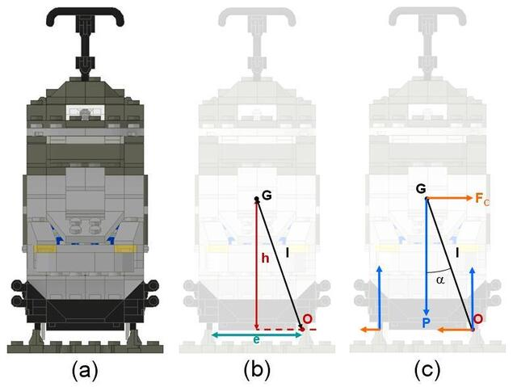
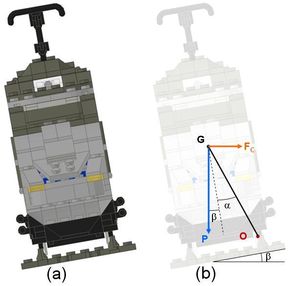
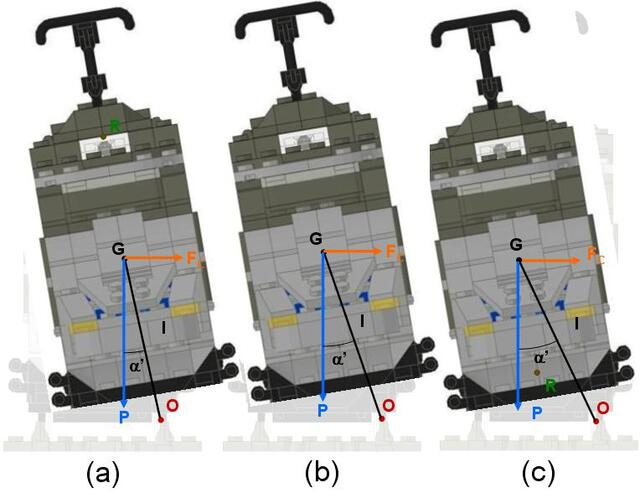

Les différentes discussions sur la liste générale FreeLUG au sujet du rayon de courbure, de l’angle d’inclinaison des rails et de la pendulation pour contrer l’effet de la force centrifuge dans les virages que prennent nos trains m’ont donné envie d’écrire cet article afin d’essayer de clarifier les choses.

## Virages horizontaux

Vu de devant, un TGV ressemble à l’image (a) de la figure ci-dessous c’est à dire des voitures (locomotives ou wagons) dont les roues s’appuyent sur des rails espacés de _e_. Pour étudier la cinématique du basculement du train vers l’extérieur du virage, plaçons-nous dans le plan perpendiculaire à l’axe du train et supposons que l’extérieur du virage se situe à droite de la figure. Toute le discussion tourne autour de la position du centre de gravité **G** par rapport au point de contact **O** entre le rail extérieur et les roues extérieures. Soient _h_ la hauteur de **G** par rapport au dessus des rails et _l_ la distance **OG** égale à ^{2}}") (voir image (b) de la figure ci-dessous).

**Figure 1. Bilan des forces**

Schéma des forces en présence (a) TGV vu de face, (b) position du centre de gravité G et (c) forces en présence. L’image du TGV a été réalisée à partir d’un modèle MLCAD de J. Mathis.

Les forces qui agissent sur **G** sont le poids **P** = m**g** (en bleu) dirigé verticalement vers le bas et la force centrifuge  (en rouge) dirigée horizontalement vers la droite. Pour faire un bilan complet des forces (voir image (c) de la figure ci-dessus), il faut ajouter les force de réactions au niveau du contact rails-roues c’est-à-dire les réactions (en bleu) verticales vers le haut du sol dont la somme s’oppose au poids et les réactions (en rouge) horizontales vers la gauche des rails dont la somme s’oppose à la force centrifuge. Le bilan montre que la somme des six forces est nulle et le train n’a aucune raison de basculer vers la droite (l’extérieur du virage). De plus, pour ce qui nous intéresse ici, on peut oublier ces forces de réactions et se limiter au poids et à la force centrifuge.

_Ce point de vue est cependant approximatif puisqu’il néglige le fait que la force centrifuge varie le long d’une voiture d’abord en direction puisqu’elle pointe toujours à l’opposé du centre de courbure du virage (ce qui diminue la force centrifuge totale) et ensuite en intensité puisque le milieu de la voiture est plus proche du centre de courbure que les extrémités (ce qui augmente la force centrifuge totale). Le terme correctif ayant le mauvais goût de dépendre du rapport entre la longueur de la voiture et le rayon de courbure, les expressions deviennent franchement plus complexes et moins parlantes. Heureusement, la correction est négligeable pour les grands rayons de courbure._

Si le bilan des forces est nul, il n’en est pas de même du bilan des couples de rotation qui agissent. En effet, si la somme des couples n’est pas nulle, le corps aura tendance à tourner autour du point de rotation. Ici, il s’agit du point **O** puisque la force centrifuge va avoir tendance à faire basculer le train vers la droite alors que le poids aura tendance à ramener le train en contact avec les rails. Un couple se quantifie par le produit de l’intensité de la force et de son bras de levier par rapport au point de rotation. Concrètement, le couple du poids vaut  et celui de la force centrifuge vaut . Tant que , le poids gardera les roues en contact avec le sol. Si la force centrifuge augmente telle que , alors le couple de la force centrifuge l’emportera et le train basculera vers la droite (à ce moment la roue droite supportera tout le poids du train puisque la roue gauche n’est plus en contact avec les rails). L’égalité des couples donne la relation .

Dans un virage circulaire de rayon _R_, la force centrifuge vaut  qui traduit le fait que cette force est proportionnelle au carré de la vitesse tangentielle et inversement proportionnelle au rayon de courbure de la trajectoire. Ainsi, plus un virage est serré et plus cette force sera grande et plus il faudra réduire la vitesse de passage si on ne veut pas que le train bascule dans le décor du genre Corner Café ou autre Market Street.

On en déduit l’expression de la vitesse maximale du train dans le virage sans qu’il bascule . Dans la configuration qui nous intéresse,  d’où la relation finale  ou inversement  est le rayon de courbure minimal pour pouvoir prendre le virage à la vitesse _v_.

Comme exemple pratique, considérons un TGV lourd et haut tel que  ce qui donne  avec . Avec les rails courbes LEGO, le rayon _R_ vaut environ 0,32 m d’où . Inversement, si on veut circuler à 20 km/h, il faut un rayon d’au moins 6,3 mètres.

## Virages relevés

Afin de réduire l’effet de la force centrifuge, on peut relever le rail extérieur tel que les traverses des rails font un angle  avec l’horizontale (voir figure 2 ci-dessous). On comprend aisément que le bras de levier du poids est augmenté alors que celui de la force centrifuge est réduit ce qui augmente la capacité du poids à maintenir le train sur les rails.

**Figure 2. Rails relevés.**

Schéma pour le cas de rails extérieurs relevés.

Pour les calculs, il suffit d’ajouter l’angle  à  d’où } } "). De même, inversement, }}") avec  ").

Dans le cas réel, on admet que l’on peut incliner les rails de 8 degrés au maximum (pour éviter que le train ne bascule vers l’intérieur du virage en cas d’arrêt imprévu).  
Pour les deux exemples traités plus haut, on obtient alors une vitesse maximale pour des rails LEGO de 1,47 m/s = 5,3 km/h et un rayon de 4,5 mètres pour une vitesse dans les virages de 20 km/h.

## Pendulation

L’idée à l’origine du concept de pendulation est d’essayer d’améliorer le confort des passagers en compensant partiellement l’effet de la force centrifuge en inclinant l’habitacle du train par rapport aux boggies. Ceci projette une partie du poids parallèlement au plancher qui s’oppose à la composante parallèle de la force centrifuge. Pour les expressions, il suffit de remplacer  par le nouvel angle  ce qui donne .

On peut distinguer 3 cas :

**Figure 3. Différents cas de pendulation**

(a) pendulation par le haut au niveau du plafond, (b) pendulation autour du centre de gravité, (c) pendulation par le bas au niveau du plancher. R est le point fixe de la pendulation.

1\. la pendulation passive par le haut où l’habitacle est suspendu au niveau de son plafond et se penche naturellement du fait de la force centrifuge (comme un pendule attaché au rétroviseur de votre voiture qui se penche vers l’extérieur du virage). Néanmoins, comme le montre l’image (a) de la figure ci-dessus, le centre de gravité se déplace vers l’extérieur du virage ") ce qui va dans le mauvais sens de ce que nous cherchons à obtenir c’est à dire une vitesse plus élevée dans les virages.

2\. la pendulation active autour du centre de gravité qui ne change rien à notre affaire ") mais qui est la solution la plus confortable pour les passagers.

3\. la pendulation active par le plancher où ce sont des vérins au niveau des boggies qui inclinent plus ou moins l’habitacle en mesurant en temps réel la force centrifuge à l’aide d’accéléromètres. Cette fois, la vitesse de passage est clairement augmentée ") au détriment du confort des minifigs qui voyagent avec ce train. De plus, comme la force centrifuge supportée par le train dans les virages augmente, l’effort sur les rails est aussi plus important (les réactions horizontales au niveau des rails doivent compenser la force centrifuge) et il faut les fixer plus solidement au sol.

## Conclusion

Gagner en vitesse de passage pour les trains LEGO est un sacré challenge puisqu’on doit nécessairement fabriquer de nouveaux rails courbes avec un grand rayon de courbure de préférence relevés de quelques degrés. De même, la pendulation par le bas est délicate à mettre en oeuvre à cette échelle et reste du domaine de l’utopie.
