Discussion sur la création de motifs diagonaux par l’utilisation des briques pentues en combinaison avec des techniques de décalage.

**I) Introduction.**

Les motrices et les wagons présentent une grande diversité de livrées. Reproduire ces motifs colorés en LEGO® est un challenge. Si l’on regarde le cas particulier des motifs diagonaux, l’usage des briques pentues est une première réponse.

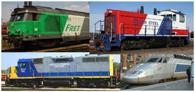

fig.1 - Exemples de motifs diagonaux sur des motrices réelles.

\- Les briques pentues sont disponibles dans un large choix de couleurs.

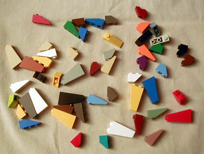

fig.2 - Diversité de couleurs

\- Les briques pentues sont largement disponibles, ainsi que leurs équivalentes inversées, avec trois différentes valeurs d’angles :

**–** 27° (Slope bricks 33 3x1)  
**–** 45° (Slope bricks 45 2x1)  
**–** 73° (Slope bricks 75 2x1x3)

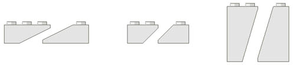

Malheureusement, une brique pentue et sa brique inversée respective ne peuvent être placées côte à côte afin de formé un motif diagonal à cause d’un recouvrement :

Cet effet de recouvrement est causé par le talon présent en pied de brique, talon d’une hauteur approximative de 0.2 tenons.

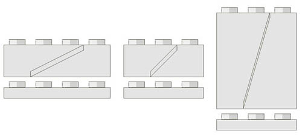

fig.3 - Effet de recouvrement

La réponse usuelle à cet effet de recouvrement est l’utilisation d’un décalage vertical d’une plaque. Un calcul rapide montre alors que les écarts entre briques pentues sont de :

|  |  |  |
| --- | --- | --- |
| 0.18 tenons | 0.14 tenons | 0.06 tenons |

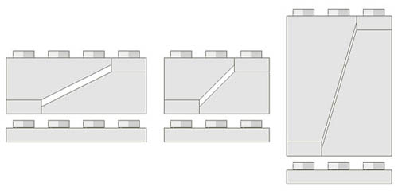

fig.4 - Décalage vertical d’une plaque

Un écart de 0.06 tenons est négligeable. Vous pouvez juger par vous même sur les exemples qui suivent que des écarts plus importants restent raisonnablement bon pour des maquettes LEGO®.

L’Express Woodhall de Tony Hafner \[1\]

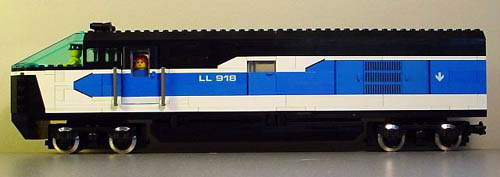

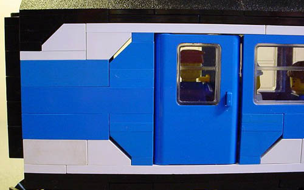

Une voiture LHB Rajdhani des chemins de fer Indiens par Samarth Moray \[2\]

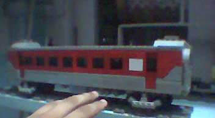

Le 66001 EWS par Mark Bellis\[3\]

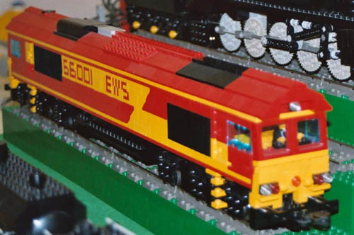

L’Intercity Danois par Esben Koling\[4\]

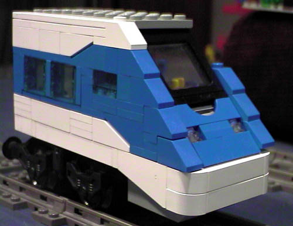

Le train pendulaire du Queensland par Esben Kolind\[5\]

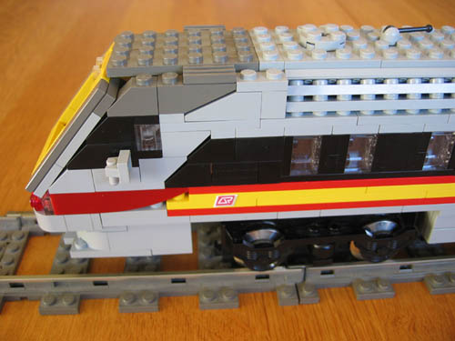

L’Acela par James Mathis\[6\]

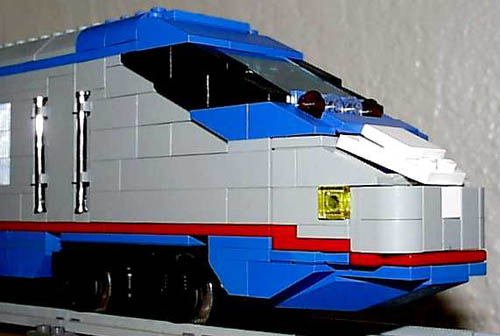

L’Amtrak Cascades par James Mathis\[7\]

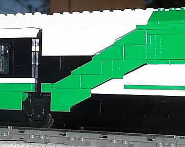

**II) Discussion sur l’utilisation combinée des briques pentues 75° 2x1x3 et de diverses techniques de décalage :  
Application à la motrice du TGV nord.**

La motrice du TGV se compose pour parti d’un motif diagonal bleu et blanc sur ses flancs. Trois fans adultes de LEGO® ont utilisé des briques pentues 75° 2x1x3 associées à trois décalages différents pour le reconstituer.

**1) Décalage vertical d’une plaque**

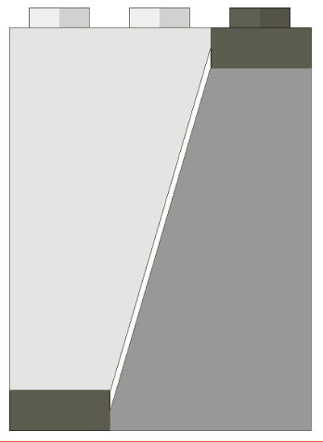

fig.5 - Décalage vertical d’une plaque

Comme nous avons vu précédemment, l’écart entre les briques pentues est de moins de 0.06 tenons. Etant donnée la taille générale des maquettes, cet écart est négligeable.

David Vinzant utilise cette solution dans sa version du TGV :

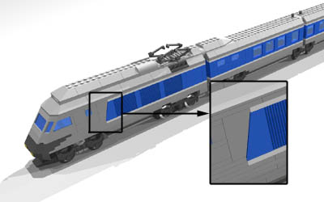

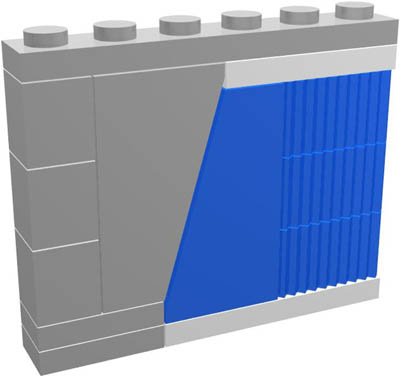

fig.6 - Train à Grande Vitesse - par David Vinzant \[8\]

**2) Décalage horizontal d’un demi tenon :**

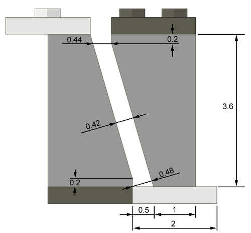

fig.7a - Calculs sur le décalage d’un demi tenon

fig.7b - Décalage d’un demi-tenon

L’écart entre les briques pentues est de 0.42 tenons et la hauteur est de 4.17 tenons. Ces valeurs permettent d’y glisser une plaque lisse de 1x4.  
Cette technique a été appliquée par Xavier Viallefont sur sa motrice de TGV.

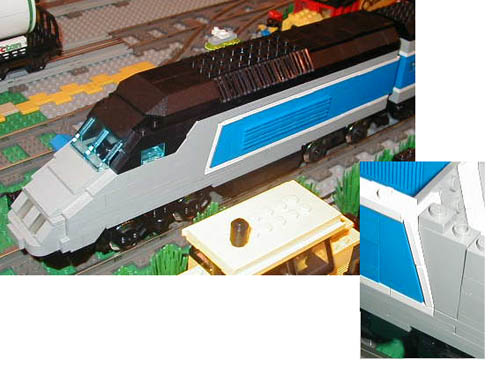

fig.8 - TGV - par Xavier Viallefont \[9\]

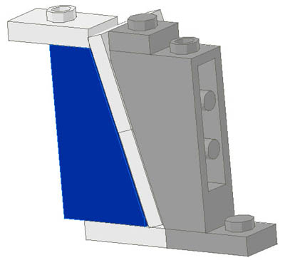

fig.9 - Décalage d’un demi tenon appliqué au motif du TGV

Le principal avantage de cette technique est qu’elle permet des motifs à trois couleurs et/ou des motifs en diagonal fin.

**3) Décalage horizontal d’un tenon :**

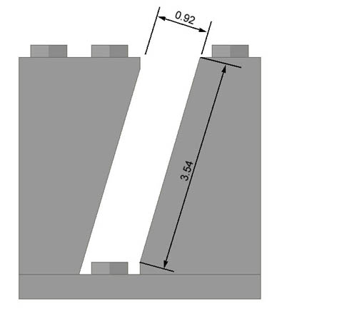

fig.10 - Décalage d’un tenon

L’écart entre les briques pentues est de 0.92 tenons. On peut y placer une plaque lisse emboîtée sur une plaque (0.8 tenons) avec une marge de 0.12 tenons. Voici la réalisation de James Mathis.

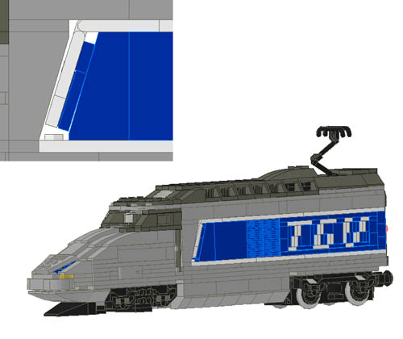

fig.11 - TGV Nord - par James Mathis \[10\]

**III) Conclusion**

Les briques pentues sont communément employées pour recréer les motifs diagonaux sur les trains LEGO® et les maquettes de TGV exposent des techniques avancées. Ces réalisations sont plus rigoureuses que ce que permet l’usage d’autocollants par exemple.

Il y a quelques inconvénients mineurs :

**–** Les écarts peuvent sembler trop importants,  
**–** Le choix de valeurs d’angles reste limité,  
**–** Le choix de la largeur du motif diagonal est limité.

D’autres solutions s’offrent à nous qui mériteraient d’être étudiées :

**–** Des plaques d’angles placé en SNOT,  
**–** Des plaques d’angles couvrant un fond uniforme.

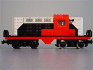

**IV) Webographie**

\[1\] **Tony Hafner**, _Woodhall Express_, [Site personnel](http://www.hafhead.com/lego/mytrain/woodhall/index.html)

\[2\] **Samarth Moray**, _Indian Railways in bricks_, [The Indian Railways fan club](http://www.irfca.org/articles/samarth/model-bricks2.html)

\[3\] **Mark Bellis**, _66001 EWS_, [Galerie BrickShelf](http://www.brickshelf.com/cgi-bin/gallery.cgi?i=1097379)

\[4\] **Esben Kolind**, _Danish Inter City_, [Galerie BrickShelf](http://www.brickshelf.com/cgi-bin/gallery.cgi?f=25892)

\[5\] **Esben Kolind**, _Queensland Tilt train_, [Galerie BrickShelf](http://www.brickshelf.com/cgi-bin/gallery.cgi?f=113761)

\[6\] **James Mathis**, _Acela_, [Galerie BrickShelf](http://www.brickshelf.com/cgi-bin/gallery.cgi?i=18127)

\[7\] **James Mathis**, _Amtrak Cascades_, [Galerie BrickShelf](http://www.brickshelf.com/cgi-bin/gallery.cgi?f=2061)

\[8\] **David Vinzant**, _TGV (Train à Grande Vitesse)_, [Galerie MOCPages](http://www.mocpages.com/moc.php/7233)

\[9\] **Xavier Viallefont**, _TGV Version 2_,[Galerie FreeLUG](http://gallery.freelug.org/album31)

\[10\] **James Mathis**, _TGV Nord_, [Galerie BrickShelf](http://www.brickshelf.com/cgi-bin/gallery.cgi?f=28106)

\[11\] **Tony Hafner**, _EMD GP7_, [Site personnel](http://www.hafhead.com/lego/mytrain/gp7/index.html)

LEGO® est une marque de la société LEGO.  
Veuillez visiter le [site officiel](http://www.lego.com/)
