Cet article donne quelques astuces en français concernant l’installation, la configuration et l’utilisation du logiciel gratuit de stop-motion Anasazi.

## Installation

Le logiciel gratuit (et petit) de stop-motion peut être téléchargé à partir de cette page (en anglais) :

[article sur animateclay](http://www.animateclay.com/modules.php?op=modload&name=Sections&file=index&req=viewarticle&artid=24&page=1)

Je vous conseille aussi fortement de télécharger l’update qui est sur la même page (en bas de la page). Cet update ajoute une boite de dialogue de confirmation lorsque vous annulez la sauvegarde et lorsque vous quittez Anasazi sans avoir enregistré votre travail [^1].

Si vous êtes perdu dans l’article en anglais que je vous ai indiqué ci-dessus, voici les liens directs vers les deux fichiers à télécharger (faites un clic droit puis "Enregistrer la cible sous") :  
**–** Anasazi : [smafull.exe](http://www.animateclay.com/anasazi/smafull.exe)  
**–** L’update : [SMA0101.zip](http://www.animateclay.com/anasazi/SMA0101.zip)

Une fois ces deux fichiers téléchargés, exécutez **smafull.exe** qui est un zip auto-extractible. Vous pouvez extraire les fichiers dans le répertoire que vous voulez, Anasazi n’a aucune exigence de coté là.

Ensuite dézippez **SMA0101.zip** au même endroit. Cela va écraser le fichier sma.exe (confirmer le remplacement).

Voilà ! C’est tout ! Anasazi est maintenant installé sur votre ordinateur, pour le lancer, il suffit de double-cliquer sur l’exécutable **sma.exe**.

**Astuce** : je vous conseille de créer un raccourci sur votre bureau vers l’exécutable sma.exe, afin de pouvoir le lancer plus facilement.

## Configuration

**Choisir la source**

Anasazi fonctionne avec tout type de matériel de capture de vidéo pourvu qu’ils soient correctement installés et reconnus par Windows. Cela inclu bien évidemment les webcams, mais aussi les cartes d’aquisition vidéo, et peut-être aussi certaines camera DV pilotables par Windows (cela dépend si votre camera DV est reconnue par Windows comme étant un matériel de capture de vidéo). Le plus important vous l’aurez compris est que votre matériel soit correctement reconnu par Windows, car Anasazi passe par Windows pour piloter votre matériel de capture de vidéo.

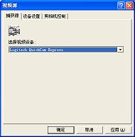

Si vous avez plusieurs matériel de capture vidéo, vous devez préciser à Anasazi lequel vous allez utiliser. Pour cela allez dans le menu **Options** puis **Source...**. Cela ouvre une fenêtre Windows dont le contenu dépend en partie de votre matériel et des pilotes (drivers) installés [^2]. A titre d’exemple je vous ai mis ci-contre la fenêtre que j’obtient sur l’ordinateur que j’utilise actuellement et sur lequel est installé Windows XP en chinois.

Toutefois, il est probable qu’il y ait dans cette fenêtre un onglet qui s’intitule **"Source"** contenant une liste déroulante vous permettant de choisir le matériel que vous désirez utiliser [^3]. Le reste des onglets permet généralement de régler la luminosité, le contraste, la balance des blancs, etc...

**Astuce :** Il vaut mieux régler ces paramètres après avoir éclairer votre scène, sous peine de devoir refaire les réglages.

**Astuce :** Si votre webcam a une option d’ajustement automatique du contraste, je vous conseille de la désactiver, car sinon vous aller avoir des changements de luminosité d’une image à l’autre qui donneront une impression de clignotement disgracieux sur l’animation finale.

**Configurer le format de la vidéo capturée**

Une fois que vous avez configuré la source correctement, vous devez aussi configurer le format de la vidéo que vous voulez obtenir. Pour cela aller dans le menu **Options** puis **Capture Option...**. Cela ouvre la fenêtre ci-dessous :

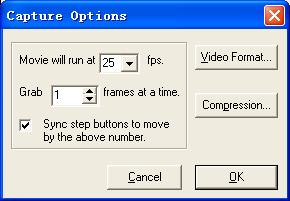

Les deux valeurs numériques à régler ici nessécitent des explications :

**–** "Movie will run at X fps." = "Le film se jouera à X images par seconde" : Si vous réglez ce paramètre sur 10 par exemple, Anasazi va s’arranger pour que le film dure 1 seconde quand vous aurez pris 10 images. Pour faire cela Anasazi duplique les 10 images de façon équitable pour en obtenir 25 (ce qui veut dire que parmi ces 10 images certaines seront en 2 exemplaires et d’autres en 3 exemplaires). Voici ce que ça donne avec un schéma :

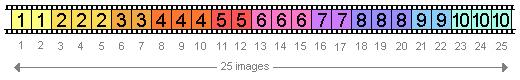

**–** "Grab X frames at a time." = "Prendre X images à la fois" : Cela indique que lorsque vous aller appuyer sur le bouton pour capturer une image, Anasazi en prendra X à la suite donc à priori toutes identiques.

**Attention** car ces deux paramètres se complètent : Par exemple si vous réglez les deux paramètres à 10, lorsque vous allez cliquez sur le bouton pour capturer une image, en fait vous allez en prendre 10, et comme c’est configuré pour se jouer à 10 images par seconde, Anasazi va les dupliquer équitablement pour en faire une seconde : Au final à chaque clic vous aurez une seconde d’images identiques, ce qui est sans intérêt.

**Astuce :** Le réglage que je vous conseille, c’est de _laisser le deuxième paramètre à 1_ (réglage par défaut), et de n’ajuster que le premier paramètre selon vos désirs.

**Astuce pour utilisateur confirmé :** Le réglage ultime que je vous conseille, c’est de mettre 25 au premier paramètre et 1 au second. Ainsi aucune image ne sera dupliquée, et vous ne prendrez qu’une seule image à chaque clic. Bien sur, si vous rejouer l’avi tel quel, l’animation est trop rapide, mais ensuite vous pouvez ralentir à votre guise la vidéo dans votre logiciel de montage, ainsi vous découplez la prise de vue, de la vitesse de lecture.

Une fois réglés ces deux paramètres il n’y a plus qu’à préciser la taille de la vidéo que vous voulez capturer ainsi que le format de compression qu’Anasazi doit utiliser pour générer l’avi.

**–** Pour spécifier la taille de la vidéo, il suffit de cliquer sur le bouton **"Video Format..."**. Cela ouvre une fenêtre Windows [^4] vous permettant de choisir la taille et le format des couleurs (je vous conseille le 320x240 ou le 640x480 en RGB32)

**–** Pour spécifier le format de compression, il suffit de cliquer sur le bouton **"Compression..."**. Cela ouvre une fenêtre Windows [^5] vous permettant de choisir le format de compression (Je vous conseille de choisir le format _Trames complètes (Non compressé)_ afin de ne pas perdre de qualité sur les fichiers originaux, ensuite vous compressez le film final à l’aide du logiciel de montage).

Enfin juste un mot pour dire que l’on peut aussi configurer les raccourcis claviers des diverses fonctionnalités dans le menu **Options** puis **Preferences...**.

## Utilisation

L’interface d’Anasazi est composée de deux fenêtres, l’une affichant la vidéo que vous êtes en train de capturer (qui peut être redimensionnée indépendament de la taille de la vidéo capturée) et l’autre contient les boutons permettant d’utiliser le logiciel. C’est sur cette dernière que je vais m’attarder :

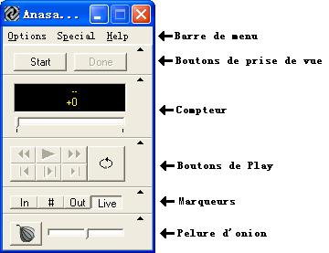

**Astuce :** Un truc à savoir absolument pour vous éviter de perdre des heures de travail [^6] : Anasazi enregistre sur le disque dur la vidéo que vous êtes en train de capturer à chaque nouvelle image. Donc s’il y a une coupure de courant, un crash Windows ou autre problème de ce genre, ne croyez pas votre travail perdu. Anasazi enregistre la vidéo en gros porc à la racine de votre disque dur c : par défaut [^7]. Ce fichier s’appelle **cx103.avi** et est directement au format avi. Il suffit donc de le copier et le renommer dans un endroit sur. Son nom ne change pas, donc il faut le récupérer avant de relancer une nouvelle capture (et de plus il est effacé une fois que la capture est terminée).

* * *

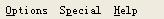

La majorité des fonctionnalités qui sont accessibles par les menus ne sont pas très importantes, hormis ce qui concerne la configuration et que nous avons vu au chapitre précédent. Donc une fois que vous avez fini votre configuration, à priori vous n’aurez plus besoin de toucher aux menus.

* * *

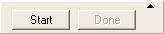

Juste en dessous des menus se trouvent les boutons de prise de vue. Il faut cliquez sur **Start** pour commencer une nouvelle animation. Attention le bouton Start capture une première image, donc assurez vous que votre scène est prète pour la première image avant de cliquer sur Start !  
Le bouton Start se transforme alors en **"Grab"** qui signifie "Prendre" et qui sert donc à capturer une nouvelle image. Bouger les élements de votre scène et appuyer sur **Grab** quand vous êtes prêt pour une nouvelle image, et ainsi de suite.

Une fois que vous avez fini, il suffit de cliquez sur le bouton **"Done"** juste à coté. Cela ouvre une boite de dialogue vous permettant de sauvegarder votre vidéo avec le nom voulu à l’endroit voulu.

Voilà ! Théoriquement avec ces deux boutons vous pouvez faire un film en stop motion... Mais il y a d’autres fonctionnalités interressantes dont il serait dommage de se priver ! En tout premier lieu, la fonctionnalité de **pelure d’onion**.

* * *

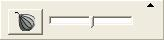

La fonctionnalité de pelure d’onion permet de surimposer la dernière image prise avec ce que voit actuellement votre webcam, c’est à dire le **"live"**. Pour activer cette fonctionnalité il suffit d’appuyer sur le bouton

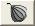

(idem pour la désactiver).

La slidebar (i.e. ascenceur horizontal) qui est juste à coté permet de faire varier le pourcentage de mélange des deux images. Si le bouton est au milieu, alors les deux images sont melangés à 50/50. Si vous poussez le bouton complètement à gauche, alors vous avez 100% de l’image précédente et 0% du live, au contraire si vous poussez le bouton complètement à droite, alors vous avez 0% de l’image précédente et 100% du live.

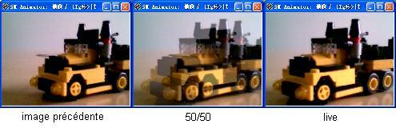

Cette fonctionnalité est très pratique pour vérifier la fluidité de votre animation. Cela permet de voir si les deux images ne sont pas trop diférentes ou si votre personnage n’a pas fait un trop grand déplacement. Cela sert aussi dans le cas où vous avez malencontreusement fait bouger la camera avec vos gros doigts alors que vous étiez en train d’animer vos personnages. Avec la pelure d’onion, vous pouvez replacer la camera en faisant correspondre parfaitement le décor qui n’est pas censé bouger.

* * *

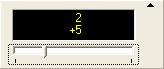

Cette partie de l’interface est le compteur d’images déjà capturées. Le chiffre du bas, à coté du + indique le nombre total d’images capturées (en l’occurence 5 dans notre exemple). Au départ il vaut +0, et quand on clique sur **Start** il passe à +1.

Le slider (ascensseur horizontal) juste en dessous permet de se déplacer dans ce qu’on a capturé jusqu’ici. Le chiffre du haut indique l’image que l’on est en train de visionner actuellement et correspond donc à la position du slider.

Si c’est le **live** qui est affiché, alors le slider est completement à droite, et le chiffre du haut est remplacé par **\- -**

* * *

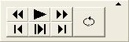

Ces boutons servent à naviguer dans ce qu’on a déjà capturé pendant le processus de capture ! En effet un des points forts d’Anasazi est qu’on peut visionner l’animation qu’on est en train de réaliser, avant de l’avoir terminée.

Voici la signification des différents boutons :  
**–** 

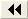

Sert à aller à l’image précédente  
**–** 

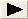

Sert à jouer la vidéo du marqueur **in** au marqueur **out**, ou du début à la fin si on n’utilise pas les marqueurs (voir les marqueurs plus bas)  
**–** 

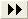

Sert à aller à l’image suivante  
**–** 

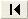

Sert à aller au début  
**–** 

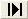

Sert à jouer la vidéo du début à la fin  
**–** 

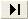

Sert à aller à la fin  
**–** 

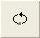

Sert à passer en mode boucle : si le bouton est enfoncé et que vous cliquez sur un des deux boutons play, la vidéo se joue en boucle en marquant une pose sur le **live** [^8]

* * *

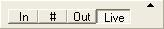

Cet élément d’interface sert à gérer les marqueurs. Les marqueurs est une fonctionnalité pas franchement indispensable, mais je vais vous en expliquer le fonctionnement histoire d’être exhaustif. Personnelement je ne les utilise pas.

Un marqueur est une sorte de repère que l’on peut placer sur une image de la vidéo qu’on est en train de capturer. On dispose de trois marqueurs : **in**, **#** et **out**. Le marqueur **#** peut être placé où bon vous semble pour repérer une image clef dans votre animation (par exemple le moment où votre personnage se met à sauter...). Les marqueurs **in** et **out** peuvent aussi être placés où vous voulez, mais ils servent aussi à marquer le début et la fin de ce qui sera joué si vous appuyez sur le bouton

 [^9].

**Attention** les marqueurs restent valides d’une capture à l’autre, ce qui à mon avis est un bug. Le seul moyen de réinitialiser les marqueurs est de fermer puis relancer Anasazi.

Pour positionner un marqueur, il faut d’abord choisir l’image que l’on souhaite marquer (avec le slider en dessous du compteur et/ou avec les boutons

et

), puis faites un clic droit sur le marqueur et choisissez **Mark as _X_ Point**. Ensuite pour revenir ultérieurement à cette marque, il suffit d’enfoncer le bouton correspondant.

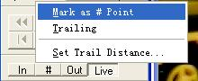

Enfin, et c’est peut-être le seul truc utile avec les marqueurs, vous pouvez poser un marqueur relativement à la fin de la vidéo. Par exemple si vous poser le marqueur **in** à 10 images de la fin, chaque fois que vous cliquerez sur le bouton

vous ne verez que les 10 dernières images capturées [^10]. Pour faire cela, dans le popup menu ci-dessus, cochez **Trailing** et choisissez **Set Trail Distance...**, cela ouvre une boite de dialogue vous permettant de régler le nombre d’images à partir de la fin ou se positionnera le marqueur.

Le bouton **live** permet de revenir au live après s’être déplacé dans la vidéo. Un autre moyen de revenir au live est de mettre le slider complètement à droite (ou de cliquer sur

) puis de cliquer sur

.

[^1]: Un clic d’inadvertence sur la croix de fermeture de la fenêtre est si vite arrivé !

[^2]: La fenêtre appartient à Windows et non à Anasazi, c’est pour cela qu’elle est dans la langue dans laquelle à été installé Windows, donc surement en français si vous lisez ce tutorial.

[^3]: Dans mon exemple, il n’y a qu’une seule webcam d’installée, on ne voit donc que _Logitec QuickCam Express_ dans la liste déroulante.

[^4]: Fenêtre n’appartenant pas à Anasazi.

[^5]: Fenêtre n’appartenant pas à Anasazi.

[^6]: Oui, je dis bien des heures, car à raison de 1 minute pour chaque prise de vue, si votre animation fait 60 images, cela fait déjà une heure de travail ! Et oui la stop-mo c’est long ! :-)

[^7]: Il est possible de spécifier un autre lecteur pour l’enregistrement de ce fichier de travail, mais pas de répertoire, ce sera toujours à la racine du lecteur. Pour cela il faut aller dans le menu _Options_ puis _Preferences..._, onglet _Files_.

[^8]: Le temps de pause est réglable : aller dans le menu _Options_ puis _Preferences..._, onglet _Looping_，le temps de pause est en millisecondes.

[^9]: Si vous positionnez le marqueur _in_ après le marqueur _out_ la vidéo sera jouée à l’envers.

[^10]: Encore que cette fonctionalité n’est vraiment utile que si l’animation est très longue.
