On référence aujourd’hui plus de 100 couleurs différentes parmi les pièces LEGO® avec des variantes parfois à peine décelable. A cela s’ajoute le fait que les noms associés à ces couleurs varie suivant la source (LEGO, Peeron, BrickLink). Il est donc temps de nous attarder un instant sur quelques unes de ces couleurs afin de faire le point.

**Les couleurs historiques.**

Commençons par...le début. Les premières couleurs qui ont existé sont sans doute parmi celles qui vous sont les plus familières. Outre le noir et le blanc, ce sont le bleu, le jaune et le rouge [^1]. Ces couleurs datant des années 50, sont inchangées depuis leur création. Elles étaient reproduites ensemble dans un encadré sur certaines boîtes ou notices comme ici sur la [315](http://www.peeron.com/scans/315-3/1).

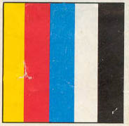

On constate que la palette de couleur est alors très restreinte. De plus, ces couleurs sont saturées (vives - contrairement aux pastels) et brillantes ce qui était logique étant donné que la cible produit sont les enfants.

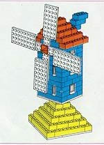

Le gris apparu à la fin des années 60 (roues, tile 1x2, quelques plaques) mais ce n’est qu’avec l’avènement de la série mythique "Space Classic" en 1978 qu’il prit son plein essor [^2]. La première brique 2x4 grise date de 1979 !!

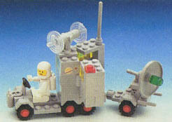

Le vert apparu timidement au début des années 70 (plaques et briques de base, arbres, volet) alors qu’il était déjà abondemment employé dans le Miniland de Billund par les LEGO designers [^3]. Il faudra attendre 1997 !! pour voir apparaitre une brique 2x4 verte. Ses apparitions restent limitées, son emploi peu abondant en dehors de quelques exceptions.

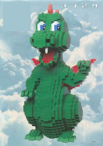

**Une couleur "à la demande"**

Une couleur apparait de manière sporadique, afin de répondre aux besoins d’un client particulier : [Maersk](http://www.maersksealand.com/HomePage/appmanager/). Apparut en 1974, le bleu Maersk permet de coller fidèlement au code couleur de cette marque de transport logistique par conteneurs.

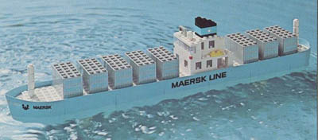

Cette couleur n’a pas pour but de faire partie du système mais au contraire n’apparait que dans les boîtes à la marque Maersk [^4].

La variété de pièces disponibles dans cette couleur est donc limitée [^5]. Pour celui qui voudrait construire avec, cela constitue donc soit un frein soit au contraire un challenge.

**D’autres couleurs "classiques"**

Pour compléter une palette de couleur restreinte, on voit apparaitre à la fin des années 70 le brun (brown) qui permet ainsi de reproduire des cheveux de minifigs mais qui ne prendra véritablement son essor qu’avec les série "châteaux" dans les années 80 et avec la série "Western" en 1996.

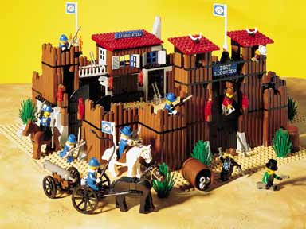

Le translucide blanc se voit adjoindre dans les années 70 le translucide jaune, vert et rouge. Les pièces qui en bénéficient sont les plus petites comme la plaque 1x1 et la brique ronde 1x1. Elles permettent de reproduire les parties lumineuses des modèles : phares, gyrophares, clignotants, feux, etc. surtout dans les sets Classic Space puis dans les sets villes.

Le gris foncé (dark grey) vient aussi renforcer le choix de couleur dans les années 80, de façon anecdotique au départ (accessoires minfigs : poubelle, pelle.) mais variés dans les années 90 et 2000 (castle, star wars, ville, Technic,...)

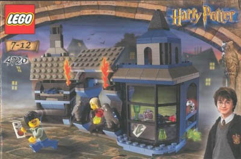

On attendra le début des années 90 pour découvrir le beige (tan) grâce au thème pirate, couleur qui sera adoptée successivement par le thème western, adventurers et Star Wars, le tan recréant assez bien le sable des déserts ou des plages et les pierres calcaires. En 2000, le tan est courant et peu de thème ne s’en sont pas emparé.

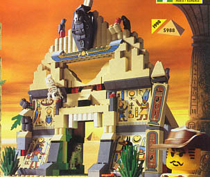

L’orange est récent (1998) et déjà relativement bien répandu (plus de 250 sets en contiennent). On note que les séries "Artic" et "Island Xtreme Stunts" sont bien pourvues ainsi que les sets "halloween" telle que la ["citrouille"](http://www.bricklink.com/catalogItem.asp?S=3731-1). Plus récemment les X-pods et le racer ["flame glider"](http://www.bricklink.com/catalogItemPic.asp?S=8641-1) sont une bonne source de petites pièces orange.

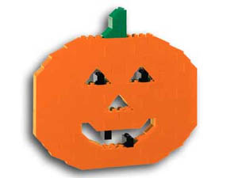

Les translucides noir (fumé), vert, bleu et bleu clair servent principalement pour faire des vitres et des pare-brise. Ils sont appliqués de manière logique à de nombreuses pièces "minces" comme les "panels".

**Les produits pour les filles**

Le jeu LEGO&reg ; est un jeu de construction. En cela il s’avère orienté « garçon ». Toutefois la cible « fille » n’est pas oubliée et des produits plus ciblés apparaissent par exemple avec le thème Paradisa, Scala, Belville ou Clikits. C’est l’occasion de voir apparaître de nouvelles couleurs :

Paradisa fait la part belle au rose (pink) dès 1992. Le vert clair (light green) apparait aussi dans cette série pour les plaques de base.

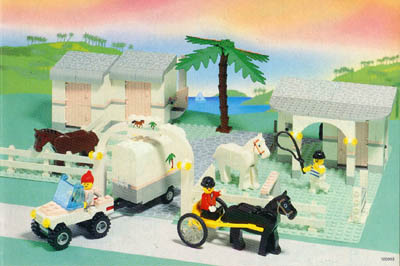

Dans la même logique, le thème "Belville" propose en plus un rose foncé (dark pink) un vert moyen (medium green), un violet pâle (light violet) et un jaune pâle (light yellow) en 1994. [^6]

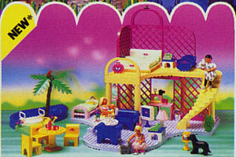

Les Clikits comporte beaucoup de couleur "eau" (aqua), bleu pâle (light blue), turquoise pâle (light turquoise) et de nombreuses couleur en translucide.

**Des couleurs très spécifiques**

Nous avons pour le moment aperçu à peine plus de 20 couleurs sur plus d’une centaine. Quels sont ces autres couleurs ?

Ce sont souvent des couleurs récentes (post 90) ayant un usage très spécifique, principalement présent dans une seule série précise et qui ne concerne que quelques dizaines de pièces différentes.

**–** Le gris très clair (very light gray) est produit pour les plaques 1x1 des sets "mosaïques"

**–** Le rouge Fabuland , comme son nom l’indique, n’apparait que dans la série des Fabuland.

**–** La couleur de la chair des personnages : "Nougat" pour les set Dora, "Flesh" pour les minifigs depuis l’abandon de la couleur jaune.

**–** Le rouge foncé (dark red) : apparait surtout dans ["Prehistoric creatures"](http://www.bricklink.com/catalogItem.asp?S=4507-1) et le ["Maersk Sealand Container Ship"](http://www.bricklink.com/catalogItem.asp?S=10152-1) mais aussi dans la série "Artic Alpha Team", "Knights Kingdom II" et "Dino Attack"

**–** Le vert foncé (dark green) est familier des fan de Bionicle mais aussi de tous les fans de train qui possèdent la ["BNSF"](http://www.bricklink.com/catalogItem.asp?S=10133-1)

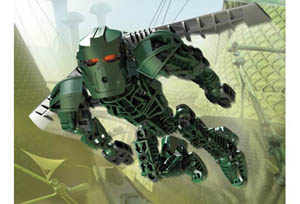

**–** Le bleu foncé est représenté dans la gamme Bionicle. On en trouve un peu dans les sets "Orient Expedition". Cette couleur est notablement utilisée pour des torses de minifigs.

**–** Le bleu sable (sand blue) est utilisé dans les "Artic Alpha Team" et dans les Star Wars, notamment le [Droid fighter](http://www.bricklink.com/catalogItem.asp?S=7252-1)

**–** Le rouge sable (sand red) est présent dans quelques rares  
Star Wars mais surtout en sachet vrac sur le ShopAThome.

**–** Le vert sable (sand green) est caractéristique des sets Harry Potter car c’est la couleur des toits de cette série. c’est aussi la couleur de la [Statue de la liberté](http://www.bricklink.com/catalogItem.asp?S=3450-1) et de la tête de [Yoda](http://www.bricklink.com/catalogItem.asp?S=7194-1).

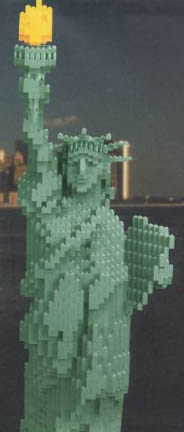

**–** Le bleu violet (violet blue) est une nouveauté des "Knight Kingdom II".

**–** Le beige foncé (dark tan) est anecdotique, même dans les "Kinghts Kingdom II" qui offrent quelques plaques.

**–** L’orange pâle brillant (bright light orange)est familier uniquement de quelques fan de Bionicle tout comme le jaune pâle brillant (bright light yellow) et le magenta sont familier de quelques fans de Belville.

**–** Le lime (un vert plutôt pâle) est au départ une couleur Duplo (86) dont s’emparèrent les Bionicles en 2001. Il apparait de manière disparate et discrète dans environ 70 sets sauf dans la récente ["Nitro Menace"](http://www.bricklink.com/catalogItem.asp?S=8649-1) ou il est prépondérant tout du moins en ce qui concerne les pièces Technic.

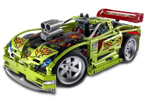

**Plus que des couleurs**

Au dela des couleurs, des pièces présentent des effets de lumière : métallique, perlescente ou qui brillent dans le noir, faisons un rapide inventaire.

**–** Les couleurs chromées

**–** "Or" :

-   ustensiles de minifig (piecettes, épée, visière de casque, trompette, clefs)
-   La plaque lisse 1x2 est aussi bien connu dans cette couleur (lingots).
-   Les nord-américains on vu arriver cette année pour le cinquantième anniversaire du System la brique 2x4 dorée.

**–** "Argent" :  
Cette couleur permet surtout de représenter les chromes des véhicules (corne de klaxon, échappements, calandre, réservoir, optique de phare).

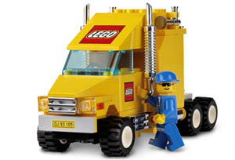

**–** Les couleurs métalliques et nacrées (pearl)

Sont utilisés surtout pour des pièces de grandes tailles, dans les thèmes Technic ou Bionicle, par exemple pour des pièces de "carrosserie". La ["Silver Champion"](http://www.bricklink.com/catalogItemPic.asp?S=8458-1) en est un bel exemple.

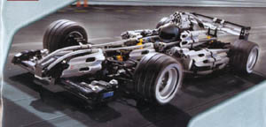

**–** Les couleurs qui brillent dans l’obscurité

C’est un blanc qui brille d’une couleur jaunâtre. Il est utilisé principalement pour les disque à lancer Bionicle et les minifigs "fantômes".

**Un changement surprenant**

En 2004, la société LEGO&reg ; décide de modifier trois des couleurs. Le gris clair, le gris foncé et le marron sont définitivement modifiés pour des versions tirant un peu vers le bleu pour les gris et un peu vers le rouge pour le marron. Cette décision est très mal acceptée par les fans adultes qui souvent ont constitué de très importants stocks de ces couleurs. Quelques mois après, la société LEGO&reg ; décide de publier une [liste](http://news.lugnet.com/lego/?n=2605) des couleurs qui resterons immuables.

**Les noms des couleurs**

Le monde Internet des fans adultes est en très grande partie en langue anglaise. Les sites qui inventorient les pièces sont en langues anglaises : Peeron, BrickLink. Une traduction en plusieurs langues vous est cependant offert sur cette [page](http://www.isodomos.com/ColorTree/Translation).

Quelques remarques sur ces traductions :

**–** le "gris pâle" est plus souvent nommé simplement "gris".

**–** "Sand" à été traduit par "sable" ce qui me parait regrettable. Cet adjectif permet d’indiquer que la couleur n’est pas clinquante, qu’elle est délavée.

**–** "Lime" est traduit par....lime. "Citron vert" ou "tilleul" serait judicieux.

**–** "Teal" est traduit par "Sarcelle" dont j’ai appris qu’il s’agissait d’un canard partiellement vert.

**–** "Aqua" est traduit par...."Aqua". Etant donné que cela est une racine latine commune, c’est aussi bien venu que "eau".

Notons qu’en anglais, les noms varient suivant les sources, plus particulièrement entre les dénominations "LEGO" et les dénominations "Peeron" et "BrickLink". Vous pouvez le voir sur cette [liste](http://www.peeron.com/inv/colors). On constate que les nouveaux gris bleuies sont maintenant dénommés "Stone" (Pierre).

**Le futur**

On pourrait penser que le nombre de couleur ayant toujours augmenté, il devrait en aller ainsi dans le futur.

Il semble au contraire que pour des raisons économiques, la société LEGO s’engage dans une rationnalisation de la palette des couleurs produites.

**Pour aller plus loin**

Je me suis basé pour cet article principalement sur :

Le [guide](http://www.bricklink.com/catalogColors.asp)  
des couleurs BrickLink

Vous pouvez aussi consulter la section « [couleur](http://news.lugnet.com/color/) » de Lugnet

**Crédits**

Les photos illustrant cet article sont la propriété du groupe LEGO®

[^1]: ainsi que le translucide blanc

[^2]: Même les châteaux étaient en jaune plutôt qu’en gris auparavant ;-)

[^3]: Il est à noté qu’outre le vert, le beige (tan) et le gris foncé (dark grey) était utilisé par les LEGO desginer pour le parc de Billund avant leur apparition dans les boites du commerce, comme le montre [ces pièces](http://www.brickshelf.com/cgi-bin/gallery.cgi?f=95292) "pat pend"

[^4]: On retrouve de manière anecdotique cette couleur dans des sets DUPLO

[^5]: 55 différentes en vente sur BrickLink à comparer aux 2640 en blanc

[^6]: On retrouve le jaune pâle dans des sets Duplo Dora de 2004 mais surtout dans la série Island Xtreme Stunts en 2002
