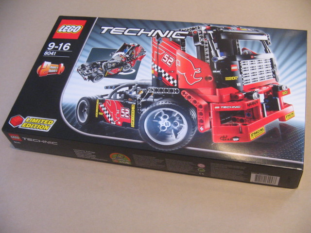
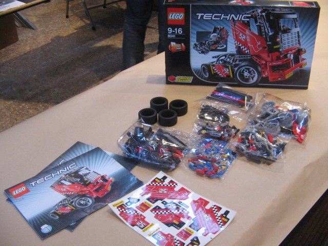
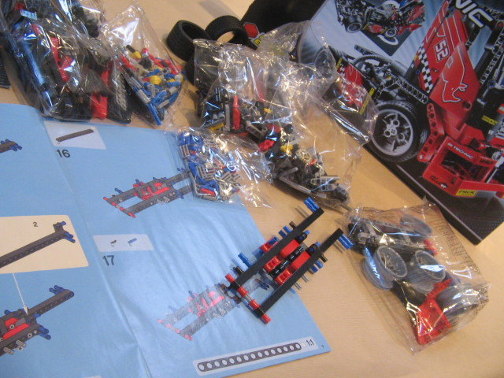
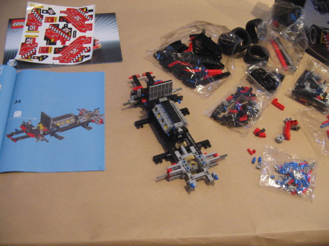
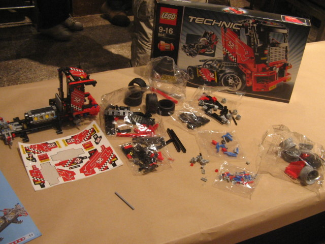
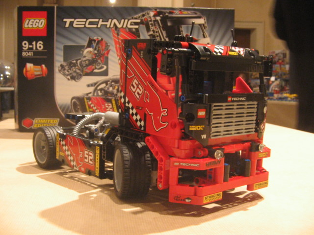

Le plus frappant pour un camion de course, c’est qu’il n’est pas du tout conçu pour ça. Sauf qu’en fait, on pouvait dire cela au début des courses de camions en France, dans les années "80".

Aujourd’hui, c’est une erreur. Les équipes existantes travaillent sans cesse à l’amélioration de leurs camions. Ils n’ont plus rien à voir avec ceux que l’on croise sur la route. Les Techniciens LEGO l’ont bien compris. C’est pour cela qu’ils nous proposent dans la gamme Technic un vrai camion de course.

On y trouve le moteur en position centrale, juste derrière la cabine, comme les vrais et en prime avec un beau V8. Des bonbonnes de réserves d’eau et un gros radiateur de refroidissement. Du coup la cabine est fixe, pas besoin de la relever.

Voilà pour la présentation, en avant pour la construction !

J’ai commandé la boîte sur le Shop Lego en ligne, pratiquement dès sa mise en vente. Je voulais un peu l’exclusivité, de plus, il y a écrit "Limited edition", je ne voulais pas rater ça ! J’ai monté la boîte à l’exposition Festibriques, devant un public curieux et doublement intéressé. D’une part parce que je montais une boîte et d’autre part, à cause du thème de la boîte.

La boîte LEGO est classique mais très jolie. Le camion en jette. Tout laisse augurer une belle construction.

**La belle boîte de la bête !**

On entend bien bouger les pièces à l’intérieur. Ce qui veut dire qu’il reste de l’air dans la boîte. Peut être que c’est pour que le gros V8 respire !

A l’ouverture, on trouve deux livrets pour la notice, une superbe planche d’autocollants que j’ai collé (il va neiger !), les pneus qui se baladent et 7 sachets de pièces, non numérotés.

**Le contenu...**

La construction commence par le châssis, puis, en partant vers l’avant, la direction. Tout cela sans problème, sauf pour trouver les pièces. Comme je n’étais pas chez moi, je n’ai pas tout déballé. Les pièces sont restées dans leurs sachet. Il y a moins de risque de perdre quelque chose. Au début, il faut pas mal chercher. C’est un peu long, mais à force, on s’y retrouve, on sait ce que contiennent les sachets.

Les barres Technic sont repérées par leurs tailles. En plus, une vue à l’échelle 1 les représente sur la notice. On ne peut pas se tromper.

**Etape du châssis.**

On enchaîne par le moteur, bien visible une fois le camion fini. Il n’y a rien d’extraordinaire à ce moteur. C’est un Technic tout simple. Je le regrette un peu, car tout de même, pour de la course, il manque une bonne prise d’air et quelques pièces pour simuler un gros turbocompresseur. Surtout quand on voit la taille du pot d’échappement.

**Le V8 un peu dépouillé.**

Après avoir assemblé le pont arrière, en "métapièce et avec un nouveau différentiel, on passe au montage de la cabine. Et là, placement des grands autocollants. Pour le premier, argh, blocage, il n’y a aucun numéro pour les repérer. Mais bon, ils sont quand même bien reconnaissables. Deuxième angoisse, ils sont légèrement électriques et se plaquent tout seul sur la pièce ! Enfin, ils se décollent très bien. Tant qu’on ne les lâche pas complètement, on a droit à plusieurs tentatives. Ils sont très fins, très propres. On les distingue à peine une fois posés. En fait, je me plains, mais c’est un vrai régal à placer. Ils épousent parfaitement les pièces. Le rendu final en vaut vraiment le coup. En fait, ce que je n’aime pas, c’est quand un autocollant recouvre plusieurs pièces. Ce n’est pas le cas ici.

**La pose des autocollants.**

Le montage se poursuit sans problème, avec la suite de la cabine, les pare-chocs, la sellette qui sert de lest en réalité et enfin les roues. Au bout de trois heures de construction, la bête est prête à affronter d’autres concurrents.

Pour les regrets, il y a le moteur, mais je vous en ai déjà parlé. La cabine est un peu vide à l’intérieur. Il va falloir rajouter quelques plaques, pour le fond et pour cacher le vide du côté passager. La position des roues fait que le camion penche vers l’avant, alors qu’en réalité il est très bien équilibré. Du coup, c’est pas facile à piloter, par le dessus de la cabine. D’ailleurs, le volant intérieur est uniquement là pour faire beau !

Sinon, je ne suis pas déçu du tout par le rendu final ! On a un camion agressif, qui devrait faire bien peur au bitume. Les logos sont superbes, il y a eu de la recherche, j’adore le "smooth oil" ! C’est vraiment un chouette modèle, pour tous les fans de camions. On l’a examiné sous toutes les coutures avec Elvisnake et Ramoutcho (du forum SeTechnic), on n’a pas trouvé grand chose à ajouter. Mais cela pourra faire l’objet d’un autre article.

**Une gueule à tomber !!**
