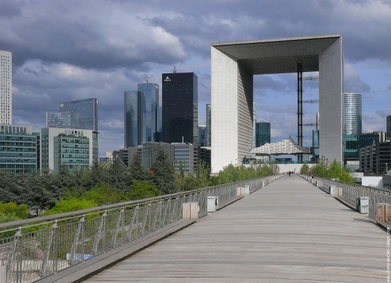
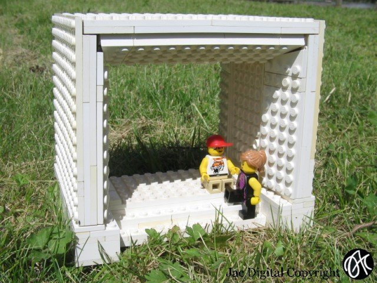

Trop grand le Cube, pas si sûr !

A force de construire des tours de plus en plus grande, il nous est venu l’idée du [quartier des affaires](/articles/le-quartier-des-affaires-freelug/) avec des buildings de toutes tailles. Au milieu de certains, s’ouvre une place, avec un parvis dallé, l’endroit idéal pour y placer des sculptures de toutes sortes. C’est là que m’est venue l’idée de refaire l’arche de la défense en réduction.

Je trouve ce bâtiment fascinant de par sa conception et sa taille imposante.

L’EPAD (Établissement public pour l’aménagement de la région de la Défense) lance donc en 1982 un concours international d’architecture. Ce concours réunit 424 projets anonymes venus du monde entier, dont quatre sont sélectionnés par l’EPAD et présentés au Président de la République de l’époque, François Mitterrand. C’est d’ailleurs lui qui inaugurera le bâtiment en 1989. C’est le projet de l’architecte danois Johann Otto von Spreckelsen et de l’ingénieur concepteur danois Erik Reitzel, qui proposaient de construire une grande arche, qui est sélectionné.

Des Danois dans le projet, il était un peu normal de reproduire ce bâtiment monumental en briques LEGO.

C’est un cube géant de 112m de hauteur. Les flanc sont recouverts de verre et de marbre et contiennent 35 étages de bureaux. On y trouve aussi un musée de l’informatique, un restaurant, un centre de congrès et d’expositions. De son toit on peut admirer la vue dont l’alignement de quelques monuments célèbres, arc de triomphe, Obélisque de la Concorde... Il y a eu quelques comparatifs sympathiques, car l’espace entre le bas du cube et le plafond est immense.

Des ascenseurs très discrets permettent d’accéder directement à la partie supérieure du cube, les côtés étant des bureau privées.

**Lumixane**

Photo provenant de la galerie de Lumixane : [http://www.fond-ecran-image.com/galerie-membre/membre-3957.html](http://www.fond-ecran-image.com/galerie-membre/membre-3957.html)

## Le mini cube en briques

Pour la construction du modèle en briques LEGO, je n’ai pas voulu empiler des briques de bases, car je voulais reproduire l’effet du cadre extérieur, euh, comme un cadre, comme le vrai d’ailleurs. J’ai donc opté pour des plaques verticales, soutenues par une charpente en poutrelles Technic.

Il fallait aussi pouvoir le traverser de part en part. J’ai donc construit quelques marches. Mais très peu par rapport au vrai...

Il m’était possible aussi de le rendre tout lisse, grâce à des pièces sans tenons 2X2 (tiles). Mais j’aime bien aussi voir les tenons apparents, même s’ils sont dans tous les sens.

Le plus important dans des réductions de ce genre c’est d’arriver à garder un air de famille. C’est à dire de faire en sorte que le bâtiment se reconnaisse. On ne peut pas prendre des côtes et compter le nombre de fenêtre. Il faut essayer de trouver les bonnes proportions. C’est ce qui m’a plu dans cette reproduction.

[Galerie photos.](http://photos.freelug.org/main.php/v/JAC/MOC/Batiment/Batimentdeville/titarche/)
