Xavier Viallefont a conçu un feu bicolore de train fonctionnel à l’aide de deux diodes et d’une résistance. Lors d’une rencontre régionale d’AFOLs chez lui, j’ai pu prendre quelques photos des différentes étapes du montage.

Tout d’abord il faut choisir deux briques 2x3. Vous pouvez choisir la couleur que vous voulez, généralement noire ou gris foncé, ici on utilisera des briques gris clair.

Les briques 2x3 sont de deux sortes, il y a les vieux modèles dont les tubes centraux sont sans renfort (à droite sur la photo), et les modèles plus récents qui possèdent des renfort latéraux (à gauche).

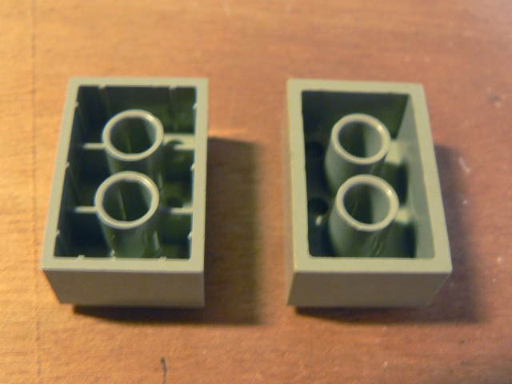

Nous aurons besoin au moins d’une brique ancien modèle afin d’avoir des tubes parfaitement lisse ce qui améliorera le rendu final.

On commence par découper le pourtour de la brique 2x3 ancienne pour ne garder que le dessus avec les tenons et les tubes centraux. Pour faciliter le travail, on peut construire un guide avec une plate (c’est plus simple) ou mieux à mon avis une demi plate de décalage. Voici un exemple de montage pour avoir une demi plate de décalage.

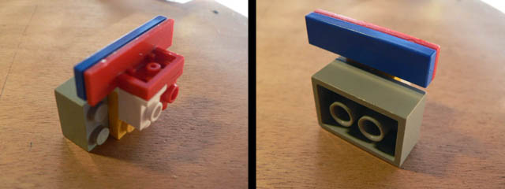

A l’aide d’un cutter et du guide, on peut marquer la ligne de découpe tout autour de la brique, puis on peut finir la découpe toujours au cutter mais sans le guide.

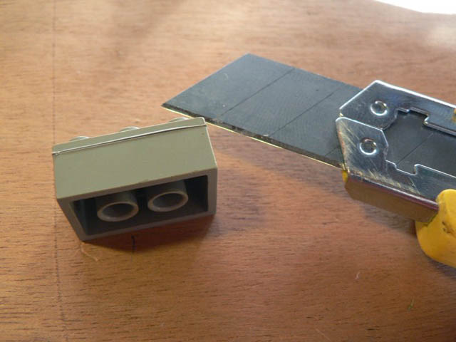

Une fois la découpe terminée, on peut fignoler en passant un petit coup de papier de verre fin.

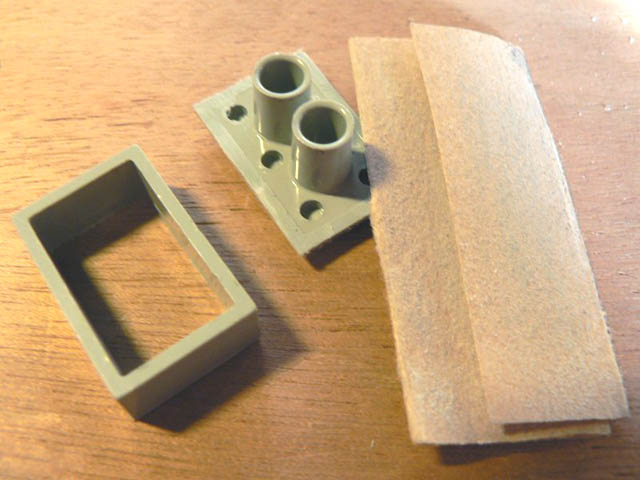

L’étape suivante est d’agrandir le diamètre intérieur des tubes et en même temps de percer un trou au fond. Le diamètre intérieur des tubes doit être agrandi car les diodes que l’on va utiliser font 5mm de diamètre. Cela se fait avec une perceuse/visseuse et une mèche de 5 mm. Faites tourner la mèche tout doucement, c’est du plastique, ça se perce facilement.

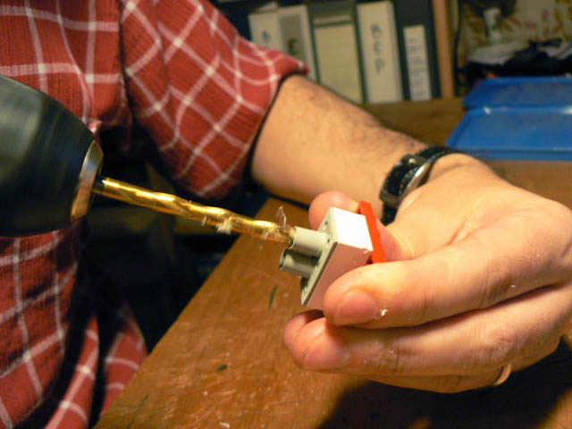

Le tube sert de guidage à la mèche, si bien que le trou du coté des tenons est net et parfaitement centré.

Bien sûr la brique 2x3 (blanche sur la photo) qu’on aura pris soin de mettre en dessous, sera abîmée par le mèche. Si vous ne voulez pas gaspiller de brique, vous pouvez utiliser l’autre brique 2x3 grise dont on devra de toute manière retirer les tubes par la suite.

Ensuite il suffit de couper les tubes en biais, simplement à l’aide du cutter (fiez-vous à votre instinct pour déterminer l’angle de coupe). La découpe des tubes est facilité puisqu’on a enlevé de la matière en perçant avec le mèche de 5mm. Il est donc fortement conseillé de faire ces deux étapes dans l’ordre. Désolé, je n’ai pas pris de photo de cette étape.

La première pièce est terminée, on peut s’occuper maintenant de la deuxième. Il faut tout d’abord enlever les tubes intérieurs, car il faut de la place pour mettre la résistance. On commence par donner des coups de cutter et on finit en arrachant les morceaux avec une pince.

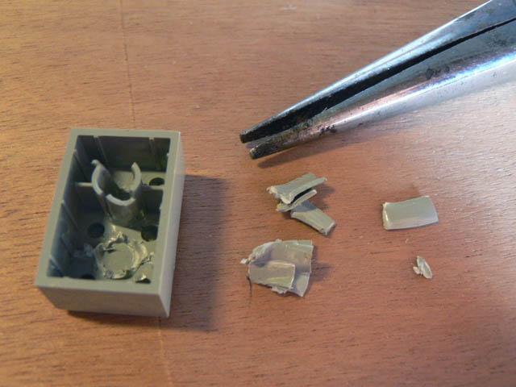

On pourrait se contenter de s’arrêter là pour cette pièce, mais je trouve que le feu résultant est un peu trop épais, aussi ai-je préféré enlever une plate d’épaisseur à la brique. Pour cela, c’est assez simple, on procède de la même façon que pour la première brique, au cutter et à l’aide d’un guide.

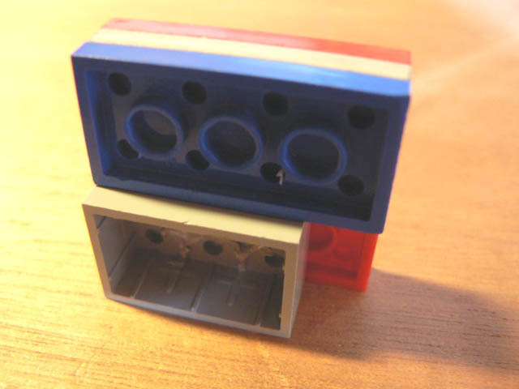

Une fois la découpe circulaire finie, il faut faire une encoche sur un des coté afin de laisser passer le fil. Voici la pièce une fois finie.

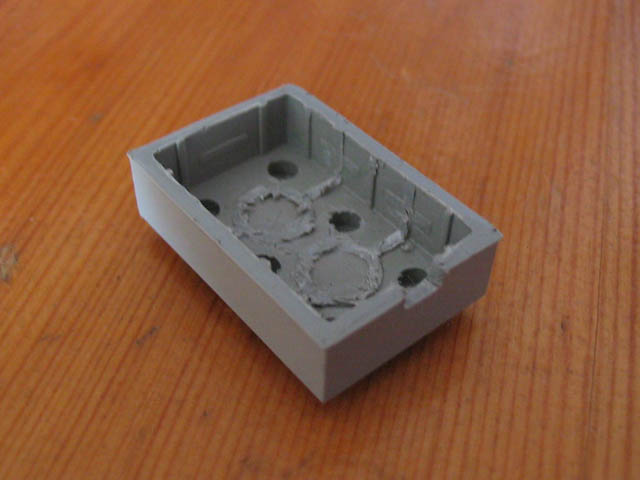

Sur la photo suivante, on peut voir les pièces détachées : les deux diodes de couleur rouge et verte, la résistance et les deux briques 2x3 usinées. On va maintenant passer on montage électronique.

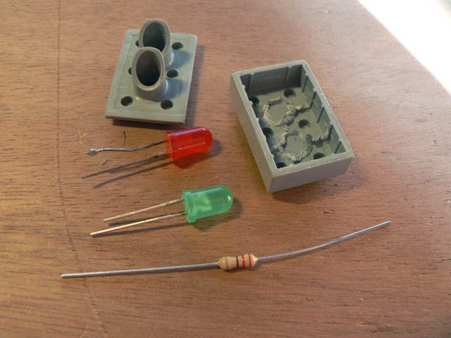

A l’aide d’une pince plate, on enfiche par l’arrière les deux diodes en veillant à croiser les polarités (à savoir ne pas mettre les méplats des deux diodes du même coté).

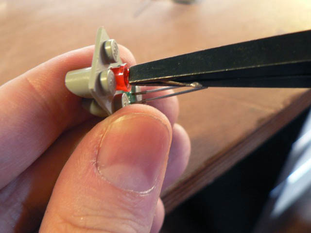

Puis on replie les pattes de l’une des diodes sur l’autre, puisqu’on va les souder en parallèle.

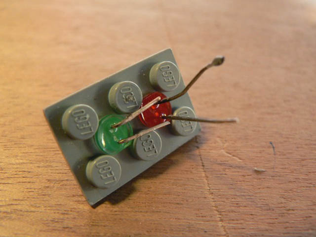

On soude ensuite la résistance en série.

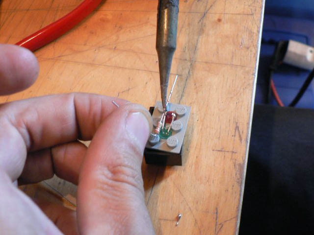

Pour finir, il faut couper un câble électrique LEGO en deux (comme cela, pour ne pas gâcher, vous pourrez faire deux feux), le dénuder et souder un fil à la résistance et l’autre à l’autre patte de la diode.

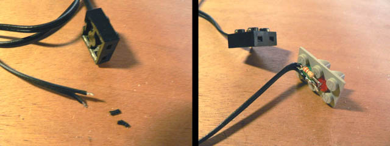

Ci-dessous on peut voir le montage en gros plan, et le feu sur le point d’être terminé.

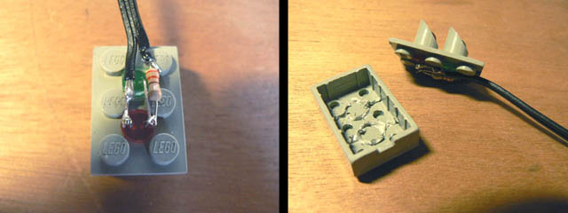

On n’est pas obligé de coller les deux pièces en plastique, cela tient à peu près bien tout seul. En ne les collant pas, cela permet de faire sortir le fil en haut ou en bas selon les besoins (selon que le feu sera placé sur un pylône ou sur un portique par exemple).

Voici le résultat final :

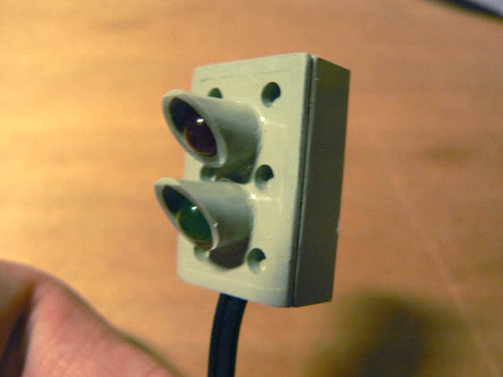

Enfin pour finir, il ne reste plus qu’à tester le feu à l’aide d’un transformateur de train. Si le courant passe dans un sens, le feux est vert, dans l’autre il est rouge.

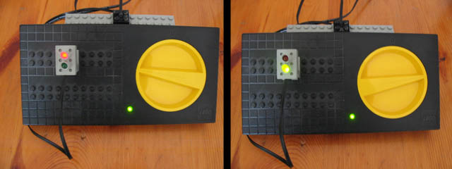

A vos fers à souder !

**Avertissement** Enfant, ne faites pas cette manipulation. Demandez à un adulte de vous aider. Les auteurs ne sauraient être tenu responsables de blessure éventuelle et/ou de dommage provoqué par de mauvais branchements électriques.
