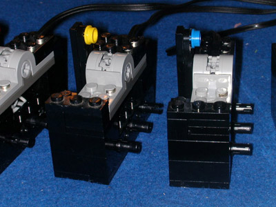
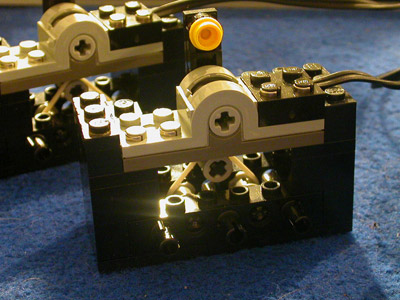
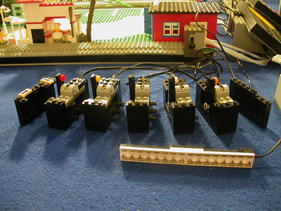
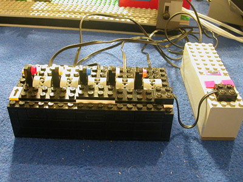

Après la motorisation des aiguillages 9V, il est bien besoin d’organiser un peu la commande électrique de ces aiguillages. La solution proposée ici ne fait appel qu’à des pièces Lego non modifiées. C’est fortement inspiré du travail de [Dave Koudys](http://sparky.i989.net/lvtrain.htm) en recherchant une réduction générale de la taille du bloc.

Le Principe est basé sur un levier basculant commandant un inverseur de polarité 9V Technic.

Il y a un petit élastique (courroie blanche) dans le bloc pour garantir le retour en position centrale du levier après commande.

La structure est modulaire permettant d’emboiter plusieurs blocs les uns aux autres pour unifier un pupitre de commande des aiguillages.

En faisant attention à la polarité des branchements, on peut s’arranger pour avoir la commande "voie déviée" toujours vers le haut et la commande "voie directe" toujours vers le bas, comme montré sur les photos.

De cette manière, la gestion du réseau en marche se trouve simplifiée. Vous remarquerez le codage couleur sur chaque levier. Une brique de couleur correspondante est montée sur chaque aiguillage pour faciliter le repérage pendant les phases de jeu. Les enfants apprécient bien :-)

Une [notice de montage](https://chezfilou.pagesperso-orange.fr/montages-lego/Levier-web/levier-commande_table.html) est disponible sur mon site et j’ai aussi laissé un fichier [levier-commande.ldr](http://www.brickshelf.com/gallery/frogleap/Trains/levier-commande/levier-commande.ldr) ainsi que quelques photos plus grandes sur [BrickShelf](http://www.brickshelf.com/cgi-bin/gallery.cgi?f=86555).

Amusez-vous bien !

Amicalement,
