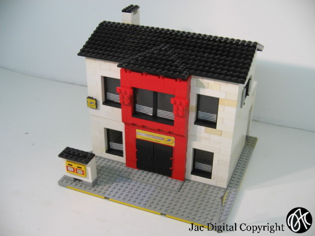
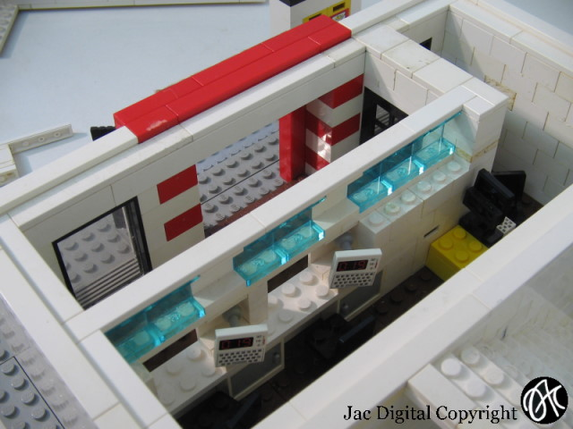
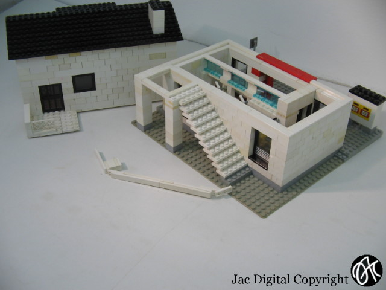
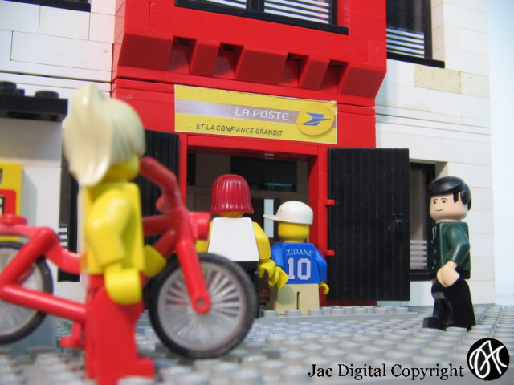

Il y a quelques années, chaque village, chaque quartier avait son bureau de poste qui dépendait d’un bureau plus grand situé, lui, dans les grandes villes.

Lors de mes déplacements, j’observe toujours les bâtiments des villes traversées et j’ai été inspiré par une façade de maison pour construire celle que je vais vous décrire maintenant.

**Vue d’ensemble**

Le bureau de poste est situé en rez de chaussée. Il comprend l’entrée pour les clients, une séparation et les bureaux du receveur et de l’employé des Postes.

**L’intérieur du bureau**

A l’étage se trouve l’appartement du receveur, comme dans la réalité.

Les murs sont construits en briques blanches de 2x2, avec des 2x3 pour pouvoir mieux croiser les pièces au départ des angles. Je voulais une toiture pas trop penchée, mais pas non plus avec de simples plaques. Le fait de superposer des plates de 2x8 ou plus, m’a permis d’avoir l’angle souhaité.

Dans mon bâtiment, seul le rez de chaussée est aménagé. J’ai placé des briques noires devant les fenêtres de l’étage pour cacher le vide. On peut contempler l’aménagement du bureau en soulevant le premier étage qui est simplement posé sur des plaques lisses. C’est un système qui permet d’animer avec des minifigs différemment à chaque présentation du bâtiment en situation.

**Le bureau sans le premier étage**

Bon, c’est un petit bureau. Le local de tri du courrier est très discret, mais comme c’est pour un petit village ou un quartier, il n’y a pas de problème. On peut dire que le courrier arrive en partie trié dans le bureau du receveur.

J’espère que cela vous aura donné de nouvelles idées de construction.

**Le bureau est ouvert**
