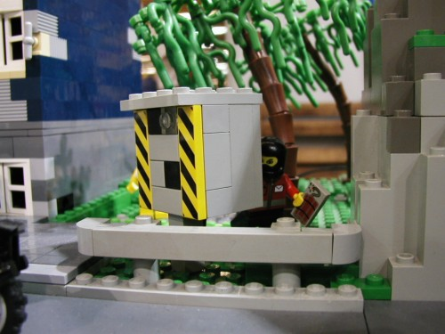

Pour l’[exposition de Kidexpo](/articles/kidexpo-2008/), le mot d’ordre était interactivité. J’ai donc cherché à mettre plusieurs animations dans ma partie du diorama. Ainsi est venue l’idée d’un radar qui flashe vraiment.

Constitué de peu de pièces, ce radar se glissera subtilement entre des buissons, au détour d’un virage ou derrière un pont... Les mieux équipés n’hésiteront pas à utiliser un RCX pour flasher les délinquants de la route.

**Un membre du FNAR en action**

[Vidéo de la publication d’origine](http://videos.freelug.org/uploads/cexAEnueMOe0xPT0dyTt.flv)

Ou téléchargez la vidéo :

Video Player

[Vidéo de la publication d’origine](https://www.freelug.org/IMG/mov/radarfixe.mov)

**Un motard pris en photo**

Téléchargez la notice :

**Notice du radar automatique**

Et pour les autres minifigs qui voudraient conduire, rappelons qu’il vaut mieux connaître son [code de la route](/articles/gommettes-code-de-la-route/) !
