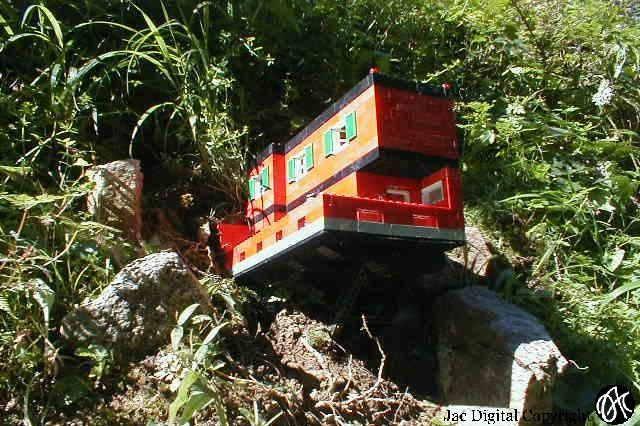
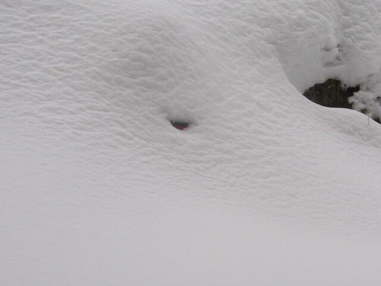
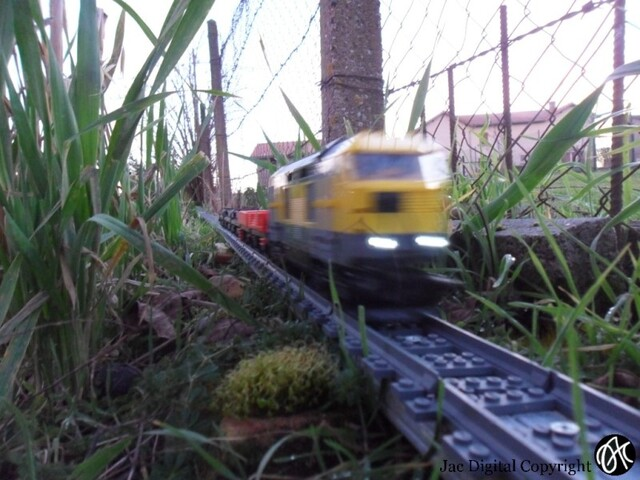
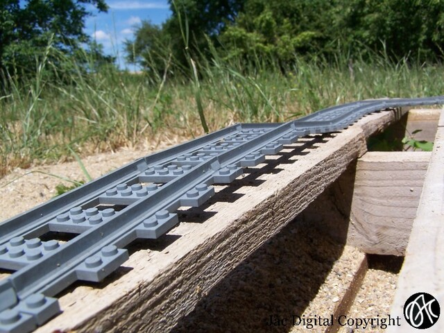
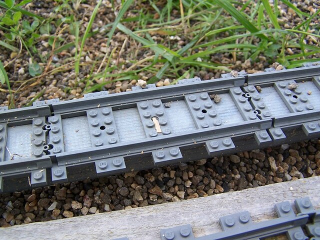
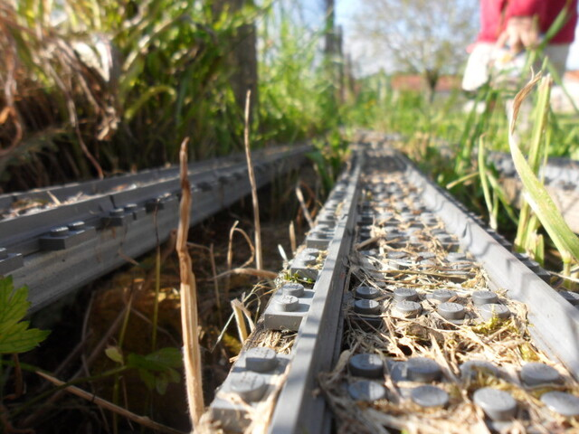
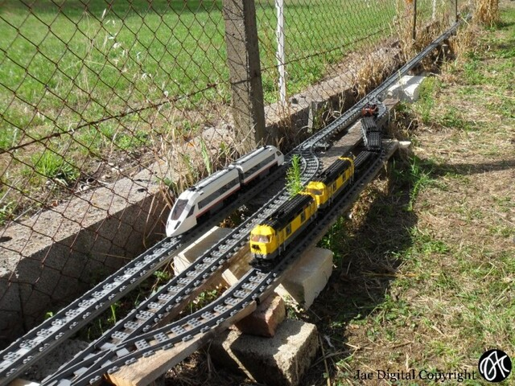

J’ai toujours eu en tête de mettre des constructions personnelles à l’épreuve du temps. C’est maintenant possible grâce à quelques expériences effectuées sur mon terrain.

J’avais commencé par installer un petit village en extérieur chez mes parents il y a quelques années de cela et je n’ai pu prendre aucune photo.

Plus tard, inspiré par un projet d’architecte qui correspondait bien au terrain que j’habitais, j’ai pu construire une villa, avec de solides fondations. Un pied en brique de 20cm est enfoncé dans le sol. La villa a passé quelques belles années dehors sans bouger. Elle a subi la pluie, le vent et surtout de bonnes couches de neige. Les briques ont très bien résisté. Cela m’a permis de prendre plus confiance dans mes constructions à laisser en extérieur.

Si si elle est là, on voit juste un peu de rouge !!!

Mais toujours dans l’espoir de faire un réseau assez grand pour ne pas avoir trop l’impression que les trains tournent en rond, je rêvais de pouvoir les faire rouler en extérieur. C’est là qu’il y a le plus de place normalement. Il fallait qu’il soit fixe et bien installé pour supporter les intempéries. De plus j’aime prendre des photos de mes MOCs bien insérés en milieu naturel.

A mon sens les rails les plus aboutie et donc les plus beaux sont ceux sortis pour le système "9V". Mais en extérieur, la partie conductrice, en métal, risquait de rouiller et je ne voulait pas faire un nettoyage de tout le réseau avant de jouer. De plus il fallait prévoir une alimentation et tirer un câble électrique à chaque sortie des trains. Ce qui ne me permettait pas d’installer la voie où je le souhaitais sur mon terrain. Le projet était donc encore en réflexion.

L’arrivé du système PFS pour les trains LEGO a réglé définitivement le problème. Certes il y a des inconvénients, la commande à infra rouge a une portée limitée surtout par grand beau temps, la performance des piles que l’on utilise dans les locomotives n’est pas éternelle. Mais la rouille sur les parties métalliques des rails et donc le nettoyage des voies disparaissent complètement avec les éléments tout en ABS. L’énergie pour les moteurs est stockée dans la locomotive, ou pas loin dans le train et du coup celui-ci devient autonome. De plus je voulais tester mes prototypes de vitesse sur une longue ligne droite. Grâce à ces deux raisons, je me suis enfin lancé dans la construction d’un réseau extérieur.

Mais attention, placer des rails dehors ce n’est pas si simple et pour les laisser en permanence aux intempéries, il faut que la voie soit bien stabilisée. La mettre sur du ballast comme en réalité complique beaucoup trop l’entretien et je ne voulais pas poser la voie à même le sol. En miniature cela ne peut se passer comme en réalité où il sert à stabiliser les rails. Il se replace dans les interstices à chaque passage des trains. Des trains spéciaux servent justement à l’entretien de cette partie très importante du chemin de fer. Ici le ballast sera forcément fictif. Il faudrait le coller pour le rendre juste décoratif. De plus la voie travaille et se dilate, il faut donc prévoir une fixation adaptée.

Pour mes premiers tronçons, j’ai assemblé les rails bout à bout, comme on construit nos réseaux habituellement, et fixé par tronçons sur des planches. Là, deux problèmes importants sont apparus. Les planches que j’ai employées provenant de palettes vieillissent mal et les rails se dilatent bien avec les changements de température. Ça fait des bosses !!!

Heureusement, les rails Lego sont bien conçus, on peut les assembler sans les joindre complètement au suivant. L’espace permet à chaque rails de se dilater sans pousser l’autre et sans faire dérailler les trains. De plus, au passage des roues on entend le "clac clac clac" caractéristique.

Les planches se déforment et vrillent ou se plient au fil du temps, ce qui risque de déplacer un peu les rails. Suite à de longues recherches techniques et quelques tests, j’ai pu récupérer des ferrailles à plafond. Cela me permet de faire des tronçons de grande longueur. Grâce à des vis auto foreuses, je peux toujours fixer correctement les tronçons de rails à chaque barre. Les barres ont aussi tendances à se vriller mais beaucoup moins. Je fais des tronçons courts.

Petit à petit le réseau s’intègre dans le décor naturel...

Cela n’empêche pas de faire une vérification à chaque sortie. Pour cela, je fais circuler une locomotive seule, en "Haut Le Pied". Comme ça s’il y a déraillement à cause d’une quelconque déformation, je ne suis pas obligé de remettre tout une rame sur les rails.

Plutôt dans l’esprit de mes tests de vitesse, le premier tracé du réseau consistait en une simple ligne droite en voie unique, avec des boucles de retournement à chaque extrémité. Puis vint le jeu et le plaisir de faire rouler un train de marchandises plus lentement et plus long. Du coup j’ai du rallonger les boucles pour permettre aux trains plus longs de faire demi tour. Ensuite vint le partage, jouer à plusieurs sur le réseau avec plusieurs trains en même temps. Pour cette deuxième étape, j’ai du prévoir des voies supplémentaires avec aiguillages pour les croisements. Au fur et à mesure, le réseau s’est agrandi. Il mesure aujourd’hui environ 23m de long. Il comporte une gare avec plusieurs voies d’évitement. Cela permet de préparer les trains. Aujourd’hui je peux mieux partager mon réseau avec les invités...

Les réseaux en extérieur, ce n’est pas une première, il en existe des tas et à toutes les échelles. Mais le construire en LEGO et le laisser en permanence dehors, ce n’est pas courant. Grâce à lui, aujourd’hui, je peux faire circuler mes trains quand je le souhaite sans rien gêner dans la maison et consacrer la pièce LEGO seulement à la construction.

Le réseau est toujours en construction car il évolue au fur et à mesure des idées que j’ai et des échanges lors des jeux à plusieurs. Pour suivre son évolution, c’est par là : [Sur le réseau extérieur](http://photos.freelug.org/main.php/v/JAC/JouMOC/voiexterieure/)

Pour un très bon tracé de la voie, référez-vous à l’article paru il y a quelques temps maintenant et qui aide bien : [Bien concevoir un circuit de trains en exposition](/articles/bien-concevoir-un-circuit-de-trains-en-exposition/)
