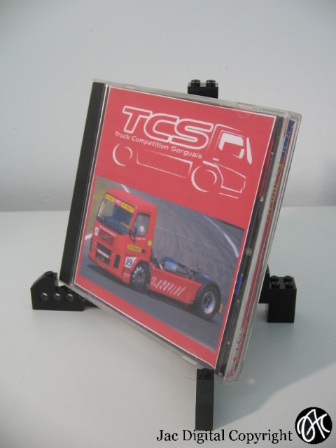
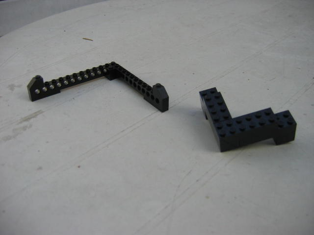
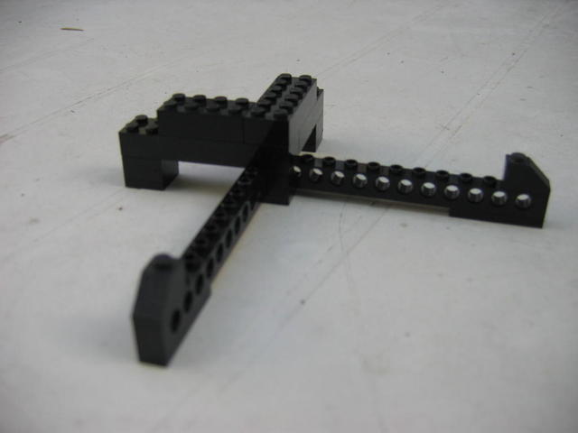
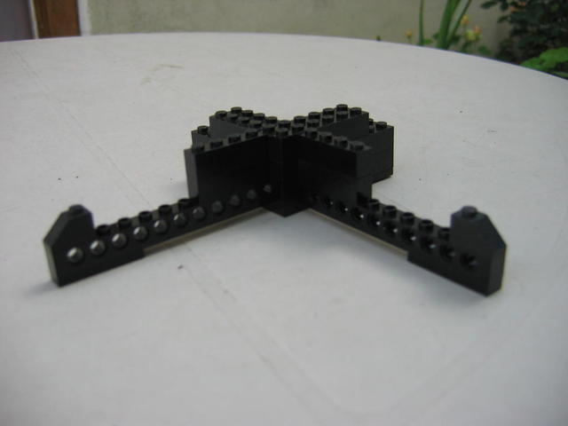
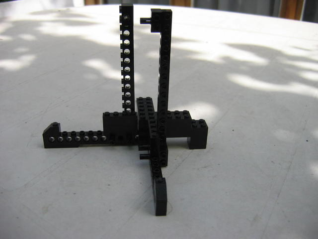
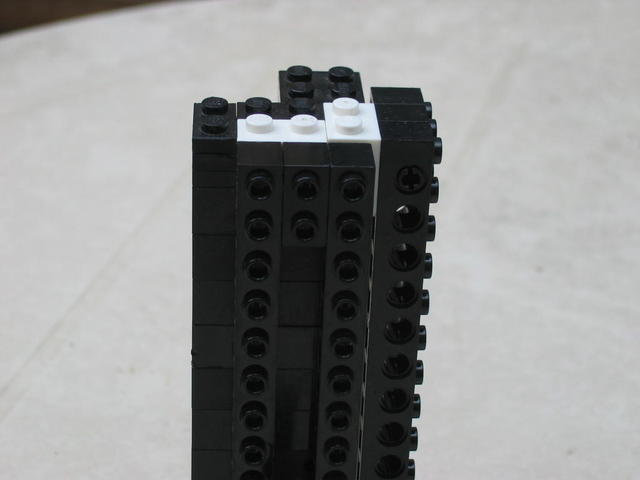
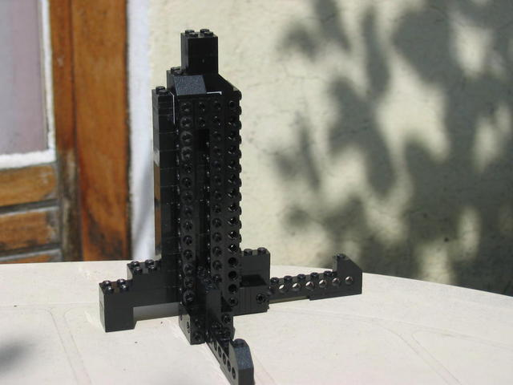
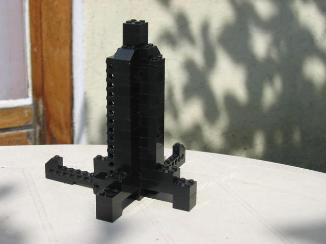
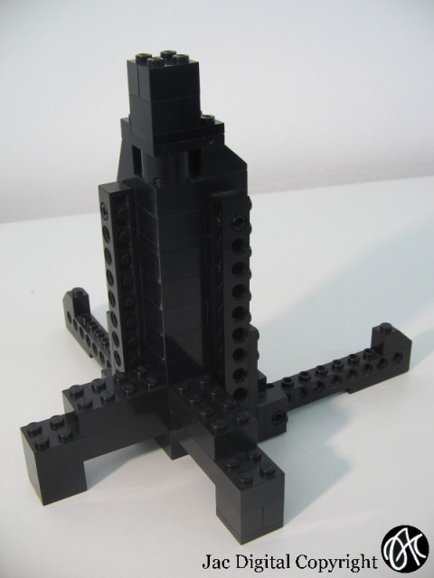

Sur un diorama, j’aime bien que tout soit construit en briques LEGO. Lors de mes expositions, je présente quelques modèles dont la notice de construction est disponible sur CD. C’est pour cela que j’ai eu l’idée de concevoir ce présentoir à CD.

Les modèles sont assez faciles à présenter, soit en situation sur le diorama, soit exposés par exemple, pour les véhicules, dans un garage.

**Présentoir à CD**

Par contre, pour les CD, ce n’est pas la même chose. On pourrait les poser à plat sur la table, mais, en les présentant posés à la verticale, on a aussi une vue sur la face arrière du boîtier, que je trouve aussi importante car je m’amuse à la compléter.

Comme je vous l’ai dit, je m’amuse à ce que tout soit en briques LEGO sur mon diorama. Du coup, j’ai construit un support pour présenter mes CD. Je me suis inspiré de ce qui se fait en plastique, comme simple présentoir. Il y a deux bras à plat pour supporter le document à présenter et un pied droit, dont la hauteur va dépendre des objets à placer dessus.

Ils sont adaptés à mes CD, mais en modifiant un peu la base et en faisant le pied plus haut, on peut très bien placer un sous verre.

Vous trouverez à la fin de l’article, le fichier MLCad pour monter votre support.

C’est en voyant le montage "bricolé" de Didier "Bonnet Rouge" que j’ai pensé à faire cet article. Donc, je lui laisse la parole pour vous expliquer son aventure et aussi le montage de la réplique de ce support qu’il a construit ensuite, grâce à quelques photos que je lui ai envoyées.

**JAC**

* * *

Mon expérience a été malheureuse. Lors de l’exposition de Parigné-l’Evêque, j’avais placé un sous verre sur un montage trop léger, pour présenter la photo réelle d’un MOC. Il y a eu un courant d’air et tout est tombé par terre. Le verre a explosé au sol. On peut remplacer le verre par de l’altuglas, plus solide et vendu aux tailles des sous verre dans les grandes surfaces de bricolage qui vendent les sous verre.

Grâce aux photos que m’a envoyées JAC, j’ai pu construire ma version adapté d’un support solide. Il y a un fichier MLCad, mais je vous décris le montage, pour ceux qui n’aiment pas utiliser ce logiciel.

Pour les deux pieds avant :  
**–** 1 plaque de 2x2  
**–** 2 briques Technic 1x12  
**–** 2 plaques 1x4  
**–** 2 pentes 45 1x2  
**–** 2 briques 1x1

Emboiter les briques Technic en opposition et les briques de 1x1 pour remplir les coins sur la plaque 2x2  
Placer les plaques 1x4 sous les briques Technic et les pentes dessus.

Pour les deux pieds arrière :  
**–** 1 brique 2x8  
**–** 2 briques 2x6  
**–** 2 briques 2x2  
**–** 2 plaques 2x2.

Faire un angle droit avec les briques 2x8 et 2x6, verrouiller l’angle avec une seconde rangée 2x6, finir l’angle droit par une brique 2x4, mettre les plaques 2x2 sous les briques 2x2 placées sous la première équerre.

**Etape 01**

Placer les pieds arrière sur les briques techniques des pieds avant.

**Etape 02**

Finir les pieds avant.

4 briques 1x4 à placer sur les pieds avants de chaque coté pour rattraper le niveau des pieds arrières.

**Etape 03**

Renfort avec les briques Technic verticales :  
**–** 4 briques Technic 1x16  
**–** 6 briques Technic 1x2  
**–** 10 pins long [6558](http://www.bricklink.com/catalogItem.asp?P=6558)  
**–** 6 plaques 1x2.

Sur les briques Technic 1x16 mettre un pin long et placer la brique Technic 1x2. A faire deux fois.

**Etape 04**

Sur le bas de la brique Technic verticale placer 1 brique Technic 1x16, emboiter 2 plaques 1x2 et une brique Technic 1x2 et placer les deux pins long petit coté en bas sur les deux pieds. Sur le haut de la brique Technic 1x16, placer la brique Technic 1x2 avec le pin long. Mettre en place les deux briques Technic verticale 1x16 puis les deux colonnes avec les autres briques Technic .

Mat central avec des briques en alternance :  
**–** 9 briques 2x4  
**–** 10 briques 2x2  
**–** 2 plaques 2x4 à mettre en haut.

Les briques forment des équerres. Les deux montants de briques Technic en alternant la position des briques 2x4 et 2x2 comme la technique du maçon !

Fixations des montants en briques Technic en haut du mat central :  
**–** 2 équerres [44728](http://www.bricklink.com/catalogItem.asp?P=44728)

Emboiter les équerres en haut au dessus des plaques 2x4 la partie 4 tenons face aux briques Technic en prenant les briques Technic 1x16 et 1x2.

**Etape 05**

Pour égaliser le sommet du mat :  
**–** 2 plaques 1x2.

Pour fignoler le sommet :  
**–** 3 pentes 45 1x2 à mettre sur les équerres et l’arrière, - 1 brique 1x2 pour boucher le trou central,  
**–** 2 briques 2x2 pour finaliser le haut.

Présentoir fini :

**Présentoir vue de face**

**Présentoir vue arrière**

Ici, le présentoir construit par JAC.

**Le modèle de JAC**

**Didier "Bonnet rouge"**

* * *

Ci-dessous la notice de construction avec MLCad.

**Notice**
