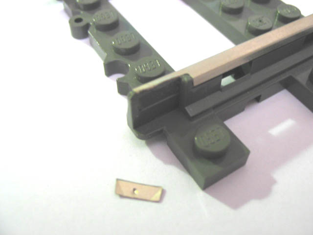
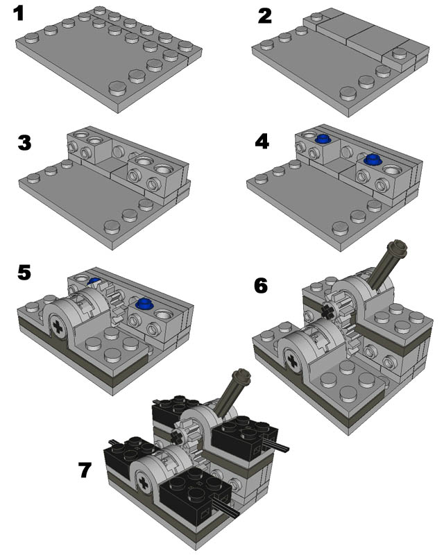
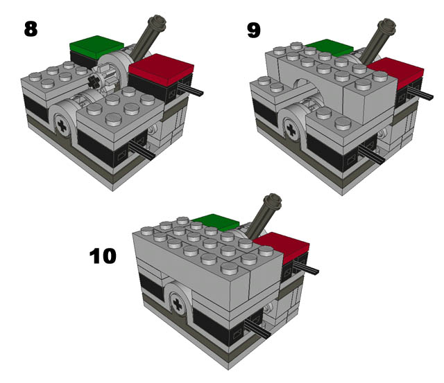
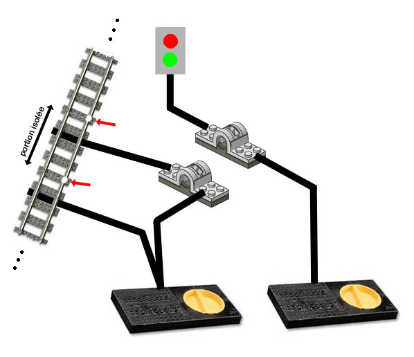
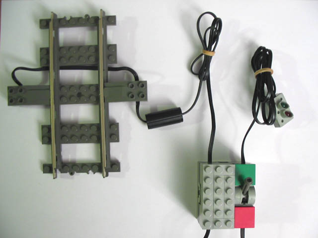

Les fans de DCC me diront sans doute que le système du cantonnement est un peu dépassé, et qu’on fait nettement mieux avec le DCC. Néanmoins, si vous n’avez pas les moyens de passer au DCC voici comment réaliser facilement un système de cantonnement, et ce, sans faire la moindre soudure, ni même montage électronique.

Le principe du cantonnement est celui qui était utilisé pour les trains 12V, à savoir isoler une portion de voie du reste du circuit. On injecte du courant dans cette portion isolée quand le feu est vert, et on coupe le courant dans cette portion quand le feu est rouge.

L’inconvénient du système de cantonnement, est que si le train a beaucoup d’inertie (ou de vitesse), il peut traverser la portion isolée sur sa lancée, puis repartir après le feu. Pour éviter cela on peut agrandir la portion isolée, mais alors le train risque de s’arrêter trop loin du feu s’il arrive avec une vitesse faible. Des essais sont donc nécessaires pour trouver le bon compromis.

Tout d’abord, pour pouvoir isoler une portion de circuit, il va falloir un peu bricoler les rails. C’est le seul "illegal move" que vous aurez besoin de faire, et cela nécessitera d’endommager deux rails (droit ou courbe selon vos besoins).

Pour cela, c’est très simple, il suffit de relever la patte métalique qui fait contact à l’extrémité d’un des rails, et de la couper avec une pince coupante.

**Avertissement** Enfant, ne faites pas cette manipulation. Demandez à un adulte de vous aider. L’auteur ne saurait être tenu responsable de blessure éventuelle et/ou de dommage provoqué par de mauvais branchements électriques.

Si vous ne voulez vraiment pas endommager vos rails, il est sans doute possible de glisser un petit morceau de papier ou de coller un petit bout de scotch à l’endroit de la patte qui fait contact. Je n’ai pas essayé cette solution car je n’y avais pas pensé de prime abord, mais elle fonctionne très probablement.

Maintenant, il reste à faire un interrupteur permettant à la fois de basculer le feu rouge/vert et de couper/alimenter la portion isolée. Pour cela j’utilise 2 inverseurs de polarité. Oui, je sais, c’est une pièce plutot rare et assez chère (environ 6,50 euros), mais en contre partie, vous n’aurez pas de montage électronique à faire.

Le premier inverseur de polarité va servir à inverser le courant alimentant [le feu de signalisation](/articles/un-feu-de-signalisation-de-train/), et ainsi changer sa couleur.

D’autre part, les inverseurs de polarité possèdent une zone morte au milieu, où le courant ne passe plus. Je vais donc me servir de cette zone morte pour couper le courant dans le tronçon isolé à l’aide du deuxième inverseur de polarité.

L’astuce consiste juste à relier les deux inverseurs de polarité avec le bon rapport d’engrenage, de sorte que celui alimentant le tronçon se déplace de la zone morte à une extrémité, pendant que l’autre se déplace d’une extrémité à l’autre.

Voici le montage que je vous propose :

**Attention** à l’étape 6, il faut emboiter les engrenages dans une certaines position : Basculez l’inverseur du haut sur le rouge, et celui du bas sur la zone morte, puis emboitez l’inverseur du haut sur son support. Ensuite vérifiez qu’en basculant l’inverseur du haut sur le vert celui du bas fait contact, et qu’en ramenant celui du haut sur le rouge, celui du bas retourne en zone morte.

Et en rajoutant quelques briques pour faire joli :

Pour ce qui est de l’alimentation maintenant, j’utilise 2 transformateurs. Le premier est mis à fond et sert à alimenter le feu (ou les feux, car si vous avez plusieurs montages de ce type, on peut alimenter tous les feux avec le même transformateur). La puissance est maximale pour que les diodes soient bien visibles.

Le deuxième transformateur sert à alimenter les rails, aussi bien le circuit normal, que le ou les tronçons. Attention tout de même à bien brancher tous les cordons dans le même sens (ce qui est loin d’être simple vu qu’il y a un inverseur de polarité dans le montage) !! De toute façon si vous créez un court-circuit, vous vous en rendrez compte facilement car la diode situé sur le tranformateur va s’affaiblir.

Vous pouvez bien évidement faire varier la puissance de ce deuxième transformateur pour faire varier la vitesse des trains, et ce qui est intéressant, c’est que vous pouvez avoir une vitesse lente ou rapide, même dans le tronçon isolé !

Voici schématiquement les branchements que vous devez faire avec un tronçon et un feu, je vous laisse imaginer ce que cela donne avec deux tronçons et deux feux.

Voila une photo du montage :

Pour éviter de tirer un cable de votre transformateur de commande de vitesse jusqu’au tronçon isolé, il est possible d’utiliser un cable d’alimentation de voie pour repiquer le courant de la partie non isolée et le réinjecter via l’inverseur de polarité dans le tronçon. Mais cela vous oblige à avoir la commande de basculement de feu près du feu en lui-même.

**Enfin un dernier point à prendre en compte** : les aiguillage 9V coupent l’alimentation dans la partie de voie non désservie par l’aiguillage, ce qui en pratique ne nous arrange pas lorsqu’on commence à faire du cantonnement sur son réseau. En effet on veut par exemple basculer un aiguillage juste après le passage du train A et juste avant l’arrivée du train B, sachant que les trains A et B vont s’arrêter devant leur feu respectif sur des voies parallèles. Or au moment où on va basculer l’aiguillage, le train A va s’arrêter car le courant dans sa voie sera coupé par le baculement de l’aiguillage.

Pour éviter ce genre de problème, il vous faudra alimenter toutes les portions de voie entre chaque aiguillage à l’aide de nombreux cable d’alimentation de voies (tous ces cables étant reliés au même transformateur).

_Autre possibilité si vous n’avez pas peur de modifier vos aiguillages_ : vous pouvez court-circuiter tous vos aiguillages en soudant des fils électriques sous les rails, ainsi une seule alimentation sera nécessaire pour tout le circuit (hormis les tronçons isolés bien sûr).

Voilà ! Vous n’avez plus qu’à vous jeter sur le "Depan Order" pour commander des inverseurs de polarité, et j’espère voir rapidement du cantonnement sur vos réseaux !
