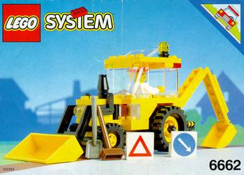
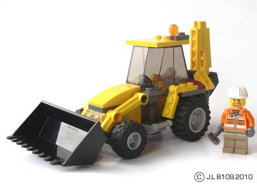
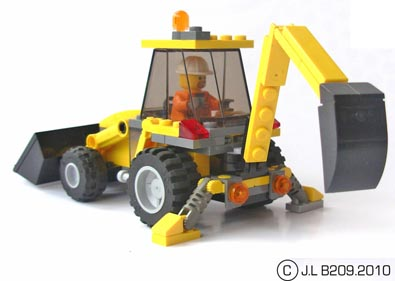
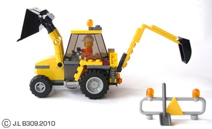
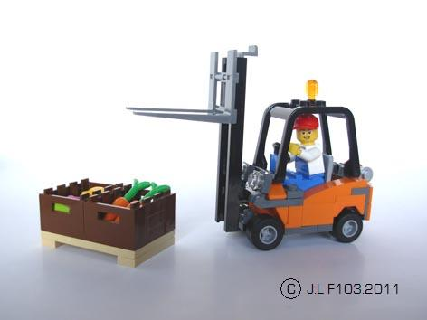
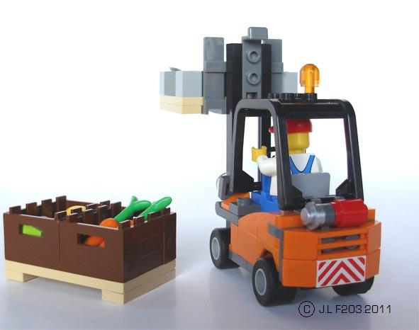

Bonjour à tous,

C’est mon premier article sur le site Freelug et pour cette inauguration, je vais vous présenter une de mes créations, un tractopelle.

En effet, ma ville Lego est constamment en chantier, et cela nécessite l’intervention d’engins performants. De plus, mon ancien tractopelle commence à fatiguer, il a les articulations fragiles. Après 19 années de service (déjà), il est temps de lui trouver un ami pour l’aider à bâtir la ville. J’ai ainsi décidé de créer un nouveau tractopelle inspiré de celui de 1992.

**le tractopelle 6662 de 1992**

Ce tractopelle 6662 a été l’une de mes premières boîtes LEGO et elle reste aussi l’une de mes préférées. Avec le temps hélas, le tractopelle ne supporte plus les charges lourdes.

**Vue générale tractopelle copyright J.L B109.2010**

Voilà donc mon nouveau tractopelle réalisé fin 2010. Il est directement inspiré de celui de 1992 de part sa taille et ses fonctions. Il peut ainsi circuler facilement sur sa voie de circulation et ne pas trop empiéter sur la voie de gauche.

**Vue arrière tractopelle copyright J.L B209.2010**

Il utilise différentes techniques avec notamment pour le godet arrière, des articulations identiques à celles du tractopelle original car il n’existe malheureusement pas de petit godet LEGO avec un système d’articulation plus récent.

**Vue de face tractopelle copyright J.L F309.2010**

A noter également la présence de béquilles pour stabiliser l’engin.

Voilà pour la présentation de ce petit MOC. Et en bonus, voici une autre petite création, un petit chariot élévateur.

**Vue générale chariot élévateur copyright J.L F103.2011**

**Vue arrière chariot élévateur copyright J.L F203.2011**

N’hésitez pas à laisser un petit commentaire.  
A bientôt pour une autre création.

Julien.
