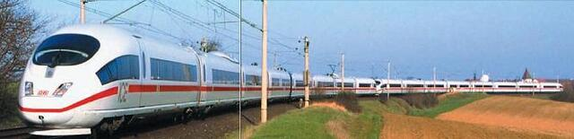
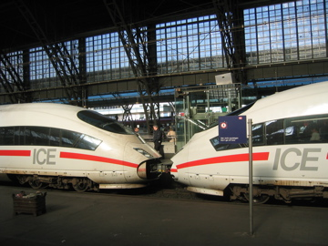
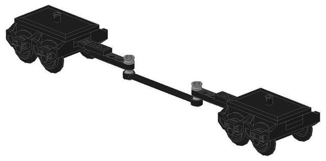
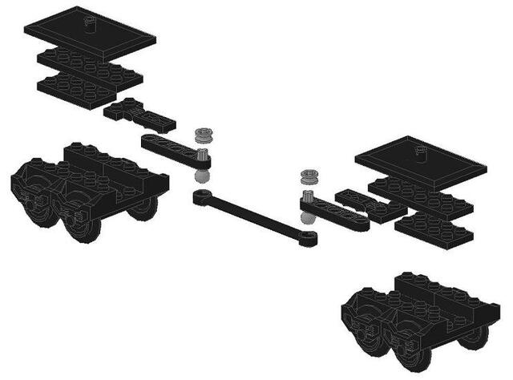

Des trains à grande vitesse sont parfois assemblés en double-rame sur certaines lignes très fréquentées. Je vous propose un montage simple pour coupler deux trains ICE réf. 7897.

Ayant récemment acquis un second ICE réf. 7897, j’ai eu rapidement l’idée de constituer une double-rame en le couplant avec le premier.

**ICE double-rame**

En pratique, le couplage est réalisé au niveau de l’avant des cockpits avant et arrière à l’aide d’un coupleur spécifique.

**Couplage des ICE par le cockpit**

Sur le modèle LEGO, le nez du train est constitué d’une grosse métapièce qui ne permet pas de réaliser un montage équivalent à la situation réelle. De plus, un couplage par le nez est incompatible avec les aiguillages et les virages serrés en S de certaines voies. Il ne reste plus que la solution d’un couplage entre boggies des deux rames.

Le montage s’avère finalement simple et ne nécessite que peu de pièces en plus des deux boggies :  
**–** 2 4276b Black Hinge Plate 1 x 2 with 2 Fingers and Hollow Studs  
**–** 2 2452 Black Hinge Plate 1 x 2 with 3 Fingers On Side  
**–** 2 3020 Black Plate 2 x 4  
**–** 2 3795 Black Plate 2 x 6  
**–** 2 2736 Light\_Gray Technic Axle Towball  
**–** 2 32017 Black Technic Beam 5 x 0.5  
**–** 2 32123a Light\_Gray Technic Bush 1/2 Smooth with Axle Hole Reduced  
**–** 1 32293 Black Technic Steering Link 9L

**Couplage entre boggies.**

**Vue éclatée du couplage.**

L’usage montre que ce couplage fonctionne mieux en traction qu’en poussée ; il vaut mieux ne motoriser que la première rame.

Pour finir, une petite vidéo de séquences prises durant l’exposition par l’association Fanabriques lors du marché aux puces de Griesheim sur Souffel.

[Vidéo de la publication d’origine](http://www.youtube.com/v/Fwy79krvjiM?hl=fr&fs=1)
