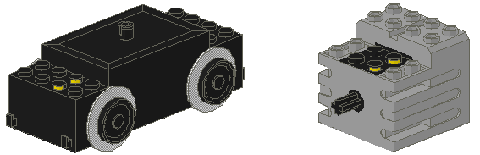
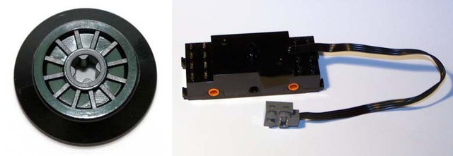
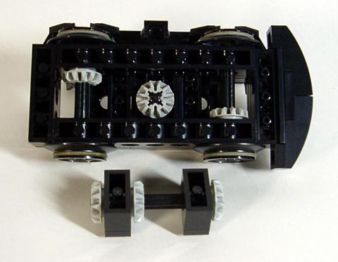
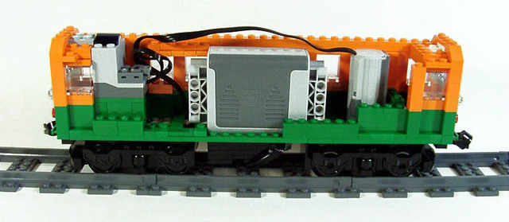
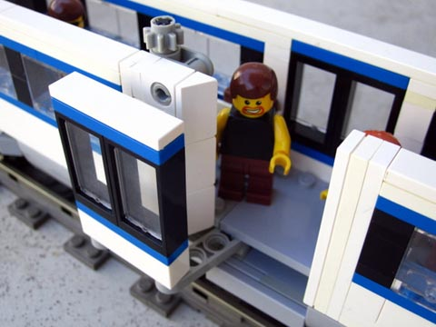
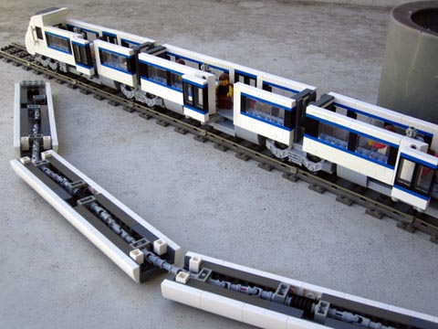
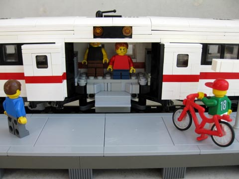
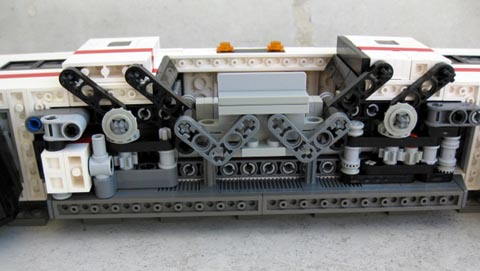
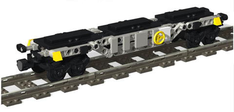

Je ne sais pas si c’est le cas pour tous, mais pour moi le "Technic" est un ensemble bien précis de pièces et de sets LEGO. Les éléments Technic sont des pièces avec des axes, des chevilles et des trous.

Les briques à trous, les engrenages et les connecteurs sont des pièces Technic. Les briques, plaques, plaques lisses et briques pentues, à moins d’être Technic-ement modifiées, n’en sont pas. Ce sont des pièces System. Je dois souligner le fait que la société LEGO ne fait pas une telle différentiation.

Les modèles Technic font un usage important des pièces Technic. Pour moi, le Train n’est pas Technic. Il a(vait) son propre moteur System 9V, différents des moteurs Technic 9V.

Mais les choses changent. Le nouveau moteur de train n’a plus de roues, et vous pouvez y attacher n’importe quelle pièce ayant un trou d’axe Technic. Les roues de trains ont un trou d’axe Technic. Les roues de train sont des pièces Technic.

## "Les roues de train sont des pièces Technic."

Cette modification mineure ne fait pas des trains LEGO des modèles Technic. Comme dit précédemment, les modèles Technic font un usage important des pièces Technic. Et ce n’est pas le cas ici. Cependant, le nouveau moteur et les nouvelles roues ne sont pas les seules pièces Technic dont un modèle de train LEGO puisse faire usage.

L’idée de motoriser un train LEGO avec des pièces Technic (moteur, brique à trous, engrenages, axes) n’est pas neuve. L’idée de base consiste à [incorporer un train d’engrenages dans le boggie comme illustré ici sur BrickShelf par BUCHI](http://www.brickshelf.com/cgi-bin/gallery.cgi?f=284050). Les roues sont entraînées à travers l’axe central du boggie par un moteur placé dans le corps de la locomotive.

Mettre en place ceci dans l’espace d’un boggie de train LEGO, une boîte de 4x8 tenons, n’est pas chose aisée. De plus la conception mécanique de ce montage souffre d’un effet secondaire intrinsèque - un couple entre le boggie et le châssis du train - qui cause des déraillements sur les aiguillages.

Cependant, avec cette méthode de motorisation des trains LEGO, vous n’êtes plus restreints aux moteurs de trains à deux essieux, et vous pouvez créer toute une variété en tailles et configurations d’essieu. Vous pouvez même envisager l’emploi de grandes roues comme celles de sociétés tierces comme [Big Ben Bricks](http://www.bigbenbricks.com/)

La motorisation Technic des trains n’est pas facile à mettre en oeuvre, et peut même paraître impraticable dans le cas des trains modernes, mais c’est un concept intéressant pour les vapeurs aux essieux fixes.

Le [Train Nuit d’Emeraude 10194](http://www.brickset.com/detail/?set=10194-1) est à ce jour le seul exemple d’un tel train Technic-ement motorisé par la société LEGO.

Donc, il est possible de motoriser un train avec des pièces Technic. Mais cela n’en fait pas un modèle Technic. Parce que le Technic est aussi une question de fonctionnalités.

[Esben Kolind](http://www.brickshelf.com/cgi-bin/gallery.cgi?m=esbenkolind) est d’accord et nous montre comment construire un train avec des [portes automatiques](http://www.brickshelf.com/cgi-bin/gallery.cgi?f=468684) qui s’ouvrent à la gare. Cette fonctionnalité utilise des pièces Technic comme des axes, des engrenages et les connecteurs habituels, mais de façon plus impressionnante, il fait usage des joints de cardan pour faire fonctionner toutes les portes avec un unique moteur par un mécanisme discret et compact.

## "Parce que le Technic est aussi une question de fonctionnalités."

En fait, Esben est depuis longtemps un fan des fonctions intégrées aux trains, [comme illustré ici dans une ancienne étude de porte coulissante, intégrant lumières, portes motorisées et marche rétractable](http://www.youtube.com/user/esbenkolind#p/u/5/2s4yFDAOhHA) .

Néanmoins, le train n’est toujours pas un modèle Technic. Le Technic est aussi question de structure. Les trains LEGO sont faits de plaques et de briques, pas de briques à trous et poutrelles. Mais certaines personnes sont ouvertes d’esprit (en tout cas plus que moi). C’est le cas de Tim gould, qui avait proposé ce wagon plat (dont vous pouvez télécharger la notice de montage sur le site de [RailBricks](http://railbricks.com/build-instructions/doc_download/13-freight-wagon)).

D’après la liste des pièces, on voit que près de 75% des pièces sont des pièces Technic (seulement 6 ont des tenons). Le résultat est assez convaincant, réaliste autant qu’un modèle LEGO peut l’être, et c’est un vrai modèle Technic.

Les exemples du tout Technic sont là : structure, fonctionnalité et motorisation. Un train LEGO Technic est possible, même en largeur de  
6 tenons, même si pense que ce n’est pas tâche facile.

Les modèles Technic sont, en général, plus grand qu’un train en 6 ou même 8 tenons de large - et je ne pense pas que ce thème ne devienne majoritaire. Mais je sais par contre que la créativité et l’imagination sont sans limite.

_"Un train LEGO Technic est possible..."_
