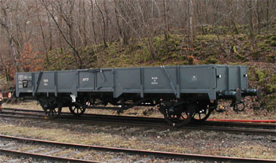
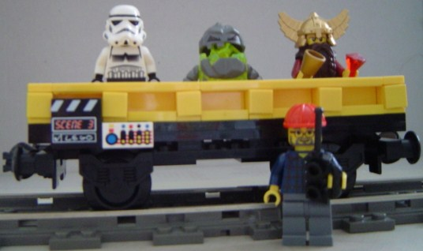
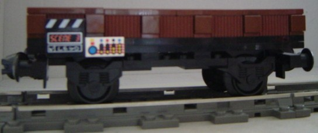
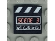
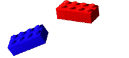
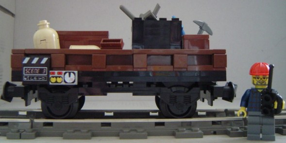
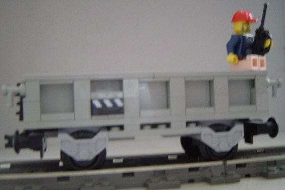

La réalisation de modèles de wagons, locomotives, trains, en LEGO est assez facile pour plusieurs raisons : le format réduit déterminé par l’échelle « Minifig » en fixe déjà les proportions, et par conséquent un nombre de pièces nécessaires pour des montages raisonnables.  
Sachant cela, il faut ensuite avoir l’idée de ce que l’on veut réaliser. Et côté trains, le vaste choix dans les différents parcs de matériels de toutes les compagnies existantes permet presque d’avoir une source inépuisable d’idées de constructions !

L’histoire, cela fait déjà quelques temps que j’avais construit un de ces petits wagons, et comme il est de montage très simple, il ne m’a pas pris beaucoup de temps !

Je ne suis certainement pas le créateur exclusif de ce MOC ! C’est souvent comme la plupart d’entre nous en regardant une photo sur [Brickshelf](http://brickshelf.com/) que nous prend l’envie de reproduire ce que l’on a vu ou de s’en inspirer.

La réalisation de la notice aura certainement été plus longue à germer !

Ces petits wagons de marchandises sont donc de montage très simple, La plupart des pièces utilisées sont faciles à réunir. De plus elles sont presque toutes disponibles sur le « Pick à Brick » du site de LEGO.

Un wagon plat, ça ressemble à ça =

**Wagon plat**

Wagon plat transport de charbon

Ils sont beaucoup utilisés et de nombreuses adaptations ont été faites, pour des détails plus techniques, [Wikipédia](http://fr.wikipedia.org/wiki/Wagon_plat) fait cela très bien !

Je vous propose donc 2 versions :

**Wagon plat version 1**

Wagon plat version 1

**Wagon plat version 2**

Wagon plat version 2

Il y a une pièce que je n’ai pu ajouter dans les notices c’est celle là :

**Tile 2x2 décoré noir**

Tile 2x2 décoré "Clap Cinéma" noir

Elles sont au nombre de deux pour chaque notice.

**Wagon plat version 1**

Notice du wagon plat

**Wagon plat version 2**

Notice du wagon plat version 2

Pour aller plus loin, il est possible d’ajouter tout un tas de petits accessoires pour décorer et garnir le wagon :

**Wagon plat équipé**

Wagon plat chargé de marchandises diverses

Et même plus ! Sur la même base je vous propose une notice bonus :

**Wagon tombereau version 3**

Wagon tombereau sur la base d’un wagon plat, il est légérement différent de la notice

**Wagon tombereau version 3**

Notice du wagon tombereau sur la base du wagon plat

Comme vous pouvez le voir, c’est facile à construire et les possibilités sont multiples, de nombreuses couleurs peuvent être aussi utilisées !  
A vos briques !

