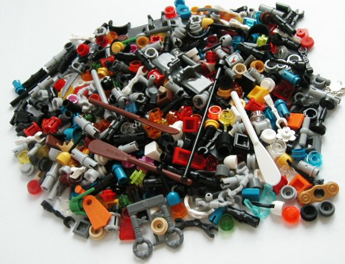

A chaque boîte, son lot de petites pièces supplémentaires. Si pour le client, cela représente soit une source de pièces pour son stock ou bien des éléments de rechange dans le cas de la perte de ces tout petits éléments, c’est aussi une contrainte de production. Le contenu des sachets étant vérifié au poids, les petites pièces dont le décompte est difficile sont sur-dosées pour éviter tout manque.

Depuis le premier janvier 2009, j’ai donc mis de côté chaque pièce supplémentaire afin de voir ce que cela pouvait représenter en un an.

Je précise tout de suite :  
**–** ces pièces sont issus de boîtes ouvertes et construites en 2009, et donc pas forcément de modèles de la gamme 2009 ;  
**–** je ne sais pas combien de boîtes cela représente ;  
**–** je n’ai pas encore ouvert toutes les boîtes ;  
**–** il peut y avoir plusieurs exemplaires de la même boîte ;  
**–** je ne suis pas Technic, donc la majorité des pièces ici sont issues de la gamme System.

Alors, que peut-on y trouver ?  
**–** 80 briques inclinées 1x1 (slope 1x1 ou cheese part) ;  
**–** 127 plates rondes 1x1 ;  
**–** 70 diverses chevilles (pin) Technic ;  
**–** 21 diverses bagues (bush) Technic ;  
**–** 5 T pneumatiques Technic ;  
**–** 31 bras et jambes de squelettes ;  
**–** 32 plaques lisses 1x1 ;  
**–** 15 cornes ;  
**–** 12 visières ;  
**–** 2 fleurs ;  
**–** 5 épaulettes ;  
**–** 14 leviers (petite antenne) ;  
**–** 36 accessoires divers de minifigs ;  
**–** 10 pièces diverses.

Cela représente tout de même environ 30 euro sur le [pick-a-brick du s@h](http://shop.lego.com/pab/).

Allez, ces 460 pièces vont pouvoir maintenant rejoindre le stock !
