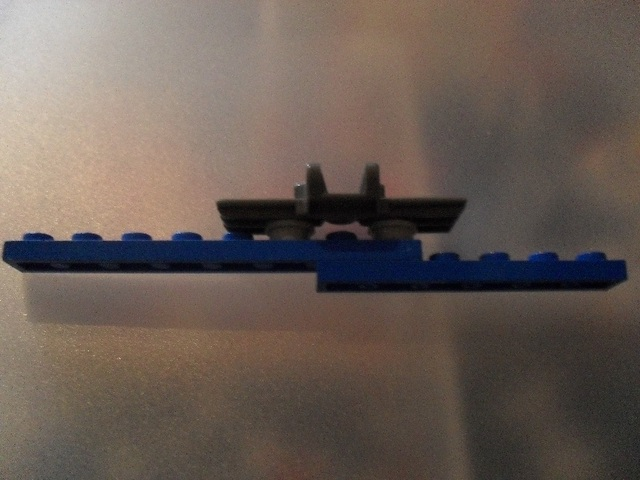
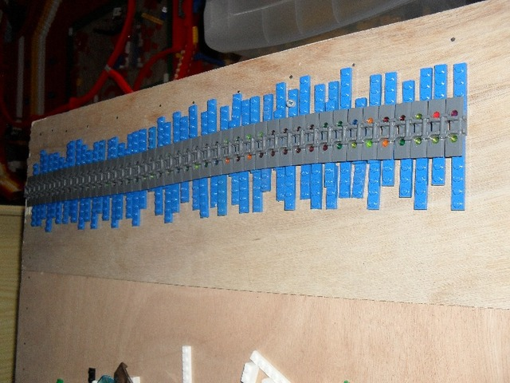
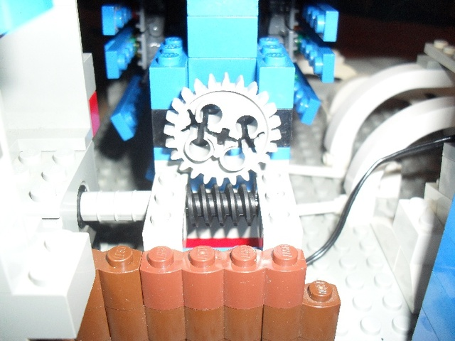
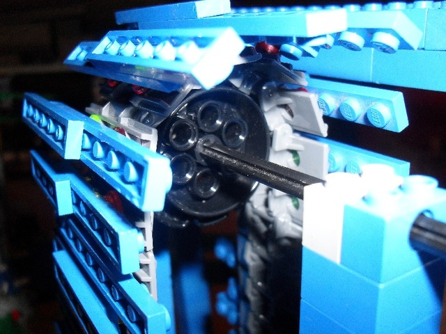
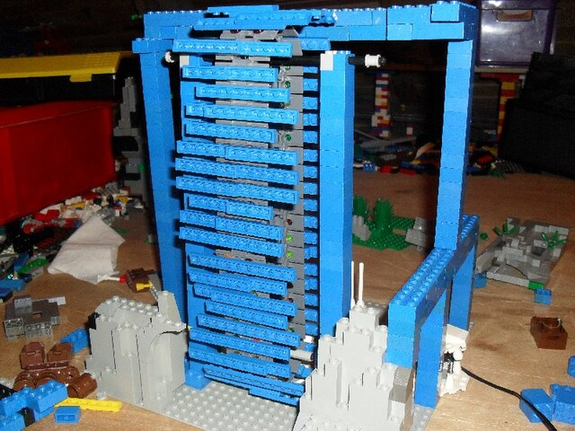
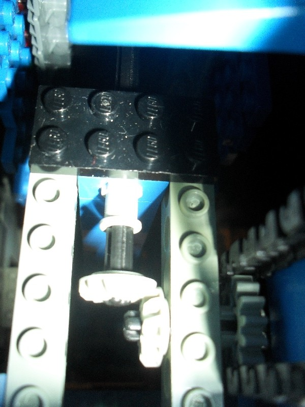
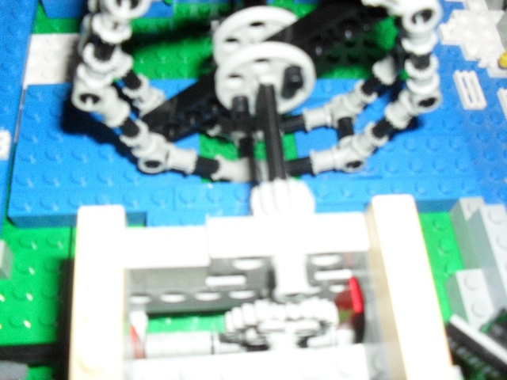

Inaugurée à l’exposition de Parigné L’Evèque, ma cascade en LEGO a attiré quelques regards. Je n’avais cependant pas pensé que ce système pourrait en intéresser d’autres, aussi a-t-il fallu attendre que Gaëlle vienne me demander des conseils pour fabriquer la sienne, et que j’entame sa restauration complète (à la cascade hein, pas Gaëlle), pour en prendre quelques photos. Et puis, plutôt que de déposer un brevet, zut, un petit tutoriel sur FreeLUG, ça fait bien à tout le monde =)

Dans ce nouveau tutoriel, nous allons faire le tour d’une petite excentricité autant technique que visuelle, qui semble ne jamais avoir été tentée avant que je m’y affaire, puisque toutes mes expéditions aussi bien sur Brickshelf que sur Youtube (à part celle du Legoworld que je trouve criminelle), pour trouver un exemple de cascade animée en LEGO, sont restées infructueuses. Mon idée d’inaugurer le principe d’une chute d’eau basée sur le principe de l’illusion optique, m’est apparue dans ma période de fascination pour les GBC. Les premiers prototypes que j’ai construits, assez lamentables, étaient d’ailleurs très proches de ces machines, à ceci prêt que les ascenseurs ne devaient pas transporter des ballons, mais des petites briques bleues par dizaines. Comme c’est toujours sur le chemin de la complexité que les idées les plus simples s’imposent d’elles-mêmes, je me suis rapidement rendu compte que la vitesse de défilement de la chaîne serait suffisante pour créer une illusion d’optique tout aussi intéressante.

La réalisation d’une telle cascade consiste ainsi en l’assemblage d’une chaîne de maillons similaires à ceux que l’on trouve dans les chenilles de la pelleteuse téléguidée par exemple. Chacune de ces pièces est dotée de deux pin holes dans lesquels on insère un round de 1x1, montage qui devrait faire hurler les puristes puisqu’il se sert de la différence de diamètre entre le pin hole et le tenon du round, et inclue donc une contrainte plastique excessive ! Notons au passage qu’à ma connaissance, cette technique n’a été utilisée qu’à une seule reprise sur un set officiel LEGO : la maquette du USS Constitution.

**Un maillon**

Avec deux round 1x1, montage pas officiel.

Bref, ces rounds servent à poser les plates bleues. Des 4, des 6, des 8, des 10 ; il en faudra pléthore pour assembler une chaîne de 40 maillons, ou plus, selon la hauteur de votre cascade. C’est là qu’il faut faire en sorte d’assembler les plates de façon à ce qu’elles observent un décalage qui crée l’impression d’une ondulation lors du défilement, sans toutefois dépasser une largeur donnée, qui correspondra à l’espacement entre les deux pans de votre falaise.

**La chaîne**

Ressemble à un squelette de poisson.

Pour automatiser le tout, il suffit de monter l’axe inférieur à un moteur ; dans ma construction un vieux moteur 9v pas puissant est suffisant s’il est couplé à une vis sans fin.

**L’axe inférieur**

Relié au bloc moteur

L’axe supérieur sera laissé libre, mais les manchons ne seront pas trop serrés entre l’axe et ses supports, de façon à ce que la roue associée aux maillons, puisse tourner librement.

**L’axe supérieur**

En roue libre

Le tout peut tenir dans un cadre dont les deux piliers seraient éloignés de 13 tenons, ou moins, ou plus. Et oui, du fait principalement de l’espacement de 1 tenon entre les deux pin holes des maillons, il faut travailler sur des longueurs impaires. Le plus difficile est de trouver la bonne hauteur des piliers, pour que les roues ne patinent pas dans les maillons...

**Le cadre**

Trouver le rapport taille / nombre de maillons le mieux adapté à votre décor.

Ensuite, la construction d’une falaise en façade du mécanisme, ce n’est que du bonheur ! Il faut cependant travailler progressivement et faire tourner régulièrement la cascade pour s’assurer que les plates bleues ne se cognent pas à une paroi. Si vous ne pouvez pas faire autrement, il est possible de faire glisser les plates sur des plans inclinés de 2x2x3, mais le frottement crée une gêne sonore assez importante...

Allez, je vous aime bien : vous avez le droit à l’astuce en trop. Je trouvais ça bête de laisser l’axe supérieur tourner dans le vide, alors comme il lui reste assez de force pour entraîner un mécanisme supplémentaire, il suffit de le relier à une boîte de transmission qui ira se cacher sous le plancher au bord de votre falaise, et à partir de là vous pouvez ajouter une petite animation sur le bord de la rivière d’où s’écoule votre chute d’eau ! Dans mon exemple, c’est une idée de moulin à eau.

**Boîte de transmission**

Une paire d’engrenages, une courroie, et c’est reparti pour un tour !

Veuillez cependant à laisser la boîte de transmission facilement accessible de façon à pouvoir débrayer les engrenages si le moteur fatigue à entraîner l’extension du mécanisme. L’ensemble tient facilement sur une plaque 32x32 voire une 16x32, et vous permettra d’animer vos dioramas en hauteur tout en ouvrant un espace considérable dans les souterrains. Ah oui, j’allais oublier : ne pas oublier de faire un assemblage de briques blanches et transparentes aux pieds de la chute d’eau pour faire l’écume et masquer le retour de la rotation. A partir de là, l’illusion est, je trouve, assez charmante. Je vous laisse avec quelques vidéos prises lors de la (re)construction de mon modèle pour voir ce que cela donne en mouvement.

**Le mécanisme du moulin**

Bon, à méditer....

[Vidéo de la publication d’origine](http://www.youtube.com/v/bA0gXISnxoI?version=3&hl=fr_FR)

Version qui était présente à Parigné, étrangement silencieuse après l’amélioration du mécanisme.

[Vidéo de la publication d’origine](http://www.youtube.com/v/VDw688Gkf38?version=3&hl=fr_FR)

Piètre qualité due au mauvais éclairage de mon atelier, en plus de la lenteur de mon moulin à améliorer.

Voilà qui est fait, j’espère que ce tutoriel vous aura appris et donné envie d’essayer à votre tour, et donc n’hésitez pas à partager vos commentaires si vous voyez des perspectives d’amélioration ou des critiques à formuler. Le plus important pour moi restant de concilier les LEGO Technic avec les System, de façon à enrichir et à animer toujours davantage les constructions harmonieuses et colorées de nos univers de briques.

Lien des vidéos si l’intégration ne s’affiche pas sur votre navigateur :  
**–** [http://www.youtube.com/watch?v=bA0g...](http://www.youtube.com/watch?v=bA0gXISnxoI&feature=related)  
**–** [http://www.youtube.com/watch?v=VDw6...](http://www.youtube.com/watch?v=VDw688Gkf38&NR=1)
