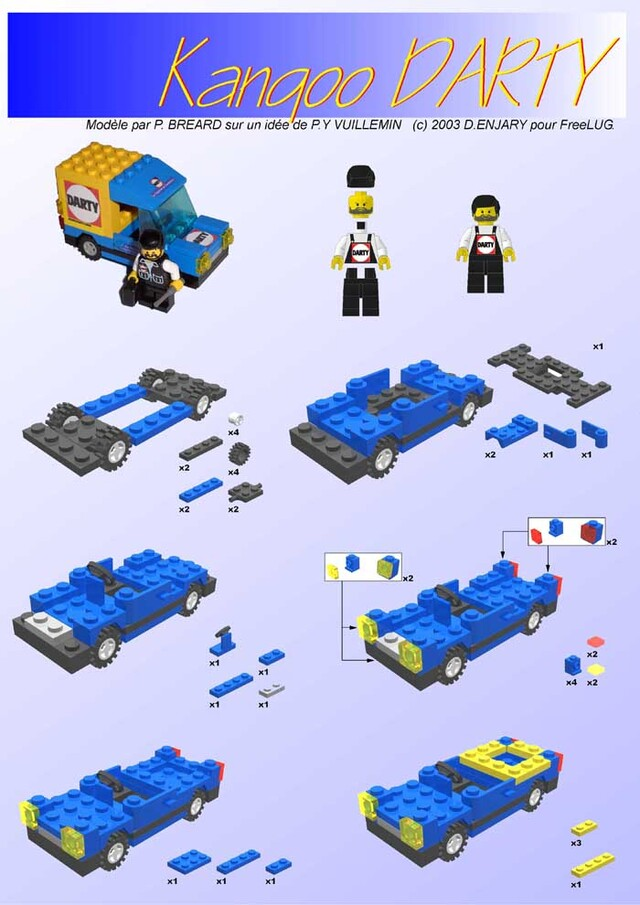
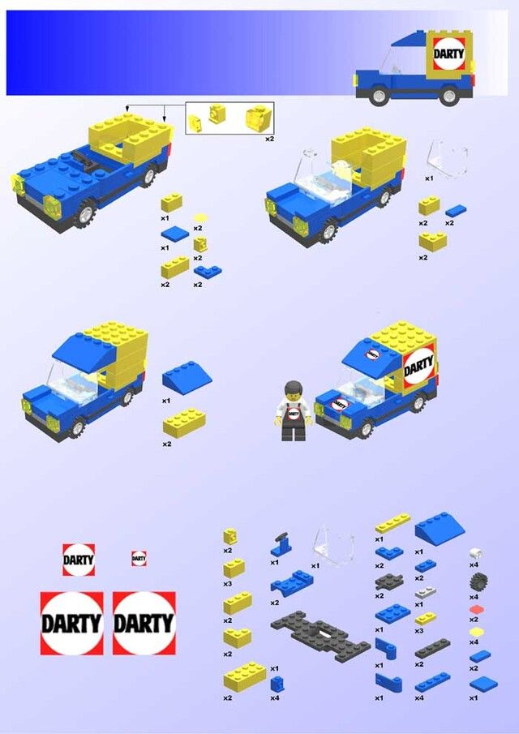

Récemment Obi nous avais présenté un véhicule utilitaire (petite camionnette de livraison) aux couleurs d’une célébre marque de distribution d’électronique et d’électroménager.

C’est au tour de LeGnome de nous présenter sa version "Kangoo".

Le fichier CAD correspondant :

P.S Toutes les marques déposées citées sont la propriété de leur(s) détenteur(s) respectif(s). Le logo DARTY est la propriété de la société DARTY qui ne parraine pas ni ce site ni ce document.
