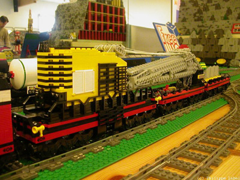

Cette Grue ferroviaire est en réalité intégrée dans une rame complète comprenant le wagon de type fourgon contenant les piles et les fils électriques pour le téléguidage, le wagon supportant la grue elle-même, le wagon recevant les chaînes de levage et supportant la flèche de la grue lors du roulement, et enfin le wagon portant les cales de stabilisation employées lors de la manoeuvre en fixe.

Voilà presque un an que cette construction a germé dans mon esprit. Cette grue ferroviaire est inspirée des grues d’intervention sur voie ferrée qu’on aperçoit de temps à autre lors de reportages sur le déraillement de wagons.

Je suis parti de photos glanées sur le web en faisant des recherches avec les mots clés "[railway, wrecking, crane, grue, ferroviaire](http://www.toytrains.com/catalogues/no6560_1957.html)". Cette grue permet dans la réalité le levage de wagons de 60t et même le levage de motrices de 120t et un peu plus. En Lego, elle a bien du mal à déplacer un wagon plat faute d’une solidité suffisante des bras de stabilisation. Ce n’est jamais que du plastique clippé tout ça :) Mais enfin, ça le fait bien pour jouer sur le réseau. Pour les amateurs de trains, sachez que cette grue est construite en 6 tenons de large.

L’autre difficulté inhérente à l’échelle LEGO est que cette grue doit pouvoir [s’articuler en son milieu](http://photos.freelug.org/d/13185-2/grue_ferroviaire17.jpg), entre cabine et flèche, pour pouvoir circuler sur les courbes très serrées des rails LEGO. Sans cette articulation, la longueur de l’ensemble rendrait tous décors aux abords des courbes impossibles à laisser en place. Seulement pour la mise en oeuvre de la grue il faut absolument rendre rigide la liaison flèche-cabine et supprimer cette souplesse, sinon... essayez pour voir :)

Cette articulation est l’astuce pour la "legotisation" de cet engin. C’est rendu possible grâce à une pièce particulière ([2719](http://www.peeron.com/inv/parts/2719)), utilisée en deux exemplaires placés soit sur la flèche en position roulement, soit montés entre flèche et cabine pour la position levage. Observez attentivement à la base de la flèche la différence entre [cette photo](http://photos.freelug.org/d/13167-2/grue_ferroviaire08.jpg) et [celle-ci](http://photos.freelug.org/d/13163-2/grue_ferroviaire06.jpg)... la [réponse est là](http://perso.wanadoo.fr/chezfilou/montages-lego/Grue-Ferroviaire/original/p152.JPG).

Pour parachever le tout, Didier Enjary (Sixstuds) a réalisé la [notice de montage](http://perso.wanadoo.fr/chezfilou/montages-lego/Grue-Ferroviaire/Grue-Complete.html) pour la [cabine](http://perso.wanadoo.fr/chezfilou/montages-lego/Grue-Ferroviaire/Cabine/Montage-Cabine.html), la [flèche](http://perso.wanadoo.fr/chezfilou/montages-lego/Grue-Ferroviaire/Fleche/Montage-Fleche.html) et le [chassis](http://perso.wanadoo.fr/chezfilou/montages-lego/Grue-Ferroviaire/Chassis/Montage-Chassis.html). Tout cela dans un style impeccable et des illustrations très claires et pédagogiques.

Bien sûr, il reste les autres wagons de la rame à monter, mais leur simple observation sur [ces photos](http://photos.freelug.org/v/Frogleap/Le-grenier-aux-Lego/Syst_mes-de-levage/Grue-Ferroviaire/), devrait vous permettre de comprendre leur structure et vous pourrez facilement en construire l’équivalent. Surtout si vous avez monté la grue d’abord ! :)

Pour les curieux, on peut aussi observer cette grue en fonctionnement sur [ces quelques vidéos](http://photos.freelug.org/v/Frogleap/Le-grenier-aux-Lego/Syst_mes-de-levage/Grue-Ferroviaire/VideoDeLaGrue/) tournées avec les moyens du bord (attention chaque vidéo fait 5Mo). La rame arrive sur les lieux de l’accident ([01](http://photos.freelug.org/d/24088-1/01RailwayCraneTurning.MOV)). Après blocage de la flèche en flexion, elle est érigée ([02](http://photos.freelug.org/d/24092-1/02JibRaisingFromTrain.MOV)), puis le crochet de service met en place les chaînes de levage ([04](http://photos.freelug.org/d/24098-1/04ServiceHookTakingTheChainPart1.MOV), [05](http://photos.freelug.org/d/24101-1/05ServiceHookTakingTheChainPart2.MOV), [06](http://photos.freelug.org/d/24104-1/06HookingTheWagon.MOV)).  
Ensuite, la grue lève le wagon déraillé ([07](http://photos.freelug.org/d/24107-1/07LoadingTheWagonPart1.MOV), [08](http://photos.freelug.org/d/24110-1/08LoadingTheWagonPart2.MOV), [09](http://photos.freelug.org/d/24113-1/09PuttingTheWagonAway.MOV)), et repose le wagon en bordure de voie ([10](http://photos.freelug.org/d/24116-1/10DroppingTheWagon.MOV), [11](http://photos.freelug.org/d/24119-1/11RemovingTheJib.MOV)).  
Enfin, les chaînes sont enlevées ([12](/articles/une-grue-ferroviaire/)), la grue se réaligne sur la rame ([13](http://photos.freelug.org/d/24125-1/13GoingBackOnTheTrain.MOV)), les accessoires sont rangés dans le wagon de service ([14](http://photos.freelug.org/d/24128-1/14StoringTheChains.MOV)) et la flèche est reposée en position de roulement ([15](http://photos.freelug.org/d/24131-1/15StoringTheJibPart1.MOV), [16](http://photos.freelug.org/d/24134-1/16StoringTheJibPart2.MOV)), sans oublier de bien ranger le crochet de service ([17](http://photos.freelug.org/d/24137-1/17LockingTheServiceHook.MOV)).  
La rame peut alors quitter la zone d’intervention ([18](http://photos.freelug.org/d/24140-1/18RailwayCraneLeaving.MOV)).

Enfin, pour remettre les idées en place, il peut arriver que la [charge à lever soit trop importante](http://photos.freelug.org/d/24095-1/03WhatHappensWithHeavyLoad.MOV)... :).

A vos briques !

Philippe "frogleap" Label.
