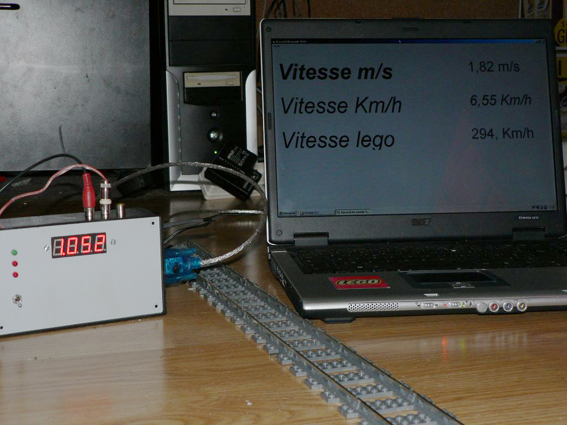
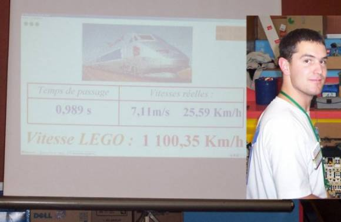
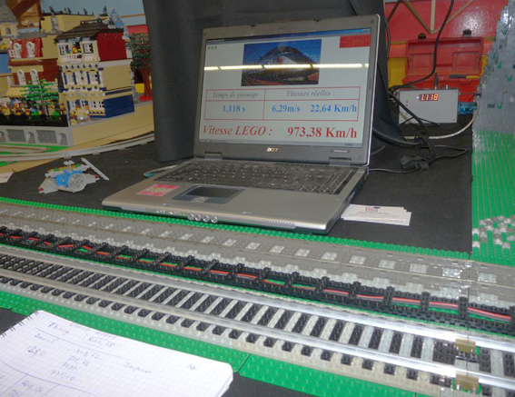

Après deux ans d’existence de la LGV spéciale trains LEGO, il est temps d’en faire un bref bilan pour préparer la suite...

## Une LGV pour Fana’Briques ?

**L’anecdote**

Au fin fond de la France profonde en juillet 2007 ; après une nuit à la belle étoile dans un champ et réveillé brutalement par l’affreux bruit d’un paysan tracteurisé venant ramasser son foin. Un dimanche matin donc ! à sept heure ! Bref, ce matin la, second jour de la [REF 2007](/articles/la-rencontre-estivale-2007-en-montagne/), on se retrouve à trois lève-tôt (Xavier, Loys, et moi-même) à parler de train grande vitesse en se demandant si l’on ne pourrait pas s’organiser un petit week-end pour faire une grande ligne droite pour que nos trains aillent le plus vite possible. Arrive Thierry, organisateur de Fana’Briques, qui après nous avoir écouté "délirer" pendant une demi heure fini par ouvrir la bouche en disant simplement "je peux vous proposer 35m de ligne droite à Fana’Briques en 2008. Ca vous intéresse de venir ?" Ha ! heu ! et 1, 2, 3 hopla c’est décidé, top la, on vient.

**Historique**

Les tous premiers essais d’accélération au delà des 9 volt préconisés par LEGO pour ses moteurs ont été faits à l’[exposition de Claix en 2005](/articles/exposition-de-claix-2005/) avec un premier réseau en « longueur » d’environ 15m.

Video Player

[Vidéo de la publication d’origine](https://www.freelug.org/IMG/avi/xavier_tgv1.avi)

**1er test (Claix 2007)**

Suite à cet essai, l’idée est venue d’améliorer un peu le système en le dotant d’un chronomètre afin d’évaluer la vitesse réelle des trains. Ceci se fait à [St Rambert en 2007](/articles/compte-rendu-de-l-exposition-de-saint-rambert-d-albon/) avec toujours environ 15m mais déjà riche d’enseignement comme on peut le voir sur la vidéo suivante (faut vraiment une voie parfaite sinon...) :

Video Player

[Vidéo de la publication d’origine](https://www.freelug.org/IMG/wmv/LGVStRamb2007.wmv)

**St Rambert 2009**

Et donc nous voilà à Rosheim pour la première tentative de record faite officiellement et avec un concours doté lors de [Fana’briques 2008](/articles/fana-briques-2008-l-olympisme-a-grande-vitesse/). Le TGV venait d’arriver dans l’est, le TGV LEGO devait y battre un record. Pour cela, nous avons une alimentation électrique puissante, un système de chronométrage complet avec affichage du résultat en temps réel et une LGV maison faite spécialement le tout monté sur tables xBaB pour une parfaite planéité.

## Techniquement, comment augmenter la vitesse d’un train LEGO...

Les moteurs LEGO sont des moteurs à courant continu donc leur vitesse de rotation dépend de la tension à leurs bornes. Avec un régulateur LEGO, la tension est de 9V au maximum et le courant de 1A max, nous avons donc utilisé une alimentation de laboratoire permettant une variation de tension plus grande (0 à 20 volt lors des premiers essais en 2005). Très vite on s’est aperçu que tout est affaire de puissance et que si la tension augmente il faut aussi que le courant suive car les rames type TGV (pour ce record) peuvent avoir jusqu’à huit moteurs) et la masse des trains fait par des AFOLs est toujours bien supérieure à celle des modèles LEGO. Nous avions donc plus de 20V pour Fana’briques 2008, et lors de [Saint-Rambert 2009](/articles/une-lgv-lego-a-saint-rambert-xve-exposition-adimin/) l’alimentation « spéciale » peut fournir de 0 à 30 volts et 5 Ampères (150 Watt au passage).

L’ensemble est commandé via un pupitre de commande.

## Une fois que le train va vite, comment le savoir ?

Si on arrive à connaître le temps de passage entre deux points distants d’une valeur connue, on peut calculer la vitesse moyenne entre ces deux points. Une solution simple et efficace, sans contact : un aimant et un ILS (Interrupteur à Lame Souple).

On récupère l’information avec un petit microprocesseur et l’on obtient grâce à deux systèmes de capture le temps de passage en milliseconde entre deux points.

Le tout est envoyé via un port USB à un micro-ordinateur pour les calculs et l’affichage.

**Test du calcul de vitesse**

**L’affichage en expo du reccord actuel**

## Les moteurs

En faisant les essais de chronomètre, on peut mesurer que plus le moteur monte en température plus il va vite. En le faisant tourner 100 tours et en chronométrant chaque tour, le temps de passage est de plus en plus court (10 ms au début puis une ou deux millisecondes au bout d’un certain temps).

Donc pour faire des bons runs, il faut commencer doucement en montant progressivement la tension aux bornes du moteur puis après quelques tours mettre la gomme !

Électriquement les moteurs sont de très bonne qualité. Ils peuvent faire une vingtaine de runs sans problèmes. Mais attention à la mécanique ! Le petit réducteur qui est dans le moteur a des pignons en plastique et si l’accélération est trop forte les dents ne résistent pas. Crac Crac Crac et après... tout cassé.

Une première série d’essais lors de l’exposition précédente à Saint-Rambert nous avait déjà alerté sur tout un tas de petit problèmes à régler : une voie parfaitement plane et droite, une alimentation électrique puissante et très homogène sur toute la longueur de la voie, fiabiliser le système de chronométrage, faire un système d’affichage de la vitesse en temps réel pour le public.

## La LGV

Pour avoir la certitude d’une bonne planéité de la voie, on décide d’utiliser les [tables xBaB](/articles/table-modulaire-xbab/) ce qui nous conduit à en fabriquer 55 spécialement pour FB.

La LGV est alimentée tous les 1,5 mètres par des fils électriques, venant directement de l’alimentation ; cela permet d’annuler quasi totalement la chute de tension du aux connections entre rails. Le chrono se fait avec deux capteurs sur la voie (début et fin de la prise de temps) qui détectent le passage du train grâce à un aimant placé sous le premier boggie de la première motrice de la rame TGV. L’affichage du résultat est instantané et se fait sur un écran pour le public.

Pour la voie elle même, sur les 35 mètres de la longueur totale, il y a 15 mètres de "vrai voie" LGV. Le chronométrage de la vitesse du train se fera sur 10m. Les rails sont en aluminium (code 250) posés (collé) sur les traverses (plates 8\*1) par tronçons de 76,8 cm. Cela permet d’assurer les meilleurs conditions possibles de roulement : rectitude, planéité, moins de raccord entre tronçons de voie donc moins de perte d’adhérence, etc.

## Et la suite ?

Pour l’instant le record a été établi à Saint-Rambert mais avec toutes les discussions que nous y avons eu, cela donne des idées pour encore améliorer les choses pour :  
**–** la mesure des temps de passage (cellules de passage plus pratique que les aimants) ;  
**–** l’alimentation électrique (encore ++) ;  
**–** la LGV (plus grande longueur de LGV en rail code 250 y compris les virages, rayon de courbure augmenté et avec dévers...).

Tout cela sera à découvrir en direct lors de Fana’briques 2010 pour aller encore plus vite en vitesse pure sur 10m et avec un nouveau challenge ’sur un tour’ complet.

Alors, tous à vos TGV y compris pendulaires et rendez-vous les [26 et 27 juin 2010 à Rosheim](/articles/fana-briques-2010-26-et-27-juin-a-rosheim/).
