Lors de sa sortie, l’unité de rangement affichait un prix quelque peu élevé : 49.99€.  
Depuis maintenant quelques semaines son prix est descendu à 14.99€.

Comme certainement beaucoup d’Afols, je me suis demandé combien de pièces on peut mettre dans les tiroirs de ce  
meuble.

Aussi en voici le montage commenté.

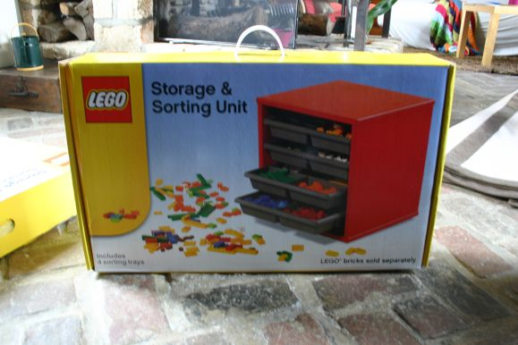

**La boite**

Ce qui marque en premier c’est le poids de la boîte, 6kg, je comprends mieux pourquoi la poste a tenu que je vienne chercher mes colis :)

Une fois ouverte, on découvre une première série de pièces soigneusement emballée individuellement.

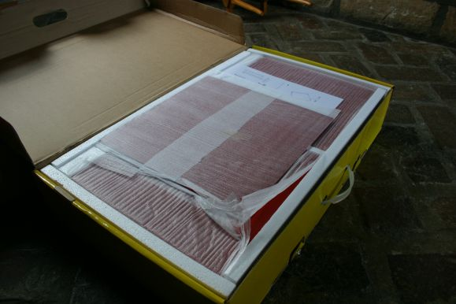

**Ouverture**

D’abord le fond, les cotés puis les tiroirs et enfin le dessus et le dessous du meuble sans oublier la notice et le sachet de vis.

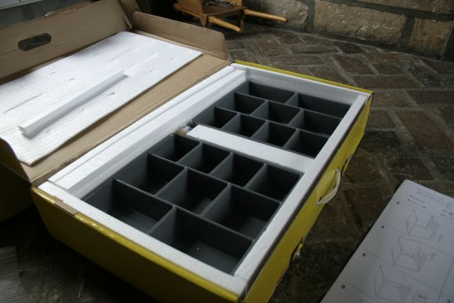

**Les tiroirs**

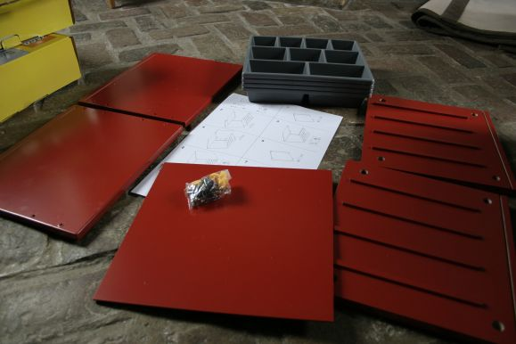

**Les pièces**

Le montage n’a rien de compliqué pour qui est rodé aux meubles d’un certain vendeur suédois.

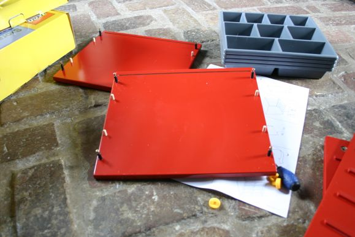

**Le fond et le dessus**

En moins de 5 minutes, le meuble est monté.  
L’unité mesure 35 cm de haut, sur 35 cm de large et 30cm de profondeur

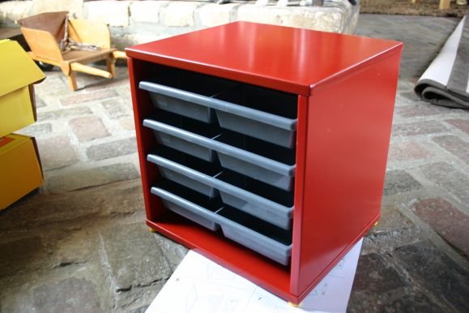

**Et voilà il est fini**

Passons maintenant aux fameux tiroirs.

Chaque tiroir est identique et comporte 9 cases.

Soit :  
**–** 4 de 7 x 5.5 x 4.8  
**–** 3 de 7.5 x 8 x 4.8  
**–** 2 de 6.5 x 13 x 4.8

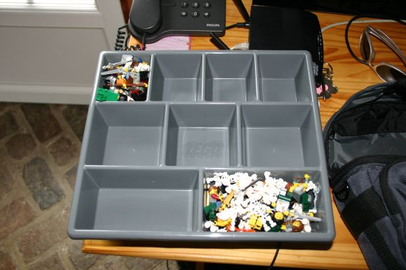

**Vue d’ensemble**

J’ai testé la contenance avec quelques minifigs :

La case 7 x 5.5 x 4.8

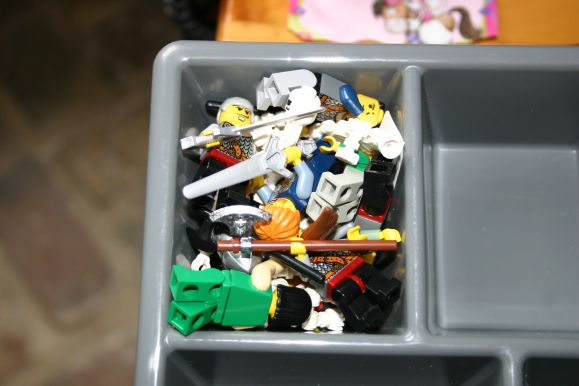

**18 minifigs**

La case 7.5 x 8 x 4.8

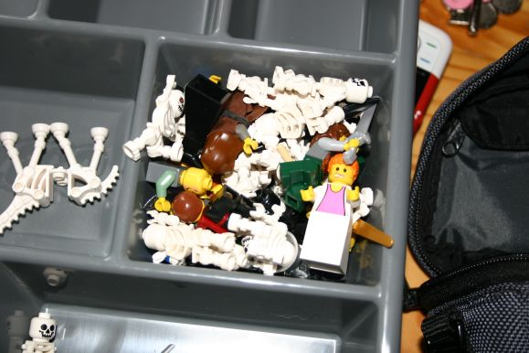

**26 Minifigs**

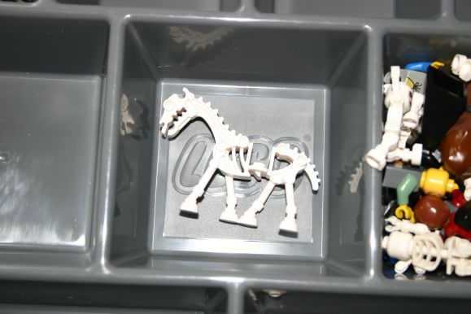

**1 cheval**

le case 6.5 x 13 x 4.8

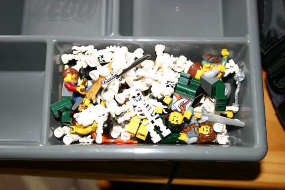

**30 minifigs et 1 cheval**

Voilà, maintenant s’il vous intéresse, direction le [Shop](http://shop.lego.com/Product/?p=851917).
