Ce deuxième article fait suite au [premier article de présentation de l’écosystème PowerUp](/articles/utilisation-de-l-application-lego-powered-up-1-4-presentation/).

Cet article détaille les fonctionnalités de la programmation via l’application. Pour l’installation de l’application, veuillez consulter le premier article.

Un troisième article détaille [les fonctionnalités de la programmation via l’application avec les nouveaux blocs](/articles/utilisation-de-l-application-lego-powered-up-3-4-programmation-v2/).

Un quatrième donne l’[équivalence entre les bloc actuels et les anciens blocs](/articles/utilisation-de-l-application-lego-powered-up-4-4-equivalence-ancien-nouveau-blocs/).

## Écran d’accueil

Le premier écran permet de lancer soit la conception d’un nouveau programme (le + dans le rond rouge à gauche), soit un programme déjà enregistré (sur la droite).

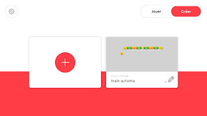

**Présentation de l’écran**

[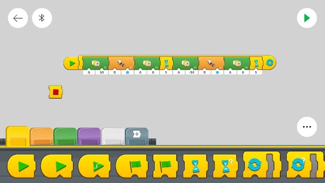](https://lh3.googleusercontent.com/T2WvnlNoN7Acoo4koRF0aQ7Omcr2sbUcFHwzXck1OFSrl7HbaqFDpbsbYwd_O9yVelMei3NVrZne02qAc8Mp6LL9Zs5qXFDxMUbdnG7G9VgrTij5ZVKF_qeUZUHaly9Rskn7Jio4pQ=w864)

Sur le haut de l’écran :

-   La flèche vers la gauche permet de sortir de ce mode
-   L’icône Bluetooth permet de paramétrer la connexion et lancer le dialogue
-   L’icône « play » (triangle vert vers la droite) permet de lancer le programme

Sur le bas de l’écran :

-   6 onglets qui contiennent plusieurs blocs. Ces onglets vont être détaillés par la suite
-   Le rond blanc avec 3 points : affiche plusieurs boutons (dupliquer le bloc, annuler/rétablir l’action, recentrer l’écran, paramétrage de l’affichage des blocs en attente et l’aide en ligne)
-   liste de blocs de l’onglet sélectionné

**Liste des onglets**

Sur le bas de l’écran, se présentent 6 onglets. Chaque onglet contient un type de commande

[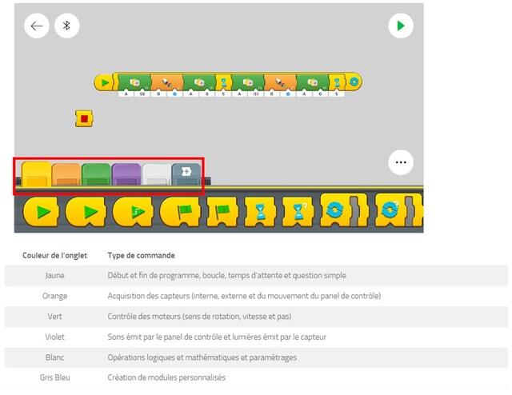](https://www.freelug.org/IMG/jpg/ecran_1-2.jpg)

## L’onglet jaune / bloc d’écoulement

[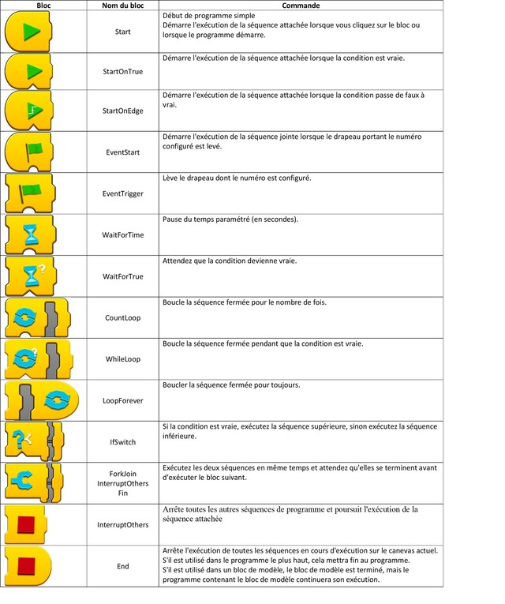](https://www.freelug.org/IMG/jpg/jaune.jpg)

## L’onglet orange / bloc capteur

[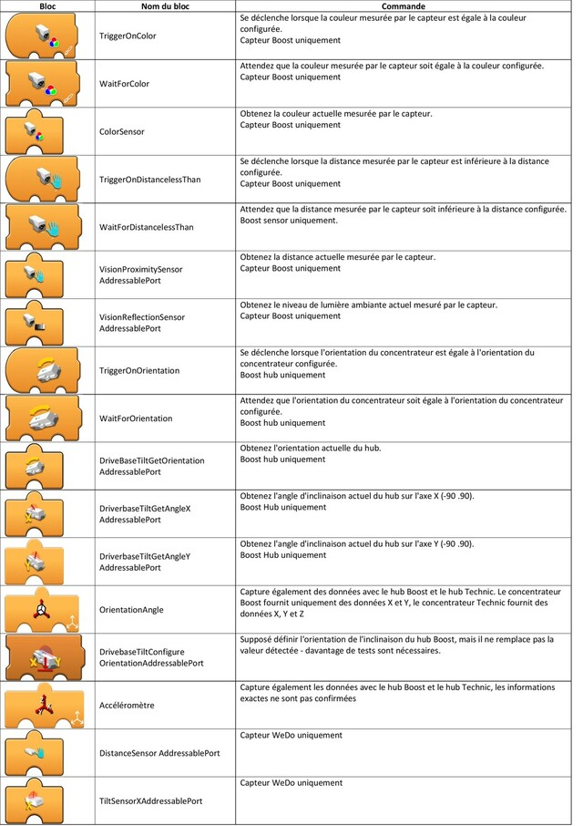](https://www.freelug.org/IMG/jpg/orange.jpg)

## L’onglet vert / bloc moteur

L’écosystème Powered Up utilise 2 types de moteurs :

-   les moteurs simples : sur les moteurs simples, la vitesse de rotation est contrôlée par une fréquence envoyée par le hub. il n’y a pas de contrôle interne de vitesse ou position – exemple le moteur M [45303](https://www.bricklink.com/v2/catalog/catalogitem.page?S=45303-1&name=WeDo%202.0%20Medium%20Motor&category=%5BEducational%20&%20Dacta%5D%5BWeDo%5D#T=S&O={{ '{%' }}22iconly%22:0}))
-   les moteurs tachymétriques : sur le moteur tachymétrique, un encodeur et des capteurs de positions internes permettent de piloter finement la rotation du moteur (en vitesse angulaire ou en degré) – exemple les moteurs [L](https://www.bricklink.com/v2/catalog/catalogitem.page?S=88013-1#T=S&O={{ '{%' }}22iconly%22:0})/[XL](https://www.bricklink.com/v2/catalog/catalogitem.page?S=88014-1#T=S&O={{ '{%' }}22iconly%22:0}) et le moteur [88008](https://www.bricklink.com/v2/catalog/catalogitem.page?S=88008-1&name=Medium%20Linear%20Motor&category=%5BPower%20Functions%5D%5BPowered%20Up%5D#T=S&O={{ '{%' }}22iconly%22:0})

[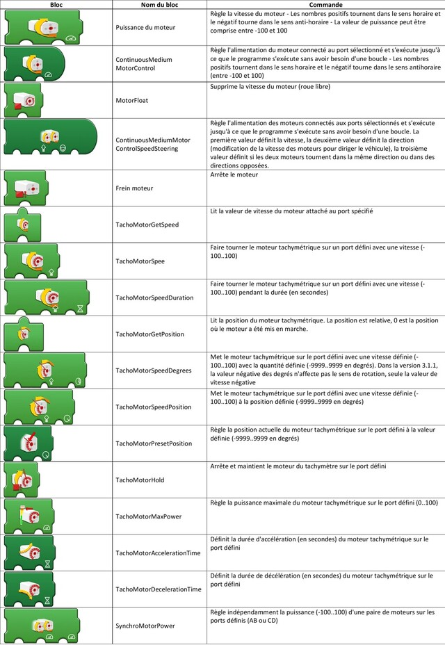](https://www.freelug.org/IMG/jpg/vert.jpg)

## L’onglet violet / bloc son et lumière

[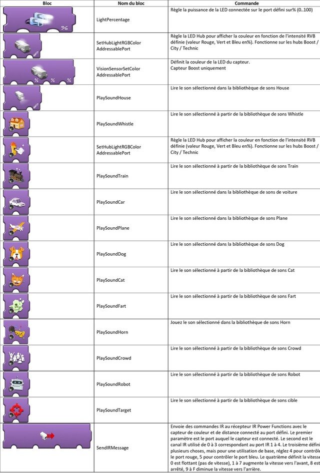](https://www.freelug.org/IMG/jpg/violet.jpg)

## L’onglet blanc / bloc opération sur les données

[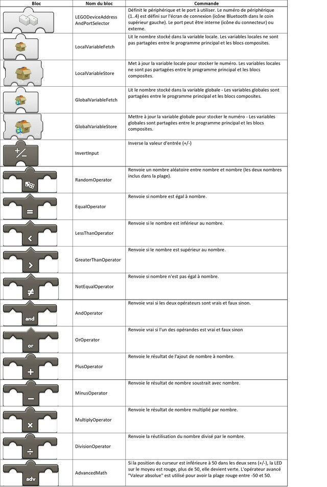](https://www.freelug.org/IMG/jpg/blanc.jpg)

## L’onglet gris-bleu / bloc Composite

[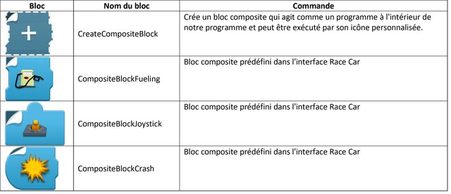](https://www.freelug.org/IMG/jpg/image6-2.jpg)

## L’onglet bleu-vert / bloc personnalisé

[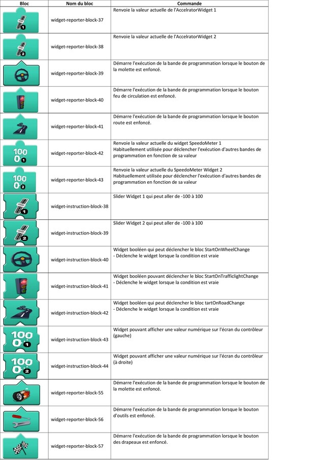](https://www.freelug.org/IMG/jpg/bleu.jpg)

## Exemple simple

Le programme suivant analyse des couleurs via le capteur de proximité/couleur et agit sur le sens de rotation du moteur selon la couleur visualisée.

Ce type de programme a été réalisé pour un train qui fait des allers-retours sur une voie unique avec un repère bleu à chaque bout (gare) et patiente en gare quelques secondes avant de repartir dans l’autre sens.

[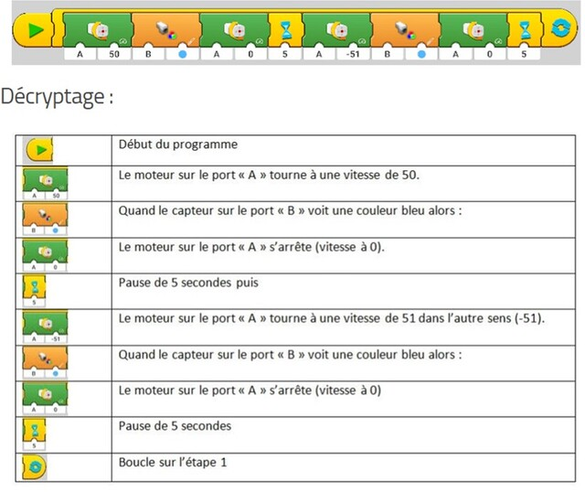](https://www.freelug.org/IMG/jpg/exemple.jpg)

— 

Suite de la présentation avec [les fonctionnalités de la programmation via l’application avec les nouveaux blocs](/articles/utilisation-de-l-application-lego-powered-up-3-4-programmation-v2/).
