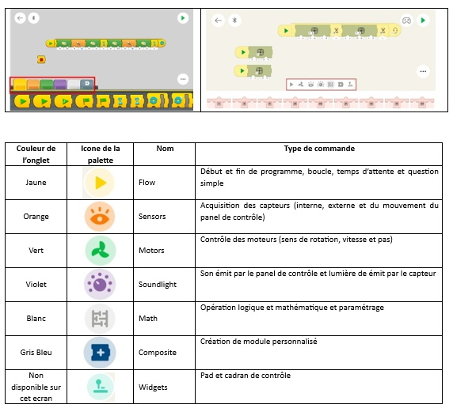
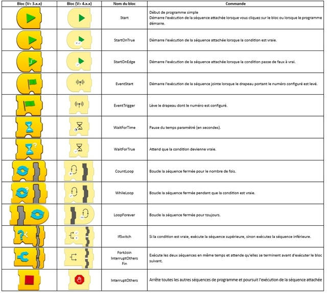
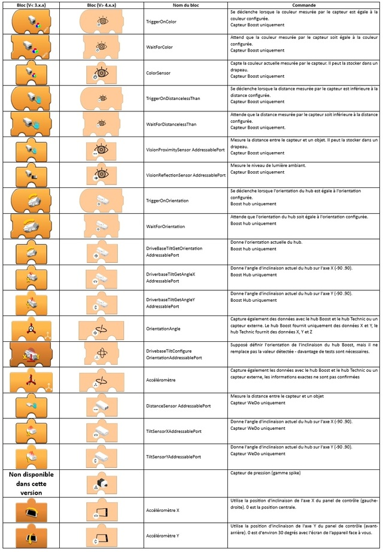
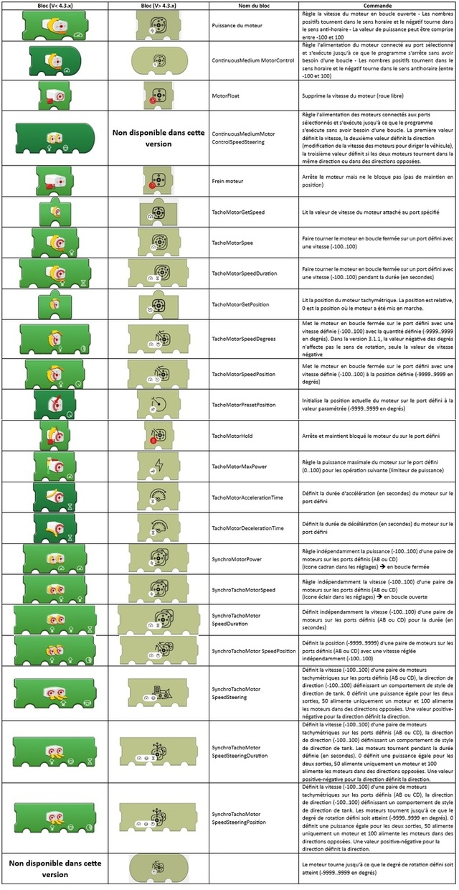
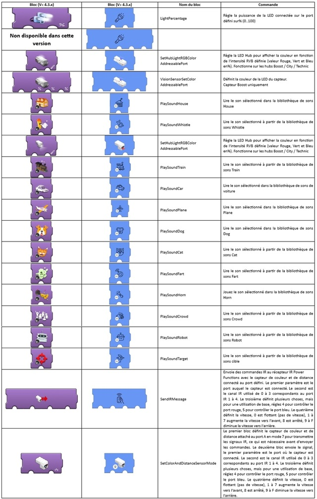
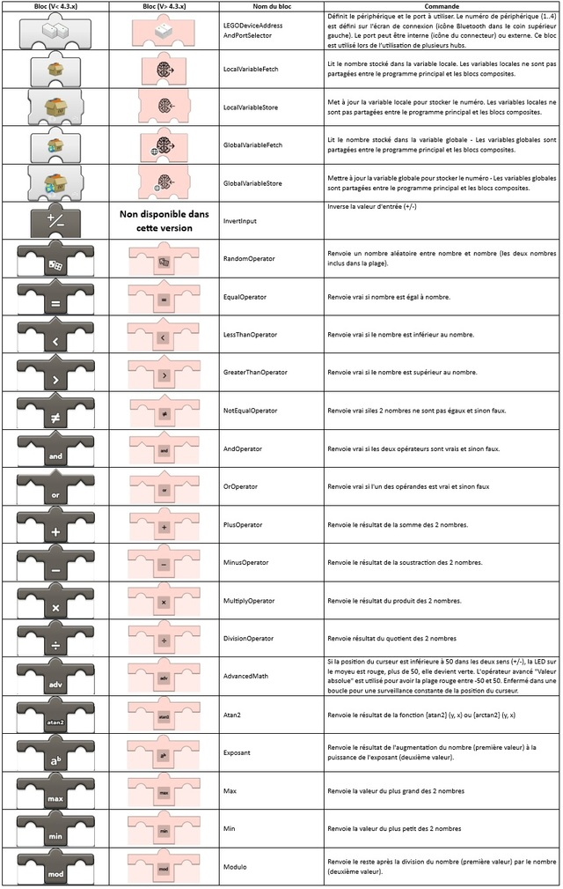
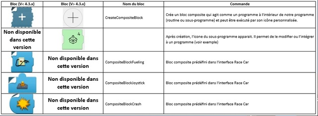
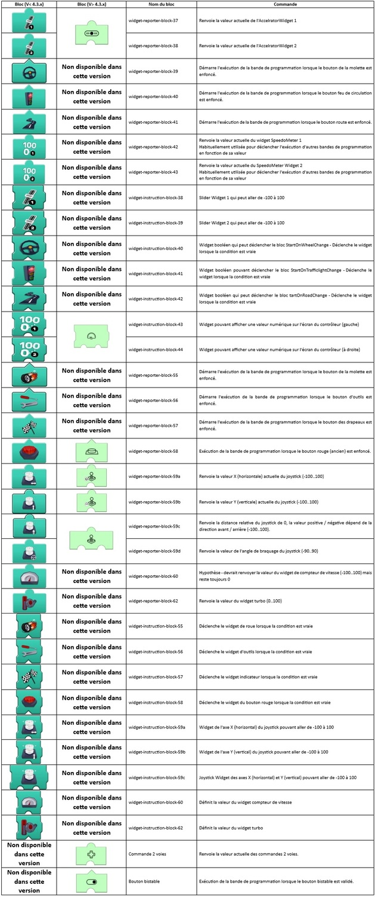

Ce quatrième article donne l’équivalence entre les blocs actuels et les anciens blocs.

Pour le détail des blocs et l’installation de l’application, veuillez consulter les [premier](/articles/utilisation-de-l-application-lego-powered-up-1-4-presentation/), [deuxième](/articles/utilisation-de-l-application-lego-powered-up-2-4-programmation-v1/) et [troisième](/articles/utilisation-de-l-application-lego-powered-up-3-4-programmation-v2/) articles.

## Comparaison ancien / nouveau

L’application lancée en 2019 a fortement évolué avec la version 4 lancée le 29 juin 2023.

## Liste des onglets

Sur le bas de l’écran, se présentent 6 onglets ou 7 palettes. Chaque onglet / palette contient un type de commande

**L’onglet / palette jaune - bloc d’écoulement**

**L’onglet orange / palette orange - bloc capteur**

**L’onglet vert / palette verte - bloc moteur**

**L’onglet violet / palette voilette - bloc son et lumière**

**L’onglet blanc /palette grise - bloc opération sur les données**

**L’onglet gris-bleu / palette bleu - bloc personnalisation**

**L’onglet bleu / palette turquoise - bloc pads**

