Après la [série 1 consacrée aux petits véhicules utilitaires](/articles/vehicules-city-serie-1/) et une [série 2 consacrée aux camions](/articles/vehicules-city-serie-2/), la série 3 présente des véhicules pompier pour secourir les habitants de LEGO CITY. En route...

## La voiture des pompiers et sa remorque.

[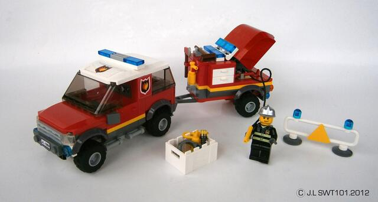](https://www.freelug.org/IMG/jpg/la_voiture_des_pompiers_et_sa_remorque1.jpg)

**la voiture des pompiers et sa remorque**

Cet ensemble comprend un véhicule pompier et sa remorque. La voiture tout-terrain possède un chassis très solide et la présence des nouveaux gardes boues apporte véritablement un aspect beaucoup plus réaliste au modèle. Les gardes boues sortis en 2005 ne sont pas adaptés à cette taille de roue.

En tout cas, cela faisait des années que j’attendais cette nouvelle pièce adaptable à une plus grande variété de roues. Mais revenons au modèle.

[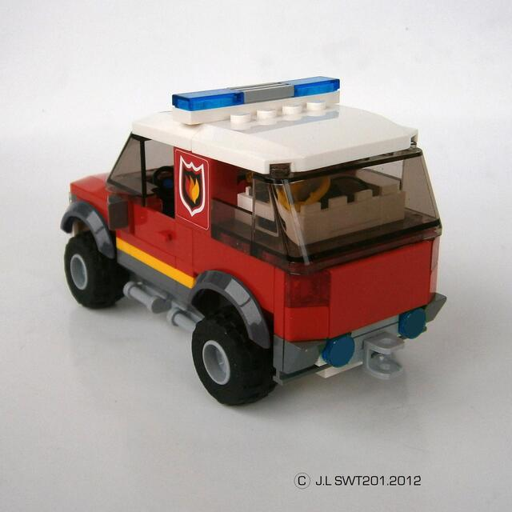](https://www.freelug.org/IMG/jpg/la_voiture_2.jpg)

**La voiture**

Pour accéder à l’intérieur de la voiture, il suffit d’enlever les éléments de toiture. Pour le côté conducteur c’est comme d’habitude, et pour la partie arrière, c’est la même chose, il suffit de glisser ses doigts au niveau des demi vitres pour ouvrir. La mise en place de ces demi-vitres facilite grandement l’ouverture de la partie arrière.

[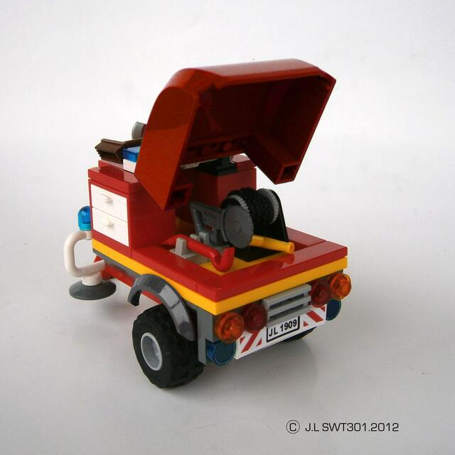](https://www.freelug.org/IMG/jpg/la_remorque3.jpg)

**La remorque**

La remorque est de taille imposante mais reste dans le même gabarit que la voiture. Encore une fois les accessoires sont nombreux : barrière, outils, balai... En ouvrant la partie arrière on découvre une lance incendie et d’autres outils.

## Le tout-terrain d’intervention.

[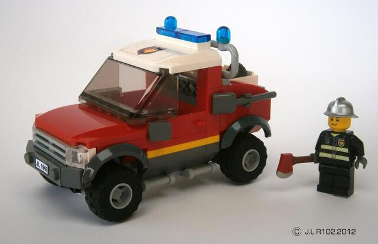](https://www.freelug.org/IMG/jpg/le_tout-terrain_1.jpg)

**Le tout-terrain**

Il reprend le même chassis que le véhicule précédent. La partie supérieure a seulement été changée, ainsi que quelques petits détails ici et là. Le pare-brise est plus incliné et rajoute plus de dynamisme au véhicule. On peut ranger les outils et une barrière à l’arrière du véhicule. La barrière quand elle est fixée sur le véhicule sert également de gyrophare.

[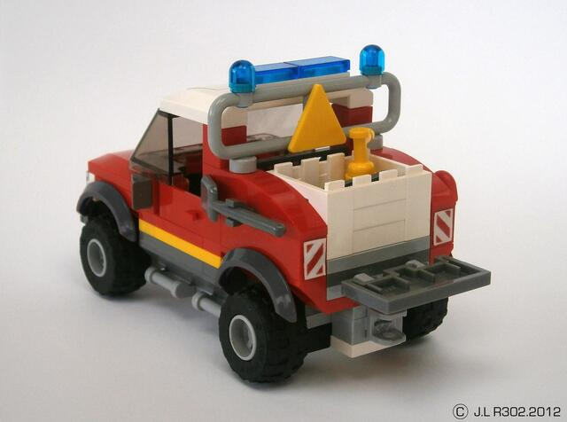](https://www.freelug.org/IMG/jpg/le_tout-terrain_3.jpg)

**Le tout-terrain**

[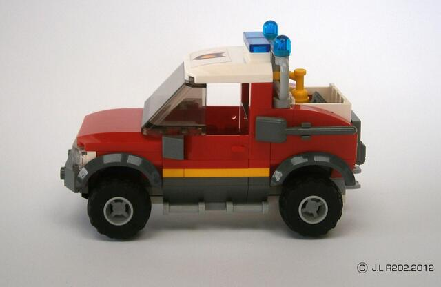](https://www.freelug.org/IMG/jpg/le_tout-terrain_2.jpg)

**Le tout-terrain**

## La patrouille forestière.

[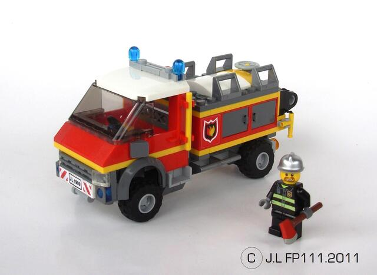](https://www.freelug.org/IMG/jpg/fp11-2.jpg)

**La patrouille forestière**

[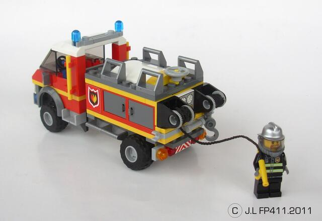](https://www.freelug.org/IMG/jpg/fp44-2.jpg)

**La patrouille forestière**

Ce véhicule a déjà été présenté dans la série 1 des véhicules CITY. Je le remets ici car c’est une série "spécial pompier" et à la vue des messages que vous avez laissé, il vous avait plu.

Ce patrouilleur forestier comprend tout le nécessaire pour une intervention en milieu difficile. La partie arrière du véhicule est détachable et la petite citerne à eau peut s’ouvrir par le dessus.

[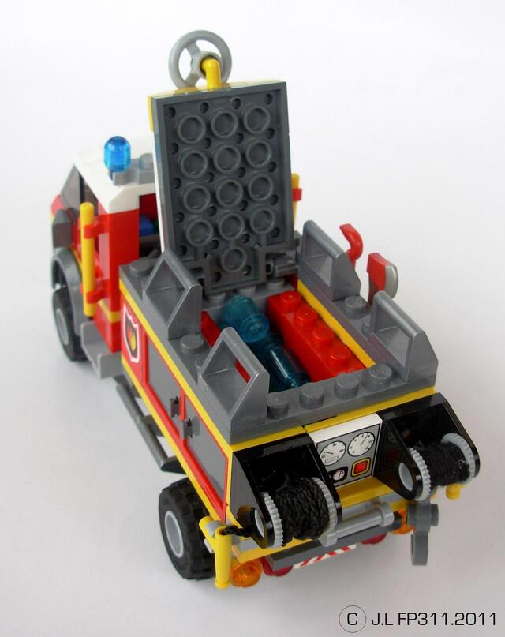](https://www.freelug.org/IMG/jpg/fp33-2.jpg)

**La patrouille forestière**

[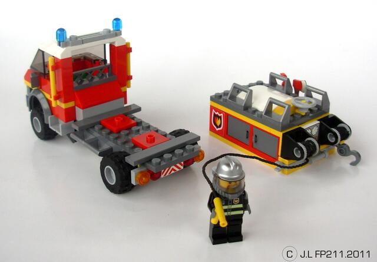](https://www.freelug.org/IMG/jpg/fp22-2.jpg)

**La patrouille forestière**

## Le camion d’intervention en forêt.

[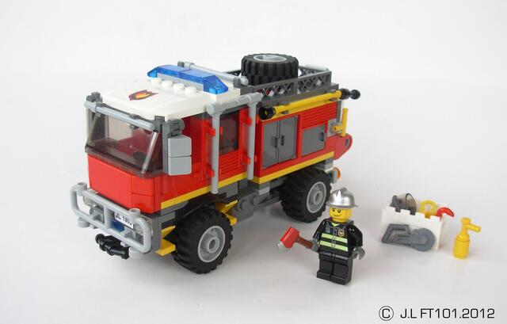](https://www.freelug.org/IMG/jpg/le_camion_d_intervention_en_foret_11.jpg)

**Le camion forestier**

On reste dans les bois avec ce camion tout-terrain qui dispose d’une cabine protégée. La barrière fixée à l’avant sert de pare-chocs au camion.

[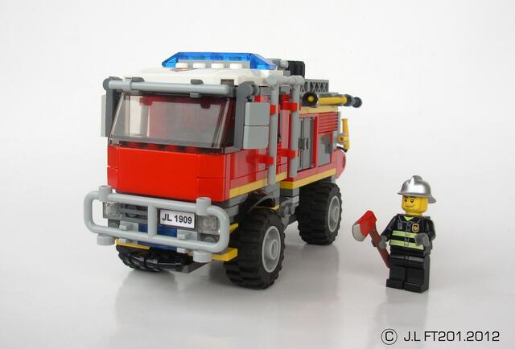](https://www.freelug.org/IMG/jpg/le_camion_d_intervention_en_foret_44.jpg)

**Le camion forestier**

[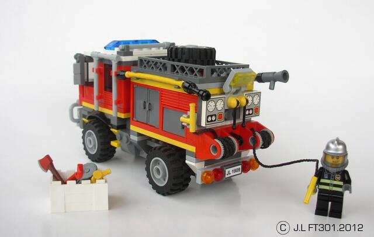](https://www.freelug.org/IMG/jpg/le_camion_d_intervention_en_foret_22.jpg)

**Le camion forestier**

L’ensemble comprend une fois de plus de nombreux accessoires qui peuvent être rangés dans les différents compartiments. Il y a 2 lances incendie à l’arrière plus une autre qui fonctionne avec les gros tuyaux jaunes et qui se fixe également à l’arrière du camion.

## L’unité mobile d’intervention des pompiers.

[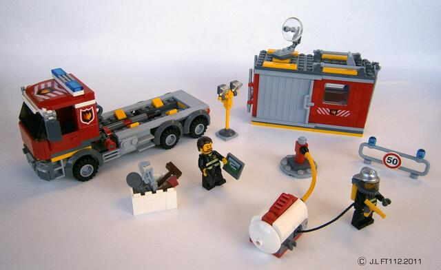](https://www.freelug.org/IMG/jpg/FT1.jpg)

**L’unité mobile d’intervention**

Ce camion reprend la technique utilisée par le camion porte container présenté dans la série 2. L’unité mobile d’intervention des pompiers se compose donc d’une camion, de son container avec accessoires et d’une borne à incendie pour le raccordement.

[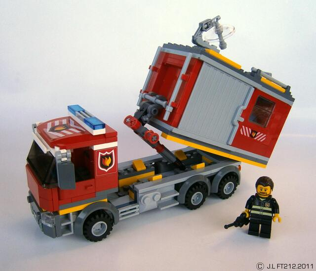](https://www.freelug.org/IMG/jpg/FT2.jpg)

**Le camion porte-container**

Voilà le camion qui pose son container sur le lieu de l’intervention.

[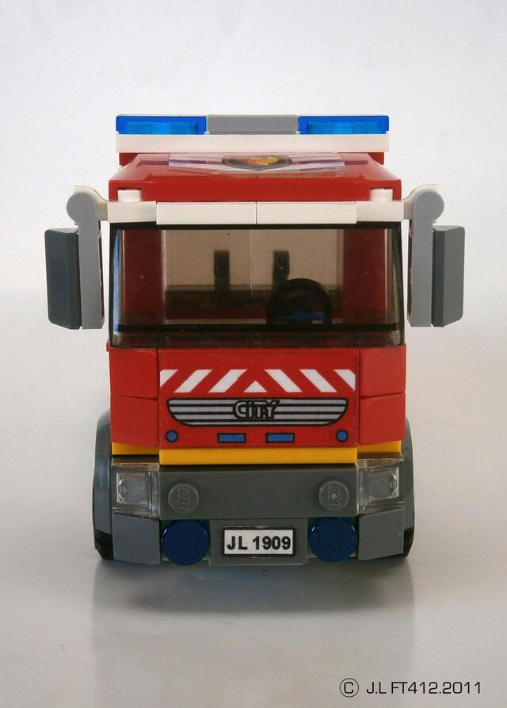](https://www.freelug.org/IMG/jpg/FT4.jpg)

**Le camion porte-container**

[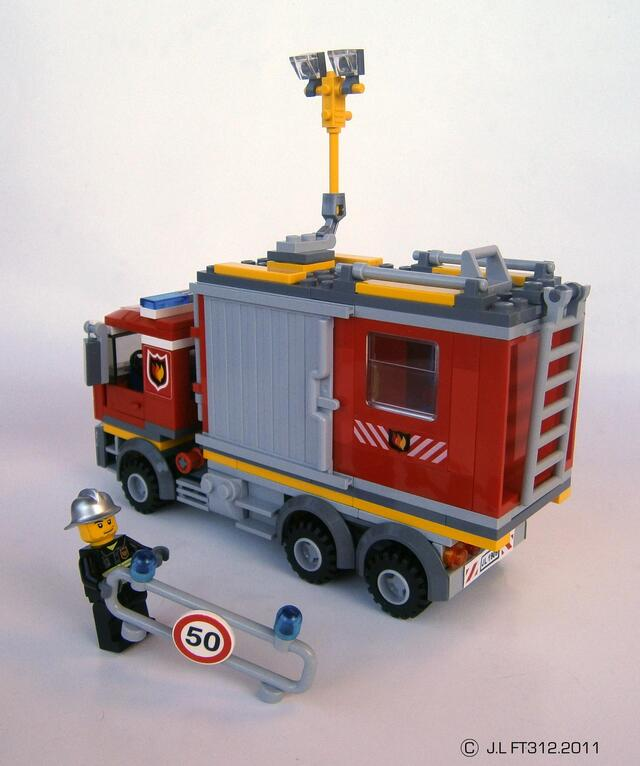](https://www.freelug.org/IMG/jpg/FT3.jpg)

**Le camion porte-container**

Le projecteur jaune peut aussi être installé sur le toit du container à la place de la parabole. A noter également la présence d’une trappe sur le toit du container.

Je me suis légèrement trompé dans la conception du container. La porte de celui-ci devrait s’ouvrir en glissant vers le container et non vers la direction tel qu’il est présenté sur les photos. Il suffit juste d’intervertir les positions de la porte et la fenêtre pour une configuration plus adéquate.

Voilà donc pour cette série 3. J’espère qu’elle vous a plu. N’hésitez pas dire ce que vous en pensez.

Pour la prochaine série de véhicules CITY, je vais vous laisser choisir entre plusieurs possibilités. Qu’est ce que vous voulez voir comme véhicules ?  
**–** Choix 1 : Série Camions  
**–** Choix 2 : Série Véhicules agricoles  
**–** Choix 3 : Série spécial Unimog

J’attends vos réponses ! La série 4 paraîtra en mai.

A bientôt

Julien
