Et c’est finalement les véhicules agricoles qui l’emportent. Les travaux des champs reprennent avec le printemps. Les tracteurs sortent du hangar, venez vite les découvrir...

## Le tracteur rouge et la presse.

[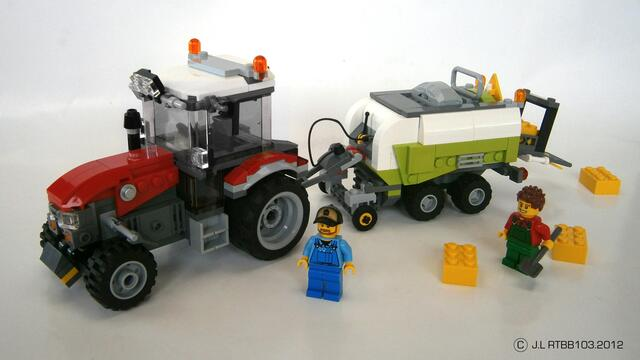](https://www.freelug.org/IMG/jpg/RTBB103-2012.jpg)

**Le tracteur et la presse**

Le tracteur :

[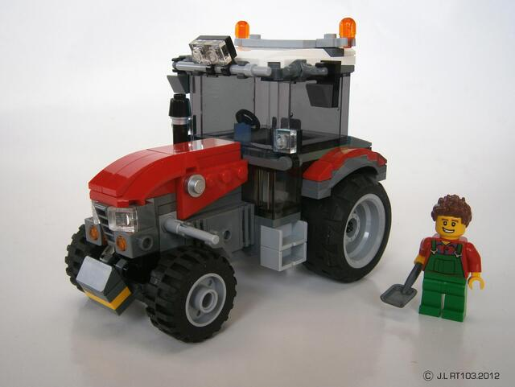](https://www.freelug.org/IMG/jpg/RT103-2012.jpg)

**Le tracteur rouge / Vue avant**

[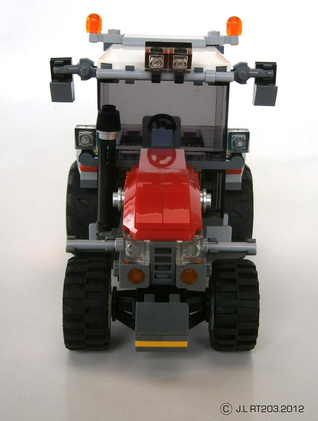](https://www.freelug.org/IMG/jpg/RT203-2012.jpg)

**Le tracteur rouge / Vue de face**

[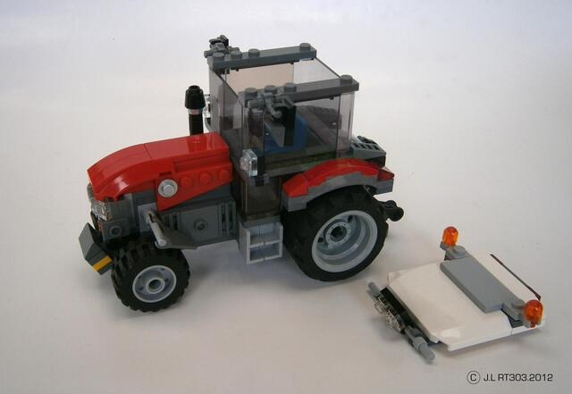](https://www.freelug.org/IMG/jpg/RT303-2012.jpg)

**Le tracteur rouge / Toit amovible**

Le tracteur repose sur un châssis similaire aux tracteurs sortis en 2009, j’ai principalement repensé le visuel en y incorporant de nombreux détails : gardes boue à l’avant, rétroviseurs, clignotants, feux avant et arrière, plaque d’immatriculation à l’arrière, gyrophares...  
Un des changements majeurs est la cabine qui est bien plus imposante et réaliste que celles que l’on trouve sur les modèles d’origine. La cabine est visible du marche pied jusqu’au toit, celui-ci pouvant d’ailleurs être facilement enlevé pour installer le chauffeur.

Si LEGO réalisait des pneus spécial tracteurs et des gardes boues adaptés pour ce type de véhicule, cela permettrait de faire de très beaux engins.

## La presse

[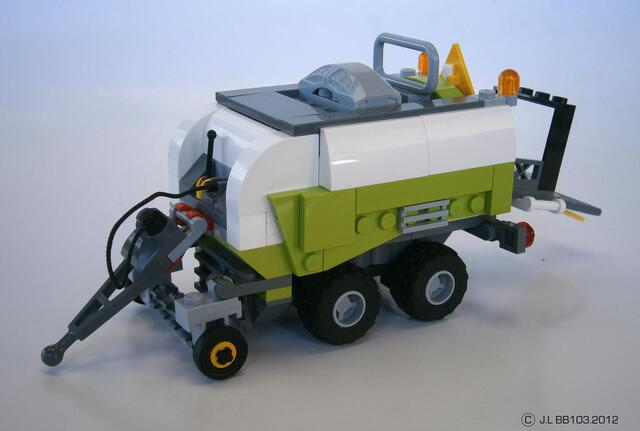](https://www.freelug.org/IMG/jpg/BB103-2012.jpg)

**La presse à ballots / Vue avant**

[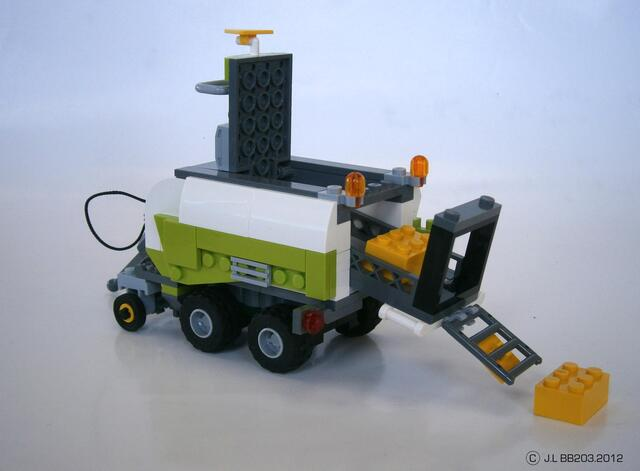](https://www.freelug.org/IMG/jpg/BB203-2012.jpg)

**La presse à ballots / Vue arrière**

La presse permet de réaliser des ballots de paille carrés. Il est possible de faire basculer l’élément à l’avant pour permettre de simuler le fonctionnement de la machine. En mode route, on soulève les petites roues du sol.

Une ouverture par le toit permet d’y glisser les petites briques pour qu’elles glissent et qu’elles tombent par l’arrière toutes seules. Des petits détails ici et là apportent une petite touche de réalisme tout en restant solide et fonctionnel.

## Le tracteur rouge avec pelle avant et remorque

[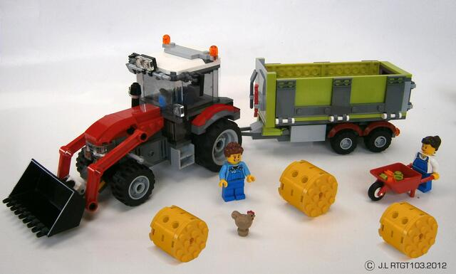](https://www.freelug.org/IMG/jpg/RTGT103-2012.jpg)

**Le tracteur et la remorque verte**

Peu de modifications sont nécessaires pour installer une pelle à l’avant du tracteur.

[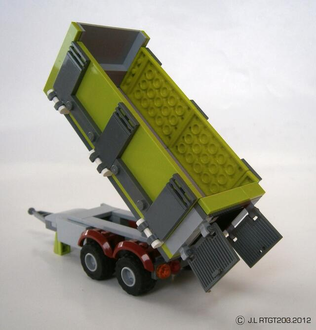](https://www.freelug.org/IMG/jpg/RTGT203-2012.jpg)

**La remorque verte / Vue arrière**

[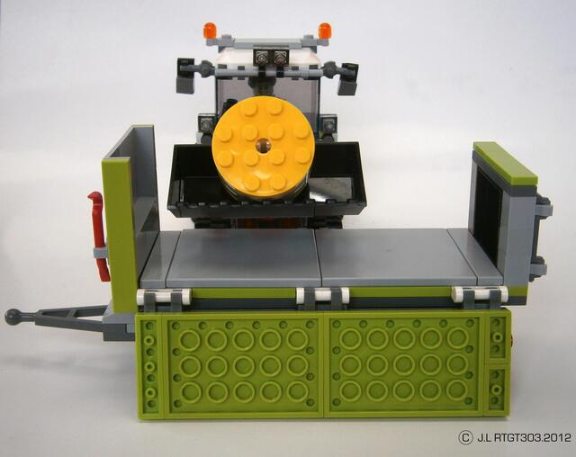](https://www.freelug.org/IMG/jpg/RTGT303-2012.jpg)

**La remorque verte**

La remorque est basculante, les panneaux latéraux le sont aussi, et une grande porte est présente à l’arrière.

## Le tracteur vert

[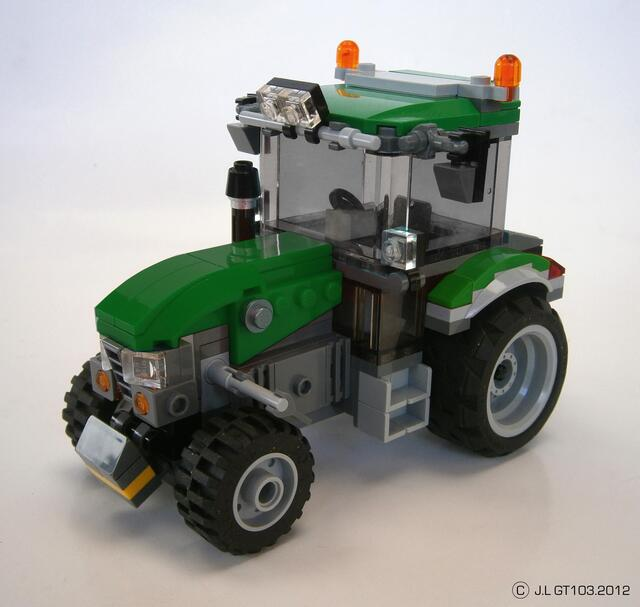](https://www.freelug.org/IMG/jpg/GT103-2012.jpg)

**Le tracteur vert**

C’est le même que précédemment, mais en vert.

## Le tracteur bleu et la grande remorque

[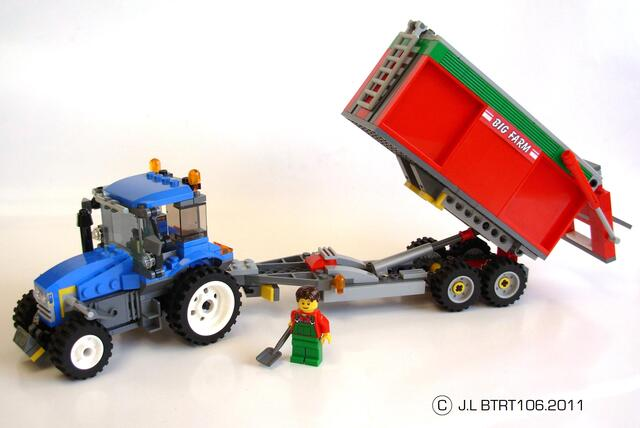](https://www.freelug.org/IMG/jpg/NH1_07-2011.jpg)

[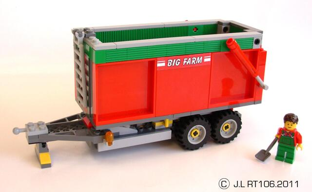](https://www.freelug.org/IMG/jpg/RT106-2011-2.jpg)

[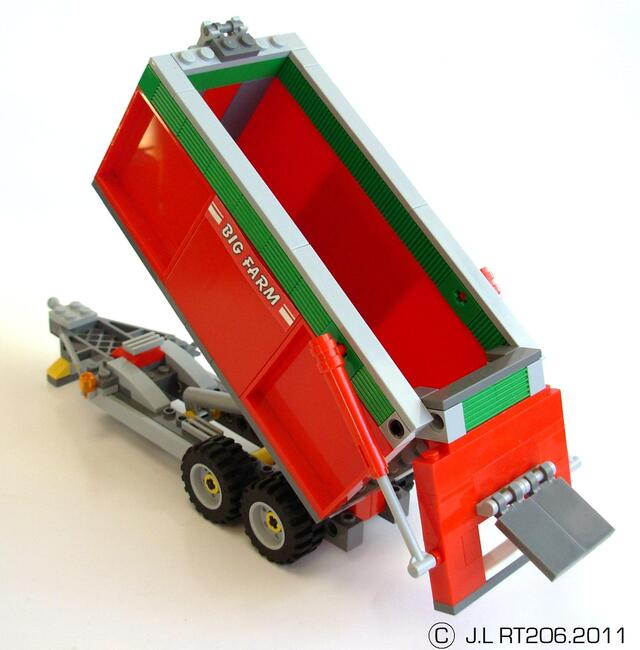](https://www.freelug.org/IMG/jpg/RT06-2011-2.jpg)

**La grande remorque rouge / Basculement et ouverture**

Ce tracteur a été réalisé voilà près d’un an déjà et présente déjà une grande cabine. En revanche, on remarque que l’accès à la cabine n’est pas aussi réaliste que sur ma version 2012. C’était un prototype prometteur, mais ce qui nous intéresse ici, c’est la grande remorque rouge.

c’est une remorque idéale pour la moisson ou l’ensilage. La totalité de la partie arrière se soulève à l’aide des vérins et il y a également une plus petite ouverture par clapets suivant l’usage. Cette remorque reste simple et facile à construire. Un petit défaut tout de même : la fixation de la remorque avec le tracteur mériterait une amélioration pour être plus résistante.

## La presse à balles rondes

[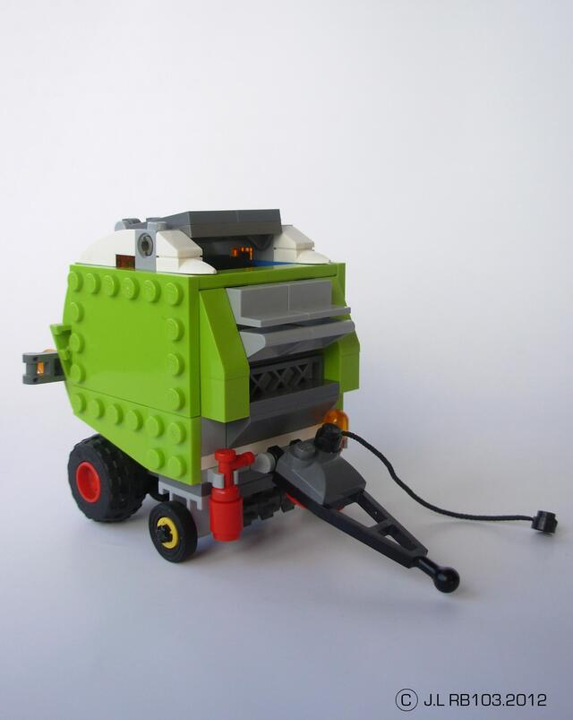](https://www.freelug.org/IMG/jpg/RB103-2012.jpg)

**La presse à balles rondes / 1**

[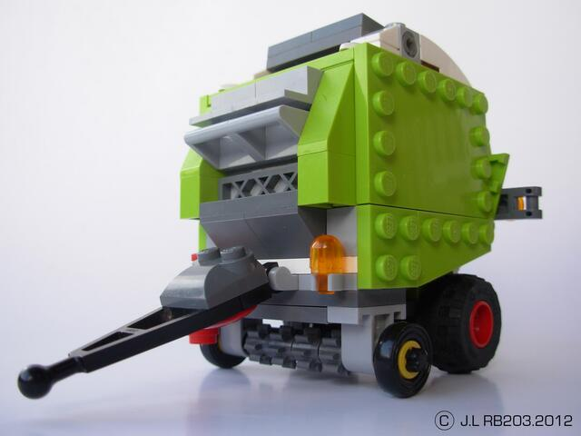](https://www.freelug.org/IMG/jpg/RB203-2012.jpg)

**La presse à balles rondes / 2**

[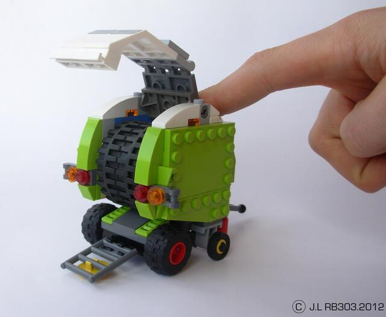](https://www.freelug.org/IMG/jpg/RB303-2012.jpg)

**La presse à balles rondes / 3**

Voici un de mes premiers outils agricoles. Il date de 2010. Ici, l’élément avant est fixe, la machine est en marche même sur la route. Pour la fonctionnalité, il suffit d’appuyer sur le dessus pour faire sortir la brique de paille ronde. Ici, deux roues remplacent la botte de paille, je n’avais pas les éléments nécessaires pour faire une botte de paille ronde en LEGO à l’époque. Mais le fonctionnement reste le même.

## Le petit tracteur vert et sa remorque

[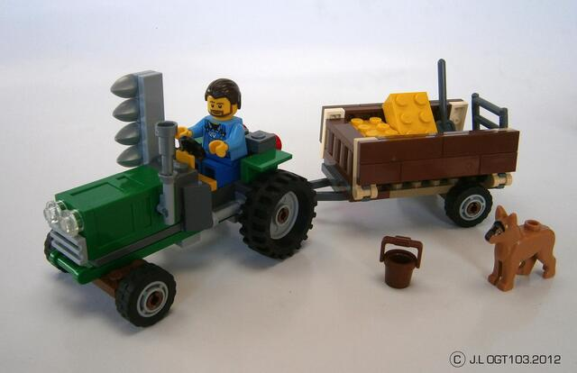](https://www.freelug.org/IMG/jpg/OGT103-2012.jpg)

**Le vieux tracteur vert et sa remorque**

Ce petit tracteur à une allure plus ancienne. Pour l’avant du tracteur, j’ai utilisé une caisse, que l’on peut ouvrir pour réparer le moteur. Une faucheuse est installée sur l’un des côtés du tracteur pour aller couper l’herbe dans le champ.

La remorque rappelle quant à elle, les remorques en bois d’antan. Les panneaux latéraux sont également basculants.

## Le petit tout-terrain sur les sentiers de campagne

[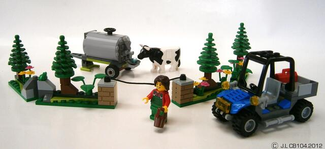](https://www.freelug.org/IMG/jpg/CB104-2012.jpg)

**Le buggy du fermier et le champ avec citerne à eau**

L’ensemble se compose d’un petit buggy, d’une citerne, de deux petits talus, d’un fermier et d’une vache. Le fermier vient apporter de l’eau aux animaux dans le champ. Une corde permet de fermer l’entrée du champ.

[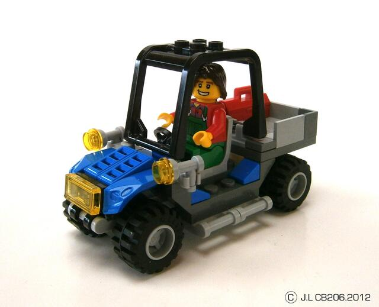](https://www.freelug.org/IMG/jpg/CB206-2012.jpg)

**Le buggy / Vue avant**

Un petit buggy simple mais efficace et peu gourmand en brique.

[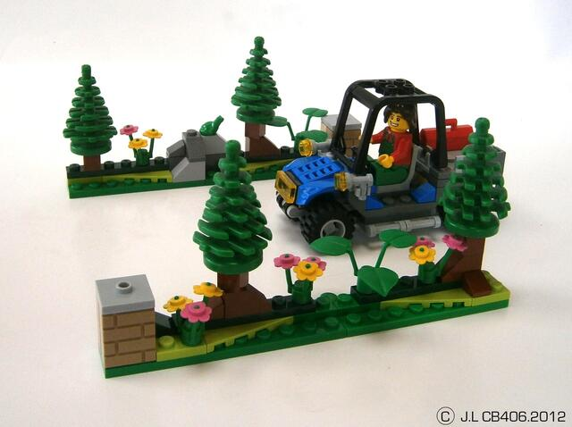](https://www.freelug.org/IMG/jpg/CB406-2012.jpg)

**Le buggy sur les chemins de campagne**

Le buggy sur les chemins de campagne.

[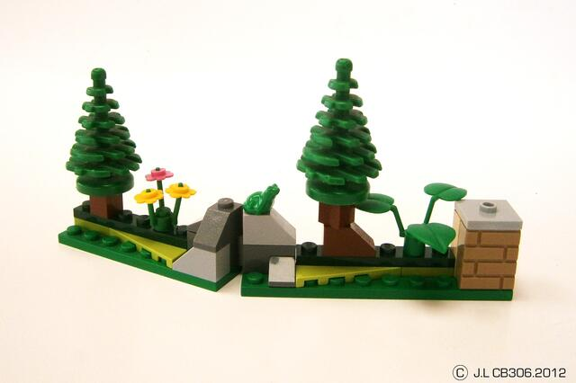](https://www.freelug.org/IMG/jpg/CB306-2012.jpg)

**Un talus**

Voici le détail d’un talus. En additionnant plusieurs d’entre eux, on peut réaliser un joli petit champ. On peut les plier et les déplier.

Voilà pour cette série sur les véhicules agricoles. J’espère qu’elle vous a plu.

Merci pour vos précédents commentaires, n’hésitez pas à en laisser d’autres.

Pour les séries précédentes, c’est par ici :  
**–** [Série 1](/articles/vehicules-city-serie-1/)  
**–** [Série 2 (véhicules utilitaires)](/articles/vehicules-city-serie-2/)  
**–** [Série 3 (pompiers)](/articles/vehicules-city-serie-3/)

A bientôt

Julien
