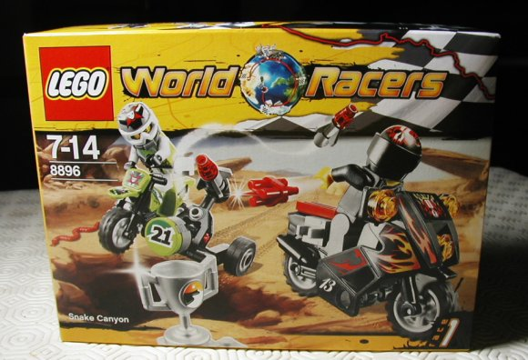
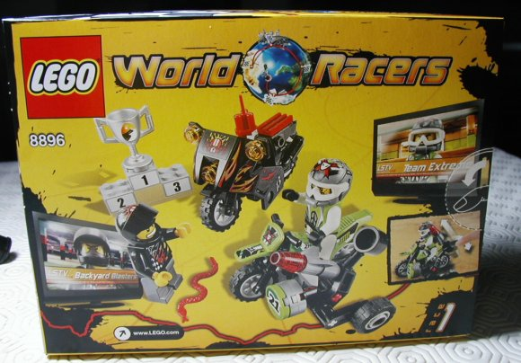
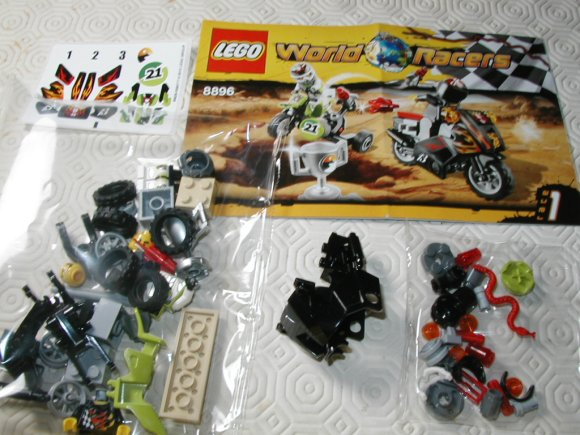
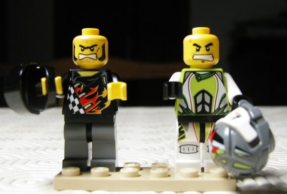
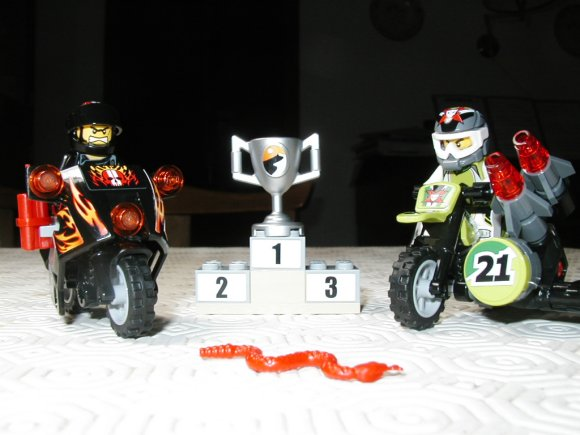

Nouveauté du second semestre 2010, la gamme World Racers met en situation des équipes de sports mécaniques en compétition à travers le monde.

## Revue de la boîte

Résumé :  
**–** Référence : 8896  
**–** Nom : Snake Canyon  
**–** Nombre de pièces : 57  
**–** Prix : environ 12 euro

Rien de bien transcendant, j’ai jeté mon dévolu sur la plus petite boîte de la nouvelle gamme World Racers, histoire de voir...

L’arrière de la boîte n’apporte pas grand chose, à part le nom des deux équipes : Backyard Blasters et Team Extreme.

La boîte ne brille pas non plus par son contenu. Deux petits sachets bien vides, une planche de stickers, un carénage de moto et la notice. On sent de suite que la construction va être rapide.

Point positif, les minifigs sont vraiment sympa dans leur tenue de motards baroudeurs. Les têtes sont à double face, et le torse imprimé des deux côtés. Le casque intégral façon cross apporte son petit plus.

Chez LEGO, ils ont bien fait de ne pas mettre "snake" au pluriel sur la boîte, puisque le contenu n’a qu’un seul serpent. Ce sera donc le Canyon du serpent, et non le Canyon aux serpents.

Les deux motos, un serpent, un podium et une coupe. On reste sur sa faim.

Le numéro 21 dispose d’un side-car armé d’une catapulte-missile, tandis que le numéro 13 a un bâton de dynamite. Ils ont l’air d’être fairplay, dans cette course :)

Bon bah voila, en fait il n’y a pas grand chose à dire sur ce set. On met plus de temps à appliquer les 16 autocollants sur les motos qu’à assembler les modèles. Autocollants si petits qu’on a l’impression de tomber dans du maquettisme. Je ne suis pas sûr que les ptites mains des enfants (ou les grosses mains d’adultes) y arrivent bien au final.

Par contre, si vous aimez les motos, cette boîte offre une moto de course noire et une moto de cross en couleur lime. C’est à vrai dire le seul intérêt de la boîte.

## Au sujet de la gamme World Racers

En acquérant une boîte de la gamme, j’aurais aimé pouvoir vous en dire plus. Je m’attendais à trouver dans la notice le contexte de ces courses, etc. Et en fait, rien... nada, pas même des photos des autres boîtes de la gamme.

Cependant, de ce que j’ai vu sur les autres boîtes en magasin, chacune vient avec sa coupe aux couleurs de l’étape (comprendre un petit autocollant).

Et en se référant au logo, on distingue cinq lieux :  
**–** la mer  
**–** la neige  
**–** la forêt  
**–** la ville  
**–** le désert (le thème de cette boîte)

Alors à défaut de pouvoir en dire plus, on se contentera de dire que cette gamme nous rappelle les [Extreme Team](http://www.brickset.com/browse/themes/?theme=Town&subtheme=Extreme%20Team) ou [Race](http://www.brickset.com/browse/themes/?theme=Town&subtheme=Race), mais en version méchante façon [Agents](http://www.brickset.com/browse/themes/?theme=Agents) puisque que visiblement, l’objectif est de gagner les courses par n’importe quel moyen.

Pour conclure, sauf si vous aimez les motos, passez votre chemin. Ce sera en tout cas ma seule boîte de la gamme (en attendant les soldes...)
