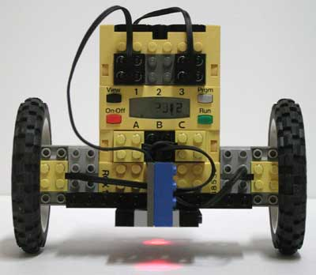
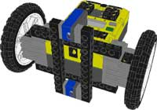
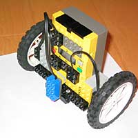
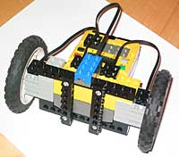

(YAL = Yet Another LegWay = Encore un autre LegWay)

Les messages d’**[Allen Foster](http://news.lugnet.com/robotics/?n=22084)** et **[Harold Jarvie](http://news.lugnet.com/robotics/?n=22121)** m’ont prouvé qu’il était possible de contruire un robot auto-équilibré inspiré du fameux **[LegWay de Steve Hassenplug](http://perso.freelug.org/legway/LegWay.html)**, et ce en utilisant uniquement des pièces LEGO.

Le **[programme de YAL](http://www.philohome.com/yal/yal1.c)** utilise un algorithme PID écrit en BrickOS, traduction directe du code d’**[Allen Foster](http://news.lugnet.com/robotics/?n=22084)**. L’entrée est fournie par la différence entre les capteurs de lumière, la sortie est appliquée aux deux moteurs.

Yal fonctionne bien avec un éclairage diffus par le haut, mais n’aime pas du tout la lumière latérale (fenêtres).

Voici quelques vidéos montrant Yal en action (Quick Time, 0.5 to 1Mb)

**–** **[Yal debout](http://www.philohome.com/yal/yal_static.mov)** (assez ennuyeux...)  
**–** **[A vos rangs... fixe ! Repos...](http://www.philohome.com/yal/yal_standup.mov)** [(programme modifié)](http://www.philohome.com/yal/yal2.c)  
**–** **[Yal peut être déplacé à la main](http://www.philohome.com/yal/yal_push.mov)**  
**–** **[...ou par une lampe de poche à la lumière atténuée](http://www.philohome.com/yal/yal_light.mov)**

* * *

## Encore mieux : la version à un seul capteur de lumière de Frédéric Siva

Frédéric (Légophile Belge qui va peut-être rejoindre les rangs de FreeLUG) a modifié le programme pour que Yal puisse fonctionner avec un seul capteur de lumière : il peut être construit uniquement avec les pièces du Robotics Invention System !

Voici le **[programme](http://www.philohome.com/yal/mylegway_fs_single.c)** modifié de Frédéric.

Il est un peu moins stable que son frère à deux capteurs, mais quand même très convaincant comme vous pouvez juger sur cette **[vidéo](http://www.philohome.com/yal/yal_fs_single.avi)** (Avi, 1Mb)

* * *

## Notes sur l’installation de BrickOS

BrickOS était par le passé notoirement difficile à installer sous Windows (j’ai éssayé plusieurs fois sans succès). Heureusement, **[John Hansen, auteur de BricxCC](http://hometown.aol.com/johnbinder/bricxcc.htm)**, a créé deux installeurs (l’un pour l’**[environnement Cygwin](http://bricxcc.sourceforge.net/BricxCCSetupCygwin.exe)**, l’autre pour **[BrickOS lui-même](http://bricxcc.sourceforge.net/BricxCCbrickOSleJOS.exe)**) qui rendent la tâche aisée. Mille mercis, John !
